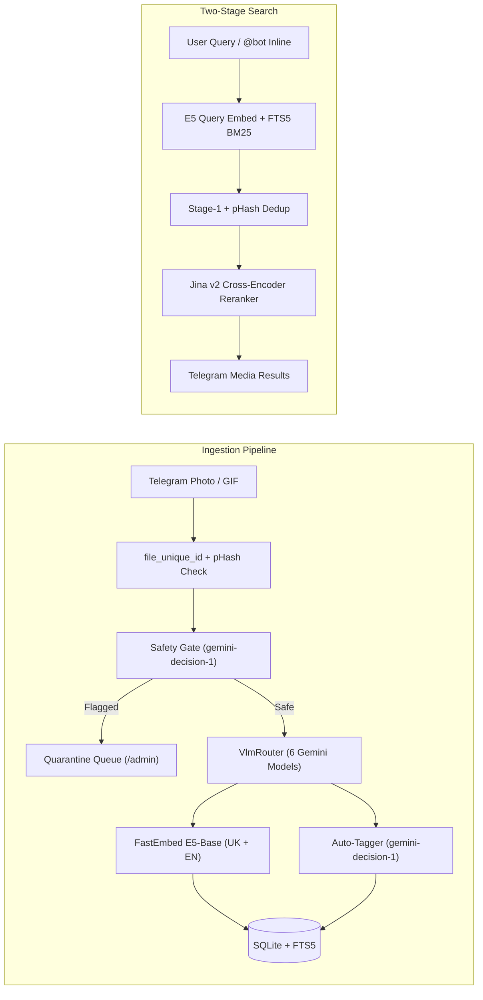

# MnemosyneM (Мнемозіна) 🧠✨

> **Fast, Multimodal Semantic Meme Search Engine & Telegram Bot in Rust**

MnemosyneM indexes photos and GIFs into a cross-lingual (**Ukrainian & English**) meme repository and lets you search by meaning, punchlines, visual scenes, OCR text, or categories — directly in Telegram chats and inline mode (`@bot`). It combines local ONNX embeddings and cross-encoder reranking with a quota-aware Gemini VLM pipeline, personal/public meme collections, scheduled delivery, and Telegram-native moderation.

---

## 🚀 Key Features

* **Two-Stage Hybrid Search (Vector + FTS5 + Cross-Encoder):**
  * Dual-language 768-dimensional local embeddings (`intfloat/multilingual-e5-base` for UK + EN passages & queries).
  * SQLite **FTS5 BM25** lexical search fused with semantic similarity and perceptual hash (`pHash`) near-clone deduplication.
  * Local **Cross-Encoder Reranking** (`jinaai/jina-reranker-v2-base-multilingual`) refining Stage-1 candidates for high precision on short queries and pure synonyms.
* **Rich Search Syntax (Chat & Inline Mode):**
  * Media filters: `!gif` / `!гіф` for animations, `!img` / `!pic` for photos.
  * Multi-tag `AND` filtering with bilingual aliases (e.g., `#коти #сон`, `#мавпи + #іт`, `#work` $\rightarrow$ `#робота`).
  * Combined queries (`!gif #робота deadline`) and inline pagination (`next_offset`).
* **Resilient Multimodal AI Pipeline:**
  * **Pre-Ingestion Safety Gate:** `gemini-decision-1` (`v1beta/decisions`) filters explicit photographic NSFW, gore, and spam while preserving comic/illustrated memes.
  * **Quota-Aware `VlmRouter`:** Balances VLM requests across 6 free-tier Gemini models (Tier 1: `gemini-3.5-flash-lite`, `gemini-3.1-flash-lite`; Tier 2: `gemini-3-flash-preview`, `gemini-3.6-flash`, `gemini-3.8-flash`, `gemini-4-hydrogen`) with SQLite-persisted Pacific Time daily counters and automatic cooldown fallback.
  * **Auto-Tagging & Discovery:** Categorizes memes via `gemini-decision-1` with English-description fallback and background `#інше` category discovery.
* **Zero-Disk Media Storage & Deduplication:** Media stays in Telegram cloud storage (`file_id`); instant `file_unique_id` checks avoid duplicate VLM calls and `pHash` collapses visual clones in results.
* **Multi-Tenancy & Personal Collections:** Configurable default upload visibility (public/private), search scope (`all`, `public_only`, `private_only`), and `/my` collection browser with per-meme visibility toggle & deletion.
* **Discovery & Engagement:** `/tinder` swipe rating, `/liked` browser, `/tags` category browser, `/random` discovery (excluding disliked memes), and `/drip` scheduled meme delivery (`1 / 3 / 5` per day) with timezone and quiet-hours (`23:00–09:00`) active-window slot planning.
* **Telegram-Native Admin Panel (`/admin`) & Telemetry (`/stats`):** Quarantine review queue (approve public/private or reject), catalog browser/purge, dynamic tag toggles, live VLM pool quota snapshots, and Stage-1 / Reranker latency metrics.

---

## 🛠️ Architecture & Tech Stack



* **Language:** Rust (`edition = "2024"`, Rust 1.85+)
* **Telegram Framework:** [`teloxide`](https://github.com/teloxide/teloxide) `0.17` + [`tokio`](https://tokio.rs/) `1.53`
* **Local ML Inference:** [`fastembed`](https://github.com/Anush008/fastembed-rs) `7.1` (`MultilingualE5Base` embeddings + `JINARerankerV2BaseMultiligual` cross-encoder via ONNX Runtime CPU)
* **Cloud VLM & Safety/Tagging:** Google Gemini API (`gemini-decision-1` + 6-model free-tier VLM pool via `reqwest` `0.12`)
* **Storage & Indexing:** SQLite (`rusqlite` `0.32` bundled) with FTS5 full-text search and automatic schema migrations
* **Visual Hashing & Logging:** `image` + `image_hasher` (`pHash`), `tracing`

---

## 💬 Commands & Search Examples

| Command | Description |
| :--- | :--- |
| `/start`, `/help` | Onboarding, compact reply keyboard, and usage guide |
| `/my` | Browse your uploaded memes, toggle public/private visibility, or delete |
| `/tags` | Interactive category/tag browser |
| `/tinder` | Swipe & rate unseen memes (`like` / `dislike` / `skip`) |
| `/liked` | Browse memes you liked |
| `/random` | Instant random meme (automatically excludes disliked memes) |
| `/drip` | Configure scheduled meme delivery (`1 / 3 / 5` per day), timezone, and quiet hours |
| `/settings` | Set default upload visibility, search scope, and reset ratings |
| `/stats` | Corpus stats, VLM free-tier quota pool status, and search latency telemetry |
| `/admin` | Admin-only moderation queue, catalog cleanup, tag toggles, and DB backup button |
| `/backup` | Admin-only online SQLite snapshot (`VACUUM INTO`) sent directly to Telegram |
| `/restore` | Admin-only DB restore: send a `.db` file with caption `/restore` (or reply `/restore` to it) to validate, swap, and restart |

**Search examples (works in DM chat and `@your_bot` inline mode):**

```text
важко вранці відкрити очі          # Cross-lingual semantic + FTS5 + Reranker search
!gif кіт дивиться у вікно          # Animations only
!img #робота #вигорання            # Photos matching both #робота and #вигорання
#мавпи + #іт                       # Tag-only browse (explicit '+' or space)
!gif #work deadline                # Bilingual tag alias (#work -> #робота) + query
```

---

## 🏁 Quick Start & Configuration

### 1. Requirements
* **Rust 1.85+** & Cargo
* **Telegram Bot Token** from [@BotFather](https://t.me/BotFather) *(enable Inline Mode in BotFather to use `@bot` search in other chats)*
* **Google Gemini API Key** from [Google AI Studio](https://aistudio.google.com/)

### 2. Configure `.env`
```bash
cp .env.example .env
```

| Variable | Default | Description |
| :--- | :--- | :--- |
| `TELOXIDE_TOKEN` | *required* | Telegram bot token |
| `DB_PATH` | *required* | Path to SQLite database file (created & migrated automatically) |
| `FASTEMBED_CACHE_DIR` | `.fastembed_cache` | Directory for cached ONNX models (e.g. `/data/fastembed_cache` on a persistent volume) |
| `GEMINI_API_KEY` | *required* | Google AI Studio API key |
| `TOP_K` | `3` | Maximum search results returned per query |
| `MAX_PHASH_DISTANCE` | `5` | Max Hamming distance to treat visually similar memes as duplicates |
| `AUTO_REPROCESS` | `true` | Background upgrade of legacy VLM descriptions and auto-tagging |
| `ENABLE_RERANKER` | `true` | Enable Stage-2 `Jina v2` cross-encoder reranking |
| `RERANK_INLINE` | `false` | Apply Stage-2 reranking to Telegram inline queries too (`true`/`false`) |
| `RERANK_MIN_SCORE` | `0.15` | Minimum calibrated reranker probability (`0.0..1.0`) to keep a hit |
| `RERANK_CANDIDATES` | `5` | Stage-1 candidate pool size passed to the reranker (`.env.example` sets `10`) |
| `ADMIN_TELEGRAM_ID` | *(empty)* | Comma-separated admin Telegram user IDs (e.g. `123456789`) |
| `RUST_LOG` | *(env default)* | Tracing filter (e.g. `info,m_nemosyne_m=info,teloxide=warn`) |

### 3. Run & Verify
```bash
cargo run
```
Send any photo or GIF to your bot in Telegram to index your first meme, then search by describing the joke, emotion, or text inside it.

For development checks:
```bash
cargo test
cargo clippy --all-targets -- -D warnings
```

---

## 🗺️ Roadmap & Documentation

* **v0.1:** Core PoC (VLM + Local `MultilingualE5Base` + SQLite + Telegram `file_id`) — ✅ Completed
* **v0.2:** Hybrid Search (FTS5 + Jina Reranker), VLM Quota Router, Auto-Tagging, Privacy, Inline Pagination, `/my`, `/tinder`, `/liked`, `/drip`, `/stats` — ✅ Completed
* **v0.3:** Pre-Ingestion Safety Gate (`gemini-decision-1`), Quarantine Queue & Telegram `/admin` Moderation — ✅ Completed
* **v0.4:** Custom High-Performance Vector Engine from Scratch (AVX2/FMA SIMD, Arena HNSW, `mmap` `.vec`, SQ8 Quantization) — 🔬 Research Complete, Implementation Next

| Document | Purpose |
| :--- | :--- |
| [ROADMAP.md](ROADMAP.md) | Full milestone backlog and architecture evolution |
| [docs/ARCHITECTURE.md](docs/ARCHITECTURE.md) | System overview, SQLite schema, concurrency & design decisions |
| [docs/search-research/README.md](docs/search-research/README.md) | Empirical retrieval audit & Hybrid + Cross-Encoder research |
| [docs/vector-engine-research/README.md](docs/vector-engine-research/README.md) | Deep-dive research & integration guide for the v0.4 Rust vector engine |
| [docs/vlm-quota-router-plan.md](docs/vlm-quota-router-plan.md) | Multi-model Gemini quota balancer specification |
