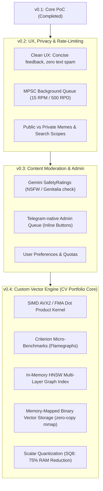
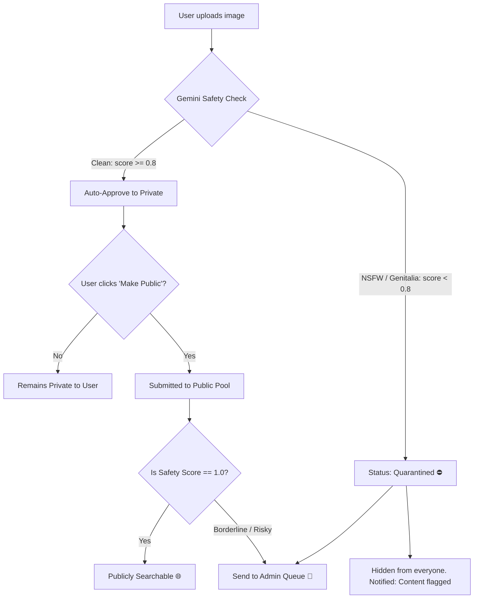

# MnemosyneM: Product Roadmap & Technical Architecture

## 🧭 Project Vision
**MnemosyneM** is a high-performance, multimodal semantic meme search engine and Telegram bot written in Rust. It combines Cloud Visual Language Models (Gemini 3.5 Flash Lite) with fast local vector embeddings (ONNX Multilingual E5) and SQLite storage, offering zero-cost image hosting via Telegram's cloud file storage.

---

## 🗺️ Milestones Overview



---

## 📌 Milestone 1: UX Overhaul & Clean Feedback (v0.2)
> **Goal:** Eliminate raw text dumps in Telegram chat, making the bot intuitive, punchy, and fast.

### 1.1. Problem & Solution
* **Problem:** Raw Gemini output (`descriptions`, 1000–1800 chars) was previously shown to the user or included in captions, exceeding Telegram's 1024-char caption limit and cluttering chat.
* **Solution:** Gemini descriptions are **internal data used only for generating embeddings**. Users should only see clean, minimal status messages and punchlines.
* **New Ingestion UX:**
  1. User sends photo.
  2. Bot responds with a single compact message:
     ```text
     📥 Meme received! Analyzing...
     ```
  3. Once processed, message updates or sends:
     ```text
     ✅ Meme indexed!
     Visibility: 🔒 Private (Only you)
     ```
     With Inline Action Buttons:
     `[ 🌐 Make Public ]` | `[ 🗑 Delete ]`

### 1.2. New Search UX
* Search results return clean captions:
  ```text
  🎯 <Meme Title or Joke Punchline>
  📊 Match: 92%
  ```

---

## 🔒 Milestone 2: Multi-Tenancy & Privacy (Public vs Private) (v0.2)
> **Goal:** Separate user collections so users can store private memes while contributing to a shared public meme catalog.

### 2.1. SQLite Database Schema Updates
```sql
-- User settings and preferences
CREATE TABLE IF NOT EXISTS users (
    user_id INTEGER PRIMARY KEY,           -- Telegram User ID
    username TEXT,                         -- Telegram @username
    search_scope TEXT NOT NULL DEFAULT 'all', -- 'all', 'public_only', 'private_only'
    created_at INTEGER NOT NULL
);

-- Memes table extensions
ALTER TABLE memes ADD COLUMN user_id INTEGER NOT NULL DEFAULT 0;
ALTER TABLE memes ADD COLUMN is_public BOOLEAN NOT NULL DEFAULT 0;
ALTER TABLE memes ADD COLUMN status TEXT NOT NULL DEFAULT 'approved'; -- 'pending', 'approved', 'quarantined', 'rejected'
ALTER TABLE memes ADD COLUMN safety_score REAL DEFAULT 1.0;          -- 0.0 (NSFW) .. 1.0 (Safe)
```

### 2.2. Search Scopes
Users can toggle their search scope via `/settings` or inline buttons:
1. **`all` (Default):** Search `(is_public = 1 AND status = 'approved') OR (user_id = CURRENT_USER)`. (All approved public memes + current user's private memes).
2. **`private_only`:** Search strictly `user_id = CURRENT_USER AND is_public = 0`.
3. **`public_only`:** Search strictly verified community memes (`is_public = 1 AND status = 'approved'`).

---

## 🛡️ Milestone 3: Content Moderation & NSFW Protection (v0.3)
> **Goal:** Automatically detect and quarantine inappropriate content (nudity, explicit genitals, NSFW, shock content) before it can enter the public catalog.

### 3.1. Technical Design: Gemini Safety Ratings
Gemini API includes built-in safety evaluations in `generateContent` responses:

```json
"safetyRatings": [
  {
    "category": "HARM_CATEGORY_SEXUALLY_EXPLICIT",
    "probability": "NEGLIGIBLE" // NEGLIGIBLE, LOW, MEDIUM, HIGH
  },
  {
    "category": "HARM_CATEGORY_DANGEROUS_CONTENT",
    "probability": "NEGLIGIBLE"
  },
  {
    "category": "HARM_CATEGORY_HARASSMENT",
    "probability": "NEGLIGIBLE"
  }
]
```

#### Dual-Layer Safety Verification:
1. Parse `safetyRatings` from Gemini HTTP response. If `HARM_CATEGORY_SEXUALLY_EXPLICIT` is `MEDIUM` or `HIGH`, flag immediately.
2. Prompt instruction: Instruct Gemini to output structured metadata:
   ```json
   {
     "is_nsfw": false,
     "safety_score": 0.95,
     "text_verbatim": "...",
     "description": "..."
   }
   ```

### 3.2. Moderation Pipeline


---

## 👑 Milestone 4: Telegram-Native Admin Panel (v0.3)
> **Goal:** Manage moderation directly from Telegram without creating or hosting a web frontend.

### 4.1. Admin Bot Flow
* Set `ADMIN_TELEGRAM_ID` in `.env`.
* When a meme is flagged or submitted for public review, the bot forwards it to the admin's private chat:

```text
🚨 [MODERATION QUEUE]
From: @username (ID: 98765432)
Gemini Rating: SEXUALLY_EXPLICIT (MEDIUM)
AI Summary: "Photo containing explicit nudity..."
Meme ID: 1793041234
```
*(Photo attached)*

**Inline Action Buttons for Admin:**
* `[ ✅ Approve Public ]` $\rightarrow$ Set `status = 'approved'`, `is_public = 1`.
* `[ 🔒 Make Private Only ]` $\rightarrow$ Set `status = 'approved'`, `is_public = 0`.
* `[ ⛔ Reject & Purge ]` $\rightarrow$ Delete permanently from DB.

---

## ⚙️ Milestone 5: Background MPSC Queue & Rate Limiter (v0.3)
> **Goal:** Strictly enforce Gemini Free Tier quotas (15 RPM and 500 RPD) while decoupling Telegram handler latency.

1. **`tokio::sync::mpsc::channel(500)`:** Buffered in-memory queue.
2. **Pacing Worker (`tokio::spawn`):** 4-second minimum sleep between Gemini API calls $\rightarrow$ **guarantees $\le 15$ RPM at all times**.
3. **Daily Counter:** Tracks requests with an automatic reset at midnight UTC to prevent crossing the 500 RPD threshold.

---

## 🚀 Milestone 6: High-Performance Vector Engine from Scratch (v0.4)
> **Target:** Senior Systems Rust / High-Performance Engineering Portfolio Piece.

### 🎯 Portfolio Elevator Pitch for CV:
> *"Architected and implemented a high-performance in-memory Approximate Nearest Neighbor (ANN) vector search engine from scratch in Rust. Built an HNSW multi-layer graph index achieving $O(\log N)$ retrieval latency, vectorized dot-product kernels using AVX2 SIMD intrinsics, memory-mapped zero-copy vector persistence (mmap), and Criterion micro-benchmarks with flamegraph profiling."*

---

### 6.1. SIMD AVX2 / FMA Vector Math Kernel
* **Current State:** Scalar iterator `a.iter().zip(b.iter()).map(|(x, y)| x * y).sum()`.
* **SIMD Architecture:**
  * Uses 256-bit `YMM` registers via `core::arch::x86_64`.
  * Computes 8 single-precision floats (`f32`) in parallel per CPU clock cycle.
  * Employs Fused Multiply-Add (`_mm256_fmadd_ps`) unrolled by 4 accumulator lanes to saturate execution pipelines:
    $$\text{Dot Product} = \sum_{i=0}^{767} a_i \cdot b_i$$
  * Expected Speedup: **4x–8x faster** than scalar execution.
* **Criterion Micro-benchmarks:**
  * Benchmark matrix: `Scalar` vs `Auto-vectorized` vs `AVX2 Hand-rolled SIMD` over 768-dim vectors.
  * Generate flamegraphs and throughput reports (GB/s).

---

### 6.2. HNSW (Hierarchical Navigable Small World) Graph Index
* **Current State:** Brute-force Flat KNN ($O(N)$ linear scan over all memes).
* **HNSW Architecture:**
  * Multi-layer skip-list inspired graph of vector nodes:
    * **Layer $L_{max}$ to $L_1$:** Sparse long-range connections for fast greedy navigation across semantic clusters.
    * **Layer $0$:** Dense bottom layer connecting nearest neighbors for high recall.
  * **Query Complexity:** Drops from $O(N)$ to **$O(\log N)$**!
    * At $100\,000$ memes: ~200 distance computations instead of $100\,000$.
  * **Memory Safety & Ownership in Rust:**
    * Graph constructed using index-based arena allocation (`Vec<Node>` with `u32` node IDs) instead of raw pointers (`*const T`) or circular `Rc<RefCell<Node>>`, guaranteeing complete memory safety without runtime overhead.

---

### 6.3. Custom Zero-Copy Memory-Mapped Vector Storage (`mmap`)
* **Current State:** 3072-byte Little-Endian BLOBs stored inside SQLite rows.
* **New Storage Engine (`.vec` format):**
  * Dedicated append-only binary vector file with structured header:
    ```
    [ Magic: 4 bytes "MNEM" ]
    [ Version: u16 ]
    [ Vector Dimensions: u16 (768) ]
    [ Vector Count: u64 ]
    [ 32-byte Aligned Vectors Payload ]
    ```
  * Memory-mapped via `memmap2` crate:
    * The OS kernel handles virtual memory paging directly into CPU cache.
    * Zero-copy loading: zero memory allocations when accessing vectors on disk.
    * Instant bot startup time (0ms loading overhead, regardless of database size).

---

### 6.4. Scalar Quantization (SQ8) *(Optional Optimization)*
* Compresses 32-bit float vectors (`f32`, 3072 bytes per vector) into 8-bit unsigned integers (`u8`, 768 bytes per vector).
* Achieves **75% RAM reduction** while maintaining $>98\%$ recall accuracy.
* Enables integer SIMD instructions (`_mm256_maddubs_epi16`).

---

## 📋 Implementation Checklist

- [x] **v0.1: Core PoC**
  - [x] Gemini 3.5 Flash Lite VLM integration with secure API headers.
  - [x] Local FastEmbed Multilingual E5 Base (768-dim embeddings).
  - [x] SQLite database with BLOB vector persistence.
  - [x] Zero-disk storage via Telegram `file_id`.
  - [x] Multi-item search results sent as Telegram media group albums.
  - [x] Fast in-memory deduplication check via `telegram_file_unique_id`.
- [ ] **v0.2: UX & Queue & Privacy**
  - [ ] Concise Telegram response format (remove Gemini text dumps).
  - [ ] MPSC background queue worker with 4-second pacing (15 RPM guard).
  - [ ] SQLite schema update (`user_id`, `is_public`, `status`).
  - [ ] Per-meme privacy toggles (`Make Public` / `Keep Private`).
  - [ ] Search scope selection (`all`, `public_only`, `private_only`).
- [ ] **v0.3: Moderation & Admin**
  - [ ] Parse `safetyRatings` from Gemini responses.
  - [ ] Automated quarantine for explicit content / NSFW.
  - [ ] Telegram-native admin moderation channel/chat with inline action buttons.
- [ ] **v0.4: Custom Vector Engine from Scratch**
  - [ ] Criterion micro-benchmarks suite for 768-dim vector cosine similarity.
  - [ ] Hand-rolled AVX2 SIMD dot-product kernel (`_mm256_fmadd_ps`).
  - [ ] Arena-based HNSW multi-layer graph index ($O(\log N)$ search).
  - [ ] Custom memory-mapped `.vec` zero-copy binary storage (`memmap2`).
  - [ ] SQ8 scalar quantization kernel.
