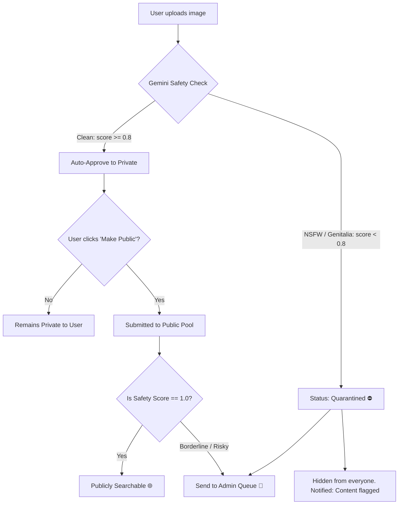

# MnemosyneM: Product Roadmap & Technical Architecture

## 🧭 Project Vision
**MnemosyneM** is a high-performance, multimodal semantic meme search engine and Telegram bot written in Rust. It combines Cloud Visual Language Models (Gemini 3.5 Flash Lite) with fast local vector embeddings (ONNX Multilingual E5) and SQLite storage, offering zero-cost image hosting via Telegram's cloud file storage.

---

## 🗺️ Milestones Overview

```mermaid
flowchart TD
    M1["v0.1: Core PoC (Completed)"] --> M2["v0.2: UX, Rate-Limiting & Inline Mode"]
    M2 --> M3["v0.3: Content Moderation & Telegram Admin Panel"]
    M3 --> M4["v0.4: Custom Vector Engine from Scratch (HNSW + SIMD + mmap)"]

    subgraph M2 ["v0.2: UX, Privacy & Inline Mode"]
        UX["Clean UX: Concise feedback, zero text spam"]
        Queue["MPSC Background Queue (15 RPM / 500 RPD)"]
        Privacy["Public vs Private Memes & Search Scopes"]
        Inline["Telegram Inline Mode (@bot query anywhere)"]
        pHash["pHash Visual Deduplication (image_hasher POPCNT)"]
        Maintenance["Autonomous Maintenance Worker (Background pHash backfill)"]
        VlmPool["Quota-Aware VLM Router (Tiered Balance + 429/404 Cooldowns)"]
        Drip["Meme Drip Delivery (Randomized dopamine scheduler)"]
        Logging["Structured Logging (tracing + timestamps + user attribution)"]
        Resilience["Startup & Network Resilience (retry loops, non-fatal command setup, token masking)"]
        GIFs["GIF & Animation Support (Telegram MP4 + Gemini Video VLM)"]
        Search["Search Quality Overhaul (Clean Lexical + FTS5/BM25 + TextRerank)"]
    end

    subgraph M3 ["v0.3: Content Moderation & Admin"]
        GeminiSafety["Gemini SafetyRatings (NSFW / Genitalia check)"]
        AdminTG["Telegram-native Admin Queue (Inline Buttons)"]
        UserMgmt["User Preferences & Quotas"]
    end

    subgraph M4 ["v0.4: Custom Vector Engine (CV Portfolio Core)"]
        SIMD["SIMD AVX2 / FMA Dot Product Kernel"]
        Criterion["Criterion Micro-Benchmarks (Flamegraphs)"]
        HNSW["In-Memory HNSW Multi-Layer Graph Index"]
        Mmap["Memory-Mapped Binary Vector Storage (zero-copy mmap)"]
        SQ8["Scalar Quantization (SQ8: 75% RAM Reduction)"]
    end
```



---

## 📌 Milestone 1: UX Overhaul & Clean Feedback (v0.2)
> **Goal:** Eliminate raw text dumps in Telegram chat, making the bot intuitive, punchy, and fast.

### 1.1. Problem & Solution
* **Problem:** Raw Gemini output (`descriptions`, 1000–1800 chars) was previously shown to the user or included in captions, exceeding Telegram's 1024-char caption limit and cluttering chat.
* **Solution:** Gemini descriptions are **internal data used only for generating embeddings**. Users should only see clean, minimal status messages and punchlines.
* **New Ingestion UX:**
  1. User sends photo.
  2. Bot responds with a single compact message:
     ```text
     📥 Meme received! Analyzing...
     ```
  3. Once processed, message updates or sends:
     ```text
     ✅ Meme indexed!
     Visibility: 🔒 Private (Only you)
     ```
     With Inline Action Buttons:
     `[ 🌐 Make Public ]` | `[ 🗑 Delete ]`

### 1.2. New Search UX
* Search results return clean captions:
  ```text
  🎯 <Meme Title or Joke Punchline>
  📊 Match: 92%
  ```

### 1.3. Batch Ingestion & Message Attribution (Reply-to-Message UX)
* **Problem:** When users send/forward batches of 10–30 memes at once, asynchronous worker notifications (`[V] Confiscated`, `⛔ [REJECTED]`) come without referencing the source message, leaving users confused about which meme succeeded or failed.
* **Solution:**
  * Add `message_id: MessageId` to `MemeJob`.
  * Send all worker responses via `.reply_to_message_id(job.message_id)`.
  * Tapping the bot's response in Telegram jumps straight to the exact uploaded photo.

### 1.4. Native Persistent Reply Keyboard (Нижня клавіатура швидких дій)
* **Problem:** Requiring users to type slash commands (`/random`, `/tinder`, `/tags`, `/settings`) or open the burger menu slows down interaction and hurts mobile UX.
* **Solution:** Provide a persistent Telegram Reply Keyboard (`teloxide::types::KeyboardMarkup`) directly beneath the input field with clean emoji icons and organized rows:
  ```text
  +---------------------------------------+
  |        🔥 Мем-Тіндер (/tinder)        |
  +-------------------+-------------------+
  | 🎲 Випадковий мем |  ❤️ Вподобані     |
  +-------------------+-------------------+
  | 🏷️ Теги/Категорії |  ⚙️ Налаштування  |
  +-------------------+-------------------+
  |            📊 Статистика              |
  +---------------------------------------+
  ```
* **Implementation Details:**
  * Created via `KeyboardMarkup::new(...)` with `.resize_keyboard(true)` and `.persistent()`.
  * Dispatcher transparently handles button text triggers as equivalent to slash commands.

---

## 🔒 Milestone 2: Multi-Tenancy & Privacy (Public vs Private) (v0.2)
> **Goal:** Separate user collections so users can store private memes while contributing to a shared public meme catalog.

### 2.1. SQLite Database Schema Updates
```sql
-- User settings and preferences
CREATE TABLE IF NOT EXISTS users (
    user_id INTEGER PRIMARY KEY,           -- Telegram User ID
    username TEXT,                         -- Telegram @username
    search_scope TEXT NOT NULL DEFAULT 'all', -- 'all', 'public_only', 'private_only'
    created_at INTEGER NOT NULL
);

-- Memes table extensions
ALTER TABLE memes ADD COLUMN user_id INTEGER NOT NULL DEFAULT 0;
ALTER TABLE memes ADD COLUMN is_public BOOLEAN NOT NULL DEFAULT 0;
ALTER TABLE memes ADD COLUMN status TEXT NOT NULL DEFAULT 'approved'; -- 'pending', 'approved', 'quarantined', 'rejected'
ALTER TABLE memes ADD COLUMN safety_score REAL DEFAULT 1.0;          -- 0.0 (NSFW) .. 1.0 (Safe)
```

### 2.3. Many-to-Many Architecture & Channel Forward Attribution (v0.2)
* **Asset vs Bookmark Separation:**
  * `memes`: Stores unique visual/semantic asset (vectors, OCR, Gemini description, channel attribution) strictly ONCE.
  * `user_memes`: Relational join table mapping `user_id` $\leftrightarrow$ `meme_id` with per-user caption and personal `is_public` visibility.
* **Instant Deduplication & Quota Protection:**
  * When User B forwards a meme already uploaded by User A, the bot recognizes `file_tg_unique_id`.
  * Bypasses Gemini VLM entirely (0 cost, 0 latency) and bookmarks it instantly into User B's collection.
  * Eliminates duplicate search results entirely.
* **Channel Attribution (Respecting Creators):**
  * Safely detects `MessageOrigin::Channel` from forwarded posts with public `@username`.
  * Generates direct link to original post (`https://t.me/{channel}/{message_id}`).
  * Forwarded messages from private users (`MessageOrigin::User`) are strictly anonymized to prevent personal data leaks.

### 2.4. Perceptual Hashing (pHash) & Background Maintenance Worker (v0.2)
* **Visual Deduplication Independent of Resolution:**
  * Uses `image_hasher` (64-bit gradient/perceptual hash) to identify visually identical memes regardless of dimensions, JPEG compression, or file format (`.jpg`, `.png`, `.webp`).
  * Bitwise Hamming distance comparison: $(h_1 \oplus h_2)\text{.count\_ones}() \le \text{MAX\_PHASH\_DISTANCE}$ (configurable threshold, default $\le 5$).
  * Compiles to native CPU `POPCNT` instruction for sub-microsecond vector scans across the entire in-memory catalog.
* **Pre-VLM Short-Circuit:**
  * New uploads are hashed immediately after downloading image bytes. If an existing meme is matched:
    * Skips Google Gemini VLM call entirely (0s latency, 0 quota consumed).
    * Links the existing meme into the user's `user_memes` collection in-place.
* **Autonomous Background Maintenance Worker (`src/maintenance/`):**
  * Decoupled from blocking startup migrations; starts in its own Tokio async loop with recurring timer (`interval(600s)` / 10–50 min).
  * Automatically backfills `phash` for legacy catalog memes where `phash == 0` via non-blocking Telegram Bot API requests.
  * Preserves low latency on `Mutex<MemeStore>`: drops the lock during network downloads, only acquiring it for microsecond in-memory/SQLite updates.
* **Multi-Model VLM Fallback Pool (`GEMINNI_MODEL_POOL`):**
  * Resilient failover pool: `["gemini-3.5-flash-lite", "gemini-3.1-flash-lite", "gemini-3.5-flash", "gemini-3.6-flash", "gemini-3.8-flash"]`.
  * Automatically switches to backup model upon encountering HTTP 503 (high demand spikes) or HTTP 429 (quota rate limits).
* **Nuanced Content Moderation:**
  * Strict pornography protection for real-life photographic nudity.
  * Explicit exemptions for historical art, medieval illuminations, frescoes, statues, caricatures, and satirical drawings.

### 2.5. Meme Drip Delivery & Autonomous Dopamine Scheduler (v0.2 / v0.3)
* **Concept & Psychology:**
  * Users configure a subscription: bot delivers $K$ random high-scoring memes per day over $N$ days at **unpredictable, randomized intervals**.
  * Unlike spammy fixed-interval timers (e.g. every 30 minutes), unpredictable random drops trigger a dopamine hit similar to an unexpected message from a friend.
* **Architecture & Algorithms:**
  * **Jitter / Poisson Interval:** Next delivery timestamp is scheduled dynamically:
    $$\text{next\_delivery} = \text{now} + \text{Uniform}(\text{min\_interval}, \text{max\_interval})$$
  * **Quiet Hours Guard (Нічний режим):** Strictly halts deliveries during nighttime (default `23:00` – `09:00` user local time or UTC). If $\text{next\_delivery}$ lands in quiet hours, it automatically shifts to morning (`09:15` + random jitter).
  * **Deduplication History:** Tracks previously delivered memes in `user_delivered_memes` table so a user never receives the same meme twice.
* **SQLite Database Schema:**
  ```sql
  CREATE TABLE IF NOT EXISTS meme_subscriptions (
      user_id BIGINT PRIMARY KEY,
      active_until BIGINT NOT NULL,
      memes_per_day INTEGER NOT NULL DEFAULT 3,
      next_delivery_at BIGINT NOT NULL,
      is_active BOOLEAN NOT NULL DEFAULT 1
  );

  CREATE TABLE IF NOT EXISTS user_delivered_memes (
      user_id BIGINT NOT NULL,
      meme_id BIGINT NOT NULL,
      delivered_at BIGINT NOT NULL,
      PRIMARY KEY (user_id, meme_id)
  );
  ```
* **Background Worker (`src/maintenance/drip_worker.rs`):**
  * Lightweight async loop polling `meme_subscriptions` every 60s for `next_delivery_at <= now AND is_active = 1`.
  * Selects an unviewed random meme (`$O(1)$` memory randomizer) and dispatches via `bot.send_photo`.

---

## 💬 Milestone 3: Telegram Inline Mode — Search & Share Everywhere (v0.2)
> **Goal:** Allow users to summon MnemosyneM directly inside ANY chat, group, or channel by typing `@bot_username <query>` and instantly picking and sending memes.

### 3.1. How It Works (Telegram Inline Queries)
Telegram provides native support for **Inline Bots** (`InlineQuery`):
1. **User interaction:** In any private chat with a friend, group chat, or channel, the user types:
   ```text
   @MnemosyneM_bot programming bug at 3am
   ```
2. **Instant Vector Search:** Telegram fires an `InlineQuery` update to our bot. The bot generates an embedding with our local FastEmbed Multilingual E5 model and executes sub-millisecond vector similarity search in SQLite/HNSW.
3. **Gallery Popup:** Telegram displays an interactive horizontal/grid gallery of matching meme thumbnails directly above the text input field.
4. **One-Tap Send:** When the user taps a meme thumbnail:
   * Telegram immediately posts the meme into the active chat on behalf of the user using the cached `telegram_file_id`.
   * Zero server upload bandwidth or latency is incurred (`InlineQueryResultCachedPhoto`).

### 3.2. Technical Implementation Architecture
* **Teloxide Dispatcher:** Transition from simple `teloxide::repl` to `teloxide::dispatch!` with `dptree`:
  ```rust
  let handler = dptree::entry()
      .branch(Update::filter_message().endpoint(message_handler))
      .branch(Update::filter_inline_query().endpoint(inline_query_handler));
  ```
* **Payload Type:** Use `InlineQueryResultCachedPhoto`:
  ```rust
  InlineQueryResultCachedPhoto::new(
      result_id,                   // Unique string ID for the result item
      file_id,                     // Telegram file_id (instant delivery, zero re-upload!)
  )
  .caption(format!("🎯 {punchline}\n📊 Match: {score}%"))
  ```
* **Multi-Tenancy & Privacy Awareness:**
  * When answering via `bot.answer_inline_query(inline_query.id, results)`:
    * Set `is_personal(true)`: Guarantees that search results containing the user's private memes are cached only for that specific Telegram user.
    * Set `cache_time(10..60)`: Caches results for rapid typing queries without hammering the embedding engine.
* **Pagination (`next_offset`):**
  * Support endless scrolling in the inline drawer via the `offset` parameter (`0..10`, `10..20`, etc.).
* **BotFather Configuration:**
  * Execute `/setinline` in `@BotFather`.
  * Set placeholder text: `"Search memes semantically..."`.
* **Group Chat Invocations (Bonus):**
  * Bot can also be added directly to group chats where members can trigger it via `/search <query>` or by replying to/mentioning the bot (`@MnemosyneM_bot`).

### 3.3. Hashtags & Category Directory (`/tags`)
* **Goal:** Allow users to browse indexed memes by categories and see meme counts per tag.
* **UX Flow:**
  1. User sends `/tags`.
  2. Bot responds with ranked list of tags + total count of memes:
     ```text
     🏷️ Meme Categories & Tags:
     • #work (42 memes)
     • #programming (38 memes)
     • #relationship (25 memes)
     • #cats (19 memes)
     • #deadline (14 memes)
     ```
  3. Interactive Inline Buttons allow one-tap jumping straight into inline search (`@MnemosyneM_bot #tag `).
* **Database & Indexing:**
  * Gemini VLM extracts 2–4 lowercase normalized tags per meme into `tags` and `meme_tags` join table.
  * Fast SQL aggregation:
    ```sql
    SELECT t.name, COUNT(mt.meme_id) AS total_memes
    FROM tags t
    JOIN meme_tags mt ON t.id = mt.tag_id
    GROUP BY t.id
    ORDER BY total_memes DESC;
    ```

### 3.4. GIF & Animation Support (MP4 Memes)
* **Goal:** Enable first-class semantic search and sharing for animated memes (GIFs) with zero hosting costs and pure Rust architecture.
* **Architecture & Technical Decisions:**
  * **Telegram Animation Object:** In Telegram, GIFs are represented as `Message::Animation` (H.264 MP4 video without audio). Telegram stores the video and provides `file_id`, `file_unique_id`, and `thumbnail: Option<PhotoSize>`.
  * **Native Multimodal Video Ingestion (Gemini VLM):**
    * Send MP4 bytes directly to Gemini API using `inline_data` with `mime_type: "video/mp4"`.
    * Gemini natively understands the scene's dynamic timeline, character motion, and text/captions appearing across frames.
    * **No FFmpeg dependency:** Eliminates heavy C/FFI bindings, cross-compilation hurdles, and server-side video decoding overhead.
  * **Zero-Cost Storage & Delivery:**
    * Zero server disk storage (Telegram Cloud hosts the media).
    * Direct chat response: `bot.send_animation(job.chat_id, FileId(job.file_id))`.
    * Inline Query response: `InlineQueryResultCachedMpeg4Gif` using cached `file_id` (zero server upload bandwidth).
  * **Fast Perceptual Hash (pHash):** Computed from `animation.thumbnail` (instant JPEG hash, zero video frame demuxing needed).
  * **Database Schema Extension:**
    ```sql
    ALTER TABLE memes ADD COLUMN media_type TEXT NOT NULL DEFAULT 'photo'; -- 'photo' | 'animation'
    ```

---

## 🛡️ Milestone 4: Content Moderation & NSFW Protection (v0.3)
> **Goal:** Automatically detect and quarantine inappropriate content (nudity, explicit genitals, NSFW, shock content) before it can enter the public catalog.

### 4.1. Technical Design: Gemini Safety Ratings
Gemini API includes built-in safety evaluations in `generateContent` responses:

```json
"safetyRatings": [
  {
    "category": "HARM_CATEGORY_SEXUALLY_EXPLICIT",
    "probability": "NEGLIGIBLE" // NEGLIGIBLE, LOW, MEDIUM, HIGH
  },
  {
    "category": "HARM_CATEGORY_DANGEROUS_CONTENT",
    "probability": "NEGLIGIBLE"
  },
  {
    "category": "HARM_CATEGORY_HARASSMENT",
    "probability": "NEGLIGIBLE"
  }
]
```

#### Triple-Layer Safety Verification (with `gemini-decision-1` Pre-Gate):
1. **Pre-Ingestion Binary Gate (`gemini-decision-1`, `POST /v1beta/decisions`):** Evaluate 3 fast `noul`/`score` questions (`is_real_photographic_nudity`, `is_drawn_art_or_comic_meme`, `safety_score`) on separate **`10K RPD / 200 RPM`** quota (~150–250 ms) *before* spending scarce `500 RPD` generative quota, returning calibrated `0.01..0.99` confidence scores instead of flaky string booleans (and avoiding comic false positives).
2. Parse `safetyRatings` from Gemini `generateContent` HTTP responses. If `HARM_CATEGORY_SEXUALLY_EXPLICIT` is `MEDIUM` or `HIGH`, flag immediately.
3. Structured generative verification (`is_nsfw`, `ocr_text`, `uk_description`, `en_description`) during VLM indexing.

### 4.2. Moderation Pipeline


### 4.3. Rejection Transparency & Clear User Feedback
* **Problem:** When Gemini rejects an image during batch uploads (e.g. `Inappropriate content detected (Gemini Safety Filter Explicit/NSFW)`), the user receives a generic error message with no context. If 20 memes were forwarded, it's impossible to deduce which meme triggered the safety filter.
* **Requirements & Implementation:**
  1. **Direct Telegram Reply:**
     * Use `reply_to_message_id(job.message_id)` so the rejection message is directly attached as a quote to the offending meme in the chat history.
  2. **Clear Rejection Message:**
     ```text
     ⛔ [REJECTED] Inappropriate content detected: Explicit/NSFW filter triggered.
     NSFW or sensitive content is strictly prohibited!
     ```
  3. **Visual Reference (Safe Fallback):**
     * If the message reply link is insufficient (e.g., deleted message or external forwarding context), include the file preview or the original caption to unambiguously identify the rejected item.

---

## 👑 Milestone 5: Telegram-Native Admin Panel (v0.3)
> **Goal:** Manage moderation directly from Telegram without creating or hosting a web frontend.

### 5.1. Admin Bot Flow
* Set `ADMIN_TELEGRAM_ID` in `.env`.
* When a meme is flagged or submitted for public review, the bot forwards it to the admin's private chat:

```text
🚨 [MODERATION QUEUE]
From: @username (ID: 98765432)
Gemini Rating: SEXUALLY_EXPLICIT (MEDIUM)
AI Summary: "Photo containing explicit nudity..."
Meme ID: 1793041234
```
*(Photo attached)*

**Inline Action Buttons for Admin:**
* `[ ✅ Approve Public ]` $\rightarrow$ Set `status = 'approved'`, `is_public = 1`.
* `[ 🔒 Make Private Only ]` $\rightarrow$ Set `status = 'approved'`, `is_public = 0`.
* `[ ⛔ Reject & Purge ]` $\rightarrow$ Delete permanently from DB.

---

## ⚙️ Milestone 6: Background MPSC Queue & Quota-Aware VLM Router (v0.2 / v0.3)
> **Goal:** Maximize free-tier Gemini throughput (1,000+ RPD / 30+ RPM combined across models), eliminate wasted calls to already-exhausted models, and decouple Telegram handler latency.

### 6.1. Background MPSC Queue & Pacing
1. **`tokio::sync::mpsc::channel(100..500)`:** Buffered in-memory queue separating upload handlers from VLM analysis.
2. **Adaptive Worker Pacing (`worker.rs` & `maintance_worker.rs`):** Transition from a static 4-second single-model sleep to dynamic spacing backed by combined active Tier-1 RPM capacity (e.g., 30 RPM = ~2s effective pacing across two 15 RPM Lite models).

### 6.2. Quota-Aware VLM Router & Circuit Breaker ([Detailed Plan](file:///home/mykhailo/dev/pet/MnemosyneM/m_nemosyne_m/docs/vlm-quota-router-plan.md))
* **API Reality:** Gemini Developer API (`generativelanguage.googleapis.com`) exposes neither an upfront remaining-quota endpoint nor `X-RateLimit-Remaining` headers. Instead, HTTP `429 RESOURCE_EXHAUSTED` JSON `error.details` distinguishes **daily exhaustion (`QuotaFailure`: `PerDay`)** vs **minute bursts (`PerMinute` / `RetryInfo.retryDelay`)**.
* **Tiered Prioritization & Load Balancing:**
  * **Tier 1 (`500 RPD / 15 RPM`):** `gemini-3.5-flash-lite`, `gemini-3.1-flash-lite` — sort by highest remaining RPD ratio (breaking ties by fewest calls in last 60s) so load distributes evenly rather than draining one model blindly first.
  * **Tier 2 (`20 RPD / 5–10 RPM`):** `gemini-2.5-flash-lite`, `gemini-3-flash`, `gemini-2.5-flash`, `gemini-3.6-flash`, `gemini-3.8-flash`, `gemini-4-hydrogen` — reserved strictly as overflow when all Tier-1 capacity is on cooldown.
* **Smart Cooldowns & Bug Fixes in [`src/vlm.rs`](file:///home/mykhailo/dev/pet/MnemosyneM/m_nemosyne_m/src/vlm.rs):**
  * Put `PerDay` `429` models on cooldown until **midnight Pacific Time (`America/Los_Angeles`)** (+5m buffer), persisted in SQLite (`vlm_model_quota`) across restarts.
  * Put `PerMinute` / `TPM` `429` models on short cooldown matching `RetryInfo.retryDelay`.
  * Fix early-return bug on non-`429`/`503` errors (`404`/`403` currently abort the fallback loop before reaching tail models) and replace per-call `reqwest::Client` creation with one shared pooled client + accurate per-model logging.

---

## 🪵 Milestone 7: Production Observability, Logging & Runtime Metrics (v0.2 / v0.3)
> **Goal:** Transition from raw, anonymous `println!` console output to production-grade structured logging (`tracing`) and in-process runtime resource metrics.

### 7.1. Problem & Current Pain Points
* **No Timestamps:** Logs lack temporal context (`[PHOTO-HANDLER]-[INFO] someone just drop new meme!`), making it impossible to diagnose when requests occurred, how long queues take, or track rate limits.
* **Anonymous Actions:** Logs do not indicate which user initiated the action (`user_id`, `@username`), complicating debugging when users batch-upload files or trigger errors.
* **Console Noise & Inflexibility:** Unstructured stdout floods the terminal with identical lines instead of level-filtered (`INFO`, `WARN`, `ERROR`), query-searchable events.
* **Lack of Resource Visibility:** Developers have no visibility into bot memory footprint (FastEmbed ONNX models, vector arrays), queue congestion, or Gemini API quota exhaustion during runtime.

### 7.2. Architecture with `tracing` & `tracing-subscriber`
* **Crate Dependencies:** `tracing = "0.1"` and `tracing-subscriber = { version = "0.3", features = ["env-filter", "time"] }`.
* **Standardized Log Format:**
  ```text
  2026-11-09T15:38:04.123Z  INFO photo_handler: New meme received user_id=98765432 username=@johndoe file_unique_id=AQADzxx...
  2026-11-09T15:38:08.456Z  WARN worker: Gemini safety filter rejected meme user_id=98765432 file_unique_id=AQADzxx... reason="Explicit/NSFW"
  2026-11-09T15:38:12.789Z  INFO search_handler: Search query executed user_id=98765432 username=@johndoe query="звільнення з роботи" results=3 latency_ms=42
  ```
* **Environment-driven Log Control:** Configure via `RUST_LOG=info,m_nemosyne_m=debug` for zero-overhead production runs and granular local debugging.

### 7.3. In-Process Resource Metrics & System Health Dashboard
* **Is pulling metrics directly from runtime a good practice?**
  * **Yes, it is industry best practice.** In-process metrics incur near-zero overhead (nanoseconds on Linux via `/proc/self/statm`) and expose internal application states that external system tools (`htop`, `docker stats`) cannot see.
* **Core Metrics Tracked:**
  1. **OS / Process Level:**
     * Resident Set Size (RSS Memory) & Virtual Memory (`/proc/self/statm` on Linux).
     * Process Uptime (`start_time.elapsed()`).
  2. **Application & Queue Internals:**
     * MPSC Queue depth (`receiver.len()` vs channel capacity).
     * SQLite database disk footprint (bytes) and total indexed memes count.
     * Gemini Free Tier Quotas: daily requests consumed ($X / 500$ RPD) and current rate-limiter pacing.
  3. **Performance & Latency:**
     * FastEmbed ONNX inference latency (ms).
     * Vector search execution time ($k$-NN scan / cosine similarity duration in ms).
* **Delivery Interfaces:**
  * **Enhanced Telegram `/stats` Dashboard:**
    ```text
    📊 MnemosyneM Runtime Metrics:
    ⏱ Uptime: 4d 12h 35m
    🧠 RAM (RSS): 184 MB | Peak: 240 MB
    💾 SQLite DB: 4.5 MB (1,420 memes)
    📥 Ingestion Queue: 0 pending / 500 max
    ⚡ Gemini API Quota: 142 / 500 RPD (28%)
    🎯 Avg Search Latency: 28 ms (Embed: 22ms, Search: 6ms)
    ```
  * *(Future)* Prometheus `/metrics` exporter endpoint if deployed in containerized clusters.

---

## 🛡️ Milestone 8: Network Fault Tolerance, Startup Resilience & Secret Hygiene (v0.2 / v0.3)
> **Goal:** Eliminate startup panics from transient network drops, establish graceful degradation for Telegram API calls, guarantee zero credential leakage in logs, and make VLM JSON response parsing immune to LLM array wrapping or type variations.

### 8.1. Problem & Real-World Failure Scenarios
* **Startup Panic on Network Hiccup:** Calls to `bot.set_my_commands(...)` invoke `.expect("Cannot set commands")`. When temporary DNS glitches, TLS handshake resets (`ConnectionReset by peer` / `OS error 104`), or Telegram API outages occur, the entire bot crashes immediately upon launch, aborting before the dispatcher can run.
* **Non-Critical Fatalities:** Telegram bot commands are persisted server-side by Telegram. Failing to synchronize command metadata at startup should never be a fatal error that terminates the process.
* **Credential Exposure in Terminal Logs:** Startup configuration logging prints `TELOXIDE_TOKEN` in plain text to `stdout`, exposing production bot tokens in copy-pasted logs, shell histories, and CI/CD outputs.
* **VLM JSON Deserialization Failure on Array Responses:** Gemini occasionally wraps its output in a 1-element JSON array `[ { ... } ]` instead of a top-level JSON object `{ ... }`. Serde interprets sequences as positional struct fields; since `MemeAnalysis`'s first field is `is_nsfw: bool`, encountering an object `{` triggers `invalid type: map, expected a boolean at line 2 column 2`. If repeated across retries, the worker hits max retries and drops the meme permanently.

### 8.2. Architecture & Resilience Patterns
* **Retry Loop with Exponential Backoff:**
  * For startup and background network tasks (such as `set_my_commands`), execute a multi-attempt retry loop with backoff (e.g., 3 retries with 2-second sleep).
* **Non-Fatal Fallback & Graceful Degradation:**
  * If non-critical setup calls fail after exhausting retries, log a structured `[ERROR]` and proceed with bot dispatching instead of calling `panic!` or `.expect()`.
* **Secret Sanitization & Masking:**
  * Sensitive tokens (`TELOXIDE_TOKEN`, `GEMINI_API_KEY`) must never be written to stdout or logs. Mask values using `[CONFIGURED]` or partial truncation (`1234****abcd`).
* **Multi-Shape VLM JSON Parser:**
  * Parse raw text into an intermediate `serde_json::Value`. Automatically extract the first element if Gemini returns an array `[ { ... } ]` and unwrap outer object wrappers (e.g., `{ "meme": { ... } }`).
  * Add flexible boolean deserialization to handle string representations (`"false"`, `"true"`) and integer flags (`0`, `1`).
  * Provide robust markdown code fence cleanup (`clean_json_str`) for ````json ... ```` blocks.
* **Dispatcher & Polling Connection Recovery:**
  * Configure Teloxide's dispatcher error handler to log network disconnections cleanly and apply reconnect backoff without crashing the process during extended network outages.
* **Worker Image Download Resilience:**
  * Protect Telegram file downloads in the MPSC worker against transient `reqwest` connection resets using automated retries before marking an ingestion job as failed.

---

## 🔍 Milestone 9: Search Quality Overhaul — Hybrid Retrieval & Cross-Encoder Reranking (v0.2 — Top Priority)
> **Goal:** Eliminate irrelevant Top-K noise on short queries (1–4 words), visual scene searches, and conceptual paraphrases, backed by empirical findings in [docs/search-research/](file:///home/mykhailo/dev/pet/MnemosyneM/m_nemosyne_m/docs/search-research/README.md).

### 9.1. Root Causes Identified (`mnemosynem_v2.db`, `N = 1,237`)
1. **UTF-8 byte-length + substring bug in [`find_top_k`](file:///home/mykhailo/dev/pet/MnemosyneM/m_nemosyne_m/src/meme_store.rs#L694-L724):** `w.len() >= 3` passes every 2-letter Cyrillic preposition (`"на"`, `"до"`, `"за"` = 4 bytes), and `.contains(w)` triggers spurious boosts inside unrelated words (`"на"` inside `"частиНАми"`, `"СвіНАбони"`; `"очі"` inside `"ВНОЧІ"`).
2. **E5 cosine anisotropy + dead `> 0.05` floor:** Random meme pairs average `0.8175` cosine and nonsense queries score up to `0.8145`; `> 0.05` lets 100% of visible memes pass, padding `TOP_K` with random filler when only 1–2 relevant memes exist.
3. **Short-query vs long-passage Mean Pooling dilution:** Queries average 2–4 words while `ocr_text | description_uk` averages `66.7` words (33.9% framing boilerplate, 14.4% Markdown layout tags in `ocr_text`), drowning single-sentence punchlines.
4. **Search-time `phash` duplicates & missing inflection matching:** Duplicate `phash` entries occupy multiple `TOP_K` slots, and raw substring checks fail Ukrainian inflections (`"касі"` vs `"касах"`).

### 9.2. Phased Implementation Plan
* **Phase 0 — Immediate Fixes (✅ Completed Nov 18, 2026):**
  * Replaced byte-length `w.len() >= 3` + `.contains()` with [`lexical_helper.rs`](file:///home/mykhailo/dev/pet/MnemosyneM/m_nemosyne_m/src/helpers/lexical_helper.rs) (`chars().count() >= 3`, UA/EN stopwords, whole-token light Ukrainian stemming).
  * Implemented search-time `phash` deduplication ([`deduplicate_by_phash`](file:///home/mykhailo/dev/pet/MnemosyneM/m_nemosyne_m/src/meme_store.rs#L855)), [`select_relative`](file:///home/mykhailo/dev/pet/MnemosyneM/m_nemosyne_m/src/meme_store.rs#L886), and [`weak_results`](file:///home/mykhailo/dev/pet/MnemosyneM/m_nemosyne_m/src/meme_store.rs#L904) (threshold raised `0.05 -> 0.5`).
  * Tightened `VLM_PROMPT` + added `sanitize_analysis`, `vlm_version = 2`, and background `reprocess_vlm` ([`maintance_worker.rs`](file:///home/mykhailo/dev/pet/MnemosyneM/m_nemosyne_m/src/maintenance/maintance_worker.rs)) — cutting average word length **`64.4 -> 44.2`** and fixing legacy `v1` English-in-`description_uk` leaks (`72.0% -> 0%` on `621` reprocessed rows).
  * *Remaining gaps before Phase 1A:* lexical boost currently inspects `ocr_text` only (not `description_uk`/`title`), and `weak_results` skips sets with `< 20` candidates (e.g., small `private_only` scopes).
* **Phase 1A — Hybrid Stage-1 Retrieval (SQLite FTS5 / BM25 + Vector):**
  * Leverage `rusqlite` `bundled` FTS5 (`-DSQLITE_ENABLE_FTS5` verified active) to index normalized/lightly-stemmed tokens across `ocr_text`, `description_uk`, `description_en`, and `title`.
  * Generate a unified Stage-1 candidate pool (`Top-20 Vector ∪ Top-20 FTS5`) — avoiding naive equal-weight RRF which degrades zero-overlap synonym recall (`25% -> 0%`).
* **Phase 1B — Stage-2 Reranking & Calibrated Validation (`TextRerank` or `gemini-decision-1`):**
  * **Local option (`fastembed::TextRerank`):** Benchmark `JINARerankerV2BaseMultiligual` (~1.1 GB) vs `BGERerankerV2M3` (~2.2 GB) in `tokio::task::spawn_blocking` after releasing `meme_store` mutex.
  * **Cloud zero-RAM option (`gemini-decision-1`, `POST /v1beta/decisions`):** Evaluate Top-15 Stage-1 candidate descriptions in 1 batch call (`noul` / `score`, **0 output tokens**, ~150–250 ms RTT, `10K RPD / 200 RPM / 50K TPM`) for `/search` reranking and calibrated rejection without extra RAM or free-text parsing.
* **Phase 2 — Golden Evaluation Suite & Future Multi-Vector / `BGEM3Q`:**
  * Codify golden benchmark queries (`standard`, `syn_zero`, `NEGATIVE`) to track `Hit@3`, `MRR`, and false-positive rejection across changes.
  * Evaluate structured 3-vector blending (`holistic + scene + meaning`, avoiding naive sentence-max noise) or `Bgem3Model::BGEM3Q` (Dense + Sparse) as corpus grows.

---

## 🚀 Milestone 10: High-Performance Vector Engine from Scratch (v0.4)
> **Target:** Senior Systems Rust / High-Performance Engineering Portfolio Piece.

### 🎯 Portfolio Elevator Pitch for CV:
> *"Architected and implemented a high-performance in-memory Approximate Nearest Neighbor (ANN) vector search engine from scratch in Rust. Built an HNSW multi-layer graph index achieving $O(\log N)$ retrieval latency, vectorized dot-product kernels using AVX2 SIMD intrinsics, memory-mapped zero-copy vector persistence (mmap), and Criterion micro-benchmarks with flamegraph profiling."*

---

### 10.1. SIMD AVX2 / FMA Vector Math Kernel
* **Current State:** Scalar iterator `a.iter().zip(b.iter()).map(|(x, y)| x * y).sum()`.
* **SIMD Architecture:**
  * Uses 256-bit `YMM` registers via `core::arch::x86_64`.
  * Computes 8 single-precision floats (`f32`) in parallel per CPU clock cycle.
  * Employs Fused Multiply-Add (`_mm256_fmadd_ps`) unrolled by 4 accumulator lanes to saturate execution pipelines:
    $$\text{Dot Product} = \sum_{i=0}^{767} a_i \cdot b_i$$
  * Expected Speedup: **4x–8x faster** than scalar execution.
* **Criterion Micro-benchmarks:**
  * Benchmark matrix: `Scalar` vs `Auto-vectorized` vs `AVX2 Hand-rolled SIMD` over 768-dim vectors.
  * Generate flamegraphs and throughput reports (GB/s).

---

### 10.2. HNSW (Hierarchical Navigable Small World) Graph Index
* **Current State:** Brute-force Flat KNN ($O(N)$ linear scan over all memes).
* **HNSW Architecture:**
  * Multi-layer skip-list inspired graph of vector nodes:
    * **Layer $L_{max}$ to $L_1$:** Sparse long-range connections for fast greedy navigation across semantic clusters.
    * **Layer $0$:** Dense bottom layer connecting nearest neighbors for high recall.
  * **Query Complexity:** Drops from $O(N)$ to **$O(\log N)$**!
    * At $100\,000$ memes: ~200 distance computations instead of $100\,000$.
  * **Memory Safety & Ownership in Rust:**
    * Graph constructed using index-based arena allocation (`Vec<Node>` with `u32` node IDs) instead of raw pointers (`*const T`) or circular `Rc<RefCell<Node>>`, guaranteeing complete memory safety without runtime overhead.

---

### 10.3. Custom Zero-Copy Memory-Mapped Vector Storage (`mmap`)
* **Current State:** 3072-byte Little-Endian BLOBs stored inside SQLite rows.
* **New Storage Engine (`.vec` format):**
  * Dedicated append-only binary vector file with structured header:
    ```
    [ Magic: 4 bytes "MNEM" ]
    [ Version: u16 ]
    [ Vector Dimensions: u16 (768) ]
    [ Vector Count: u64 ]
    [ 32-byte Aligned Vectors Payload ]
    ```
  * Memory-mapped via `memmap2` crate:
    * The OS kernel handles virtual memory paging directly into CPU cache.
    * Zero-copy loading: zero memory allocations when accessing vectors on disk.
    * Instant bot startup time (0ms loading overhead, regardless of database size).

---

### 10.4. Scalar Quantization (SQ8) *(Optional Optimization)*
* Compresses 32-bit float vectors (`f32`, 3072 bytes per vector) into 8-bit unsigned integers (`u8`, 768 bytes per vector).
* Achieves **75% RAM reduction** while maintaining $>98\%$ recall accuracy.
* Enables integer SIMD instructions (`_mm256_maddubs_epi16`).

---

## 📋 Implementation Checklist

- [x] **v0.1: Core PoC**
  - [x] Gemini 3.5 Flash Lite VLM integration with secure API headers.
  - [x] Local FastEmbed Multilingual E5 Base (768-dim embeddings).
  - [x] SQLite database with BLOB vector persistence.
  - [x] Zero-disk storage via Telegram `file_id`.
  - [x] Multi-item search results sent as Telegram media group albums.
  - [x] Fast in-memory deduplication check via `telegram_file_unique_id`.
- [ ] **v0.2: UX & Queue & Privacy & Inline Mode**
  - [x] Concise Telegram response format (remove Gemini text dumps, clean match % & captions).
  - [x] MPSC background queue worker with 4-second pacing (15 RPM guard) & poison pill protection.
  - [x] SQLite schema update (`user_id`, `is_public`, `users` table with username/first_name/last_name).
  - [x] User Settings & Privacy controls (`/settings` interactive inline menu for Public vs Private upload).
  - [x] Search scope selection (`all`, `public_only`, `private_only`) with in-place button cycling.
  - [x] Automatic user profile registration and sync on incoming messages.
  - [x] Zero-allocation $O(1)$ memory `random_meme` selection.
  - [x] Telegram Inline Query handler (`Update::filter_inline_query`).
  - [x] `InlineQueryResultCachedPhoto` instant delivery using cached `file_id`.
  - [x] Multi-tenancy inline cache control (`is_personal = true`) & Async Debounce (500ms).
  - [x] BotFather inline configuration (`/setinline`).
  - [x] Many-to-Many meme ownership (`memes` $\leftrightarrow$ `user_memes` $\leftrightarrow$ `users`).
  - [x] Channel forward attribution (`MessageOrigin::Channel` `source_title` & `source_url`).
  - [x] Instant deduplication: skip Gemini AI if meme already exists in catalog.
  - [x] Perceptual Hashing (pHash): resolution & compression independent duplicate detection (`image_hasher`).
  - [x] Configurable Hamming distance threshold via `MAX_PHASH_DISTANCE` (default $\le 5$).
  - [x] Autonomous Background Maintenance Worker (`src/maintenance/`): scheduled recurring backfill of pHash for legacy memes via Telegram Bot API.
  - [x] Dual Multilingual Embeddings: separate Ukrainian & English vector spaces with OCR exact keyword boosting.
  - [x] Standalone Database Migrations Engine (`src/migrations.rs`) with atomic batching & `_migrations` tracking.
  - [x] Multi-Model VLM Fallback Pool (`GEMINNI_MODEL_POOL`): automated failover across `3.5-flash-lite`, `3.1-flash-lite`, `3.5-flash`, `3.6-flash`, `3.8-flash` on 503/429 spikes.
  - [x] **⚡ Quota-Aware VLM Model Router & Circuit Breaker (see [docs/vlm-quota-router-plan.md](file:///home/mykhailo/dev/pet/MnemosyneM/m_nemosyne_m/docs/vlm-quota-router-plan.md)):**
    - [x] Verify exact Gemini API model IDs via `GET /v1beta/models` + live probes (keep verified free-tier pool: Tier-1 `3.5-flash-lite`, `3.1-flash-lite`; Tier-2 `3-flash-preview`, `3.6-flash`, `3.8-flash`, `4-hydrogen`; drop retired `2.5-*` and duplicate alias `3.5-flash`).
    - [x] Replace static `GEMINNI_MODEL_POOL` iteration with `VlmRouter`: separate Tier-1 (`500 RPD`: `3.5-flash-lite`, `3.1-flash-lite`) from Tier-2 (`20 RPD`), load-balancing Tier-1 by highest estimated remaining RPD % and lowest 60s RPM usage.
    - [x] Parse `429` JSON `QuotaFailure` (`PerDay` ➔ cooldown until midnight PT + 5m buffer) and `RetryInfo.retryDelay` (`PerMinute`/TPM ➔ short cooldown); disable `404`/`403` models and continue failover loop instead of returning early.
    - [x] Reuse a single shared `reqwest::Client` in `VlmRouter`, log the actual chosen model (`used_today/rpd_limit`), and release mutex locks strictly before `.await`.
    - [x] Persist per-model PT-day usage & cooldowns in SQLite (`vlm_model_quota`) via `src/migrations.rs` and share `Arc<VlmRouter>` across `worker.rs` and `maintance_worker.rs`.
  - [x] Progressive backoff and retry queue (5s, 10s) on transient VLM errors with sender requeue.
  - [x] Markdown code fence cleanup (`clean_json`) and Serde field aliases in VLM response parser.
  - [x] Worker image download retry loop with backoff on Telegram network resets.
  - [x] Multi-shape VLM response parser: handle array-wrapped JSON (`[ { ... } ]`), nested wrapper objects, and flexible booleans (`"false"`, `0`).
  - [x] Network fault tolerance for bot startup (`set_my_commands` retry loop with non-fatal fallback on connection reset/network drop).
  - [x] Token & secret masking in startup logs (`TELOXIDE_TOKEN: [CONFIGURED]`).
  - [ ] **🔥 Search Quality & Hybrid Retrieval Overhaul (TOP PRIORITY — see `docs/search-research/`):**
    - [x] **Phase 0 (Quick Wins — Audited Nov 18, 2026):**
      - [x] Fix `ocr_text` boost in `find_top_k`: implemented via `lexical_helper.rs` (`chars().count() >= 3`, UA/EN stopwords, whole-token light Ukrainian stemming).
      - [x] Search-time `phash` deduplication in `find_top_k` (`MAX_PHASH_DISTANCE`) so clone memes never occupy multiple `TOP_K` slots.
      - [x] Replace `best_score > 0.05` with relative score-gap cutoff (`select_relative` + `weak_results`, min floor `0.5`). *(Follow-up: cover `<20`-candidate scopes like `private_only`.)*
      - [x] Refactor VLM prompt & post-sanitizer (`src/vlm.rs`), plus `vlm_version=2` migration & background `reprocess_vlm` (`maintance_worker.rs` — already migrated 621 rows, cutting avg words `64.4 -> 44.2` and eliminating 72% `v1` English-in-`description_uk` leaks).
    - [x] **Phase 1A (Hybrid Stage-1 Candidate Generation):**
      - [x] Add SQLite FTS5 migration (`memes_fts` virtual table) indexing normalized/lightly-stemmed `ocr_text`, `description_uk`, `description_en`, and clean `title` (closing the current gap where `count_lexical_matches` scans `ocr_text` only), kept in sync on inserts/updates.
      - [x] Build unified Stage-1 candidate pool (`Top-20 Vector ∪ Top-20 FTS5`) without equal-weight RRF.
    - [x] **Phase 1B (Stage-2 Reranking & Calibrated Validation — Local `JINARerankerV2BaseMultiligual`):**
      - [x] Add `RerankerEngine` (`src/reranker.rs`) with `fastembed::TextRerank` (`JINARerankerV2BaseMultiligual`, `max_length=256`), `sigmoid(logit)` probability calibration, and `filter_reranked` noise/tail cutoff.
      - [x] Integrate Stage-2 reranker cleanly outside `meme_store`/`engine` mutexes via `tokio::task::spawn_blocking` (`run_search` in `src/bot/handlers.rs`) with `ENABLE_RERANKER` / `RERANK_MIN_SCORE` / `RERANK_CANDIDATES` config and automatic fallback to Phase 1A.
    - [x] **Phase 2 (Evaluation & Long-Term Scaling):**
      - [x] Add reproducible golden search evaluation test suite (`standard`, `syn_zero`, `NEGATIVE` queries tracking `Hit@3` and `MRR`).
      - [ ] Evaluate structured 3-vector blending (`holistic + scene + meaning`) or `Bgem3Model::BGEM3Q` (Dense + Sparse) as corpus grows.
  - [x] Dispatcher error handler with backoff on repeated Telegram polling disconnects.
  - [x] Per-meme privacy toggles (`Make Public` / `Keep Private` + `Delete` confirmation on uploaded meme message).
  - [x] Batch upload message attribution: attach `MessageId` to `MemeJob` and use `.reply_to_message_id()` for all worker feedback.
  - [x] Meme Drip Delivery (Рандомайзер мемів / «Дофамінова підписка»):
    - [x] SQLite tables `meme_subscriptions` and `user_delivered_memes`.
    - [x] Background Tokio scheduler with randomized Jitter intervals and Quiet Hours (`23:00` – `09:00`).
    - [x] Interactive commands `/drip` or `/subscribe` to activate/pause delivery and set daily frequency.
  - [x] Production structured logging (`tracing` + `tracing-subscriber`):
    - [x] Replace raw `println!` / `eprintln!` across `handlers`, `worker`, `vlm`, and `engine`.
    - [x] Add UTC timestamps to every log line to track when actions happen.
    - [x] Add user context (`user_id`, `@username`, `chat_id`) to photo ingestion, queue worker, and search queries.
    - [x] Configure log-level filtering (`INFO`, `WARN`, `ERROR`, `DEBUG`) via `RUST_LOG` environment variable.
  - [x] In-process runtime resource metrics & health dashboard (`/stats`):
    - [x] Measure process memory (RSS / Virtual RAM via `/proc/self/statm` on Linux).
    - [x] Track bot process uptime (`Instant::now().elapsed()`).
    - [x] Report live MPSC queue backlog depth and SQLite DB file size.
    - [x] Track Gemini Free Tier quotas consumed (PT RPD counters per tier & model).
    - [x] Measure vector search execution latency (ms: embed, Stage-1, rerank, total).
  - [x] Automatic meme categorization & Hashtag directory (`/tags`):
    - [x] Use **`gemini-decision-1`** (`POST /v1beta/decisions`) batch `noul` checks against a fixed normalized taxonomy (30–100 categories in 1 call over `ocr_text + description_uk` — zero text-generation tag drift, fits within `10K RPD` backfill).
    - [x] Create SQLite tables `tags (id, name UNIQUE)` and `meme_tags (meme_id, tag_id)`.
    - [x] Implement `/tags` command displaying all categories with live meme counts (`#category (N)`).
    - [x] Add interactive Inline buttons on `/tags` to trigger one-tap inline search for selected tag.
    - [x] Support combined tag filtering in inline queries (`@MnemosyneM_bot #work deadline`).
  - [x] Native Telegram Meme Tinder & Reactions (`/tinder` & `/liked`):
    - [x] SQLite schema `user_reactions (user_id, meme_id, reaction, created_at)` for `'like'`, `'skip'`, `'dislike'`.
    - [x] Interactive `/tinder` UI: send photo/GIF with single-row layout `[ ❤️ Лайк ]`, `[ 👎 ]`, `[ ⏭️ Скіп ]` (+ skip reset button when exhausted).
    - [x] Zero chat spam: update next meme in-place via `edit_message_media`.
    - [x] Decouple Likes from Personal Collection: likes populate `/liked` feed (with `[ 📥 Зберегти в мої меми ]` option) without cluttering personal `user_memes`.
  - [x] Persistent Reply Keyboard (`KeyboardMarkup`):
    - [x] Build multi-row keyboard with `resize_keyboard()` and `persistent()` for one-tap thumb navigation.
    - [x] Map button text directly into bot command dispatcher (`🔥 Мем-Тіндер`, `🎲 Випадковий мем`, `❤️ Вподобані`, `📊 Статистика`, `⚙️ Налаштування`, `❓ Допомога`).
  - [x] GIF & Video Animation Support (`media_type: MediaType::Animation`):
    - [x] Telegram `Message::Animation` ingestion handler in `bot/handlers.rs`.
    - [x] Gemini VLM MP4 multimodal video analysis (`inline_data` with `video/mp4`).
    - [x] SQLite schema migration: add `media_type INTEGER NOT NULL DEFAULT 0` and `thumbnail_tg_id TEXT`.
    - [x] Dual-mode search delivery: `bot.send_animation` for direct chat & `InlineQueryResultCachedMpeg4Gif` for inline queries.
    - [x] Resilient pHash computation: from `animation.thumbnail` with in-memory `ffmpeg` pipe fallback when Telegram thumbnail is missing.
    - [x] Unified Bang search modifiers: `!gif` and `!img` (or `!pic`) for explicit media filtering in inline queries and chat search.
- [ ] **v0.3: Moderation & Admin**
  - [x] Parse `safetyRatings` and Safety Filters from Gemini responses.
  - [x] Triple-barrier automated quarantine / rejection for explicit content / NSFW.
  - [x] Nuanced NSFW policy: strict photographic nudity protection with explicit cultural art/medieval illustration exemptions.
  - [x] Add `gemini-decision-1` pre-ingestion safety & spam gate (`noul` on `10K RPD` quota before calling `Flash Lite`, preventing comic false positives and saving generative quota).
  - [ ] Transparent rejection UX: reply directly to the specific rejected meme on Gemini safety filter trigger with clear error explanation.
  - [ ] Telegram-native admin moderation channel/chat with inline action buttons.
- [ ] **v0.4: Custom Vector Engine from Scratch**
  - [ ] Criterion micro-benchmarks suite for 768-dim vector cosine similarity.
  - [ ] Hand-rolled AVX2 SIMD dot-product kernel (`_mm256_fmadd_ps`).
  - [ ] Arena-based HNSW multi-layer graph index ($O(\log N)$ search).
  - [ ] Custom memory-mapped `.vec` zero-copy binary storage (`memmap2`).
  - [ ] SQ8 scalar quantization kernel.
