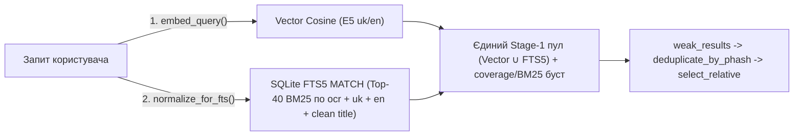

# План Phase 1A: SQLite FTS5 (`memes_fts`) + Hybrid Stage-1 (`Vector ∪ FTS5`)

> **Ціль:** Закрити головну прогалину Phase 0 — зараз лексичний пошук дивиться лише в `ocr_text` і кожного разу ре-токенізує всі 1 392 меми в циклі ([`meme_store.rs#L823`](../src/meme_store.rs#L823-L830)).
> **Чому не треба нових крейтів:** Локальний `rusqlite = "0.32"` із `features = ["bundled"]` уже скомпільований із **`-DSQLITE_ENABLE_FTS5`**.

---

## Архітектурна ідея



Ключові правила з [**Experiment 2**](../docs/search-research/02-empirical-experiments.md#L41-L78):
1. **Не використовувати рівноваговий RRF (`1/(60+r)`)** — на синонімічних запитах випадкові збіги окремих слів ламають ранжування кращих векторних кандидатів.
2. Замість цього FTS5:
   - постачає до `Top-40` сильних лексичних кандидатів (навіть якщо їх чистий косинус був на межі ~`0.45–0.50`),
   - дає пропорційний буст + прапорець `has_lexical_match` з урахуванням **всіх** полів (`ocr_text`, `description_uk`, `description_en`, очищений `title`), а не лише OCR.

---

## Крок 1. Токенізація для FTS5 та очищення `title` ([`src/helpers/lexical_helper.rs`](../src/helpers/lexical_helper.rs))

Вбудований токенізатор FTS5 (`unicode61`) не знає українських закінчень і не прибирає апострофи. Тому проганяємо текст при записі в індекс і при формуванні запиту через **одну й ту саму** нормалізацію.

- [x] **Додати `normalize_for_fts(text: &str) -> String`:**
  - За аналогією з [`extract_stemmed_terms`](../src/helpers/lexical_helper.rs#L1-L13): lowercase, прибрати апострофи `['\'', '’', 'ʼ', '`']`, розбити по `!c.is_alphanumeric()`, відкинути `chars().count() < 3` та `STOPWORDS`, застосувати `light_stem`.
  - **Відмінність від `extract_stemmed_terms`:** **НЕ робити `.sort()` і `.dedup()`** — збереження повторів потрібне, щоб SQLite **BM25** правильно рахував частоту терма (`TF`), коли слово трапляється і в OCR, і в описі.
- [x] **Додати `clean_title_for_fts(raw_title: &str) -> String`:**
  - У БД серед `652` непорожніх `title` більшість — підписи каналів (`💀TG | X | FB | Insta` — `246`, `@nepokazuy_mami` — `58`, `@yesterdays_deadline` — `35`, `LUM` — `53`, `Паштет` — `13`, `JustYourBBot`), інколи з корисним префіксом типу `Раночку\n💀TG | X | FB | Insta`.
  - По рядках відфільтрувати відомі канали/боти/підписи, прибрати `@username` та URL (`http://`, `https://`, `t.me/`), а залишок прогнати через `normalize_for_fts`.
- [x] **Додати `build_fts_match_query(query: &str) -> Option<String>`:**
  - Витягнути `extract_stemmed_terms(query)` (унікальні терми, лише `alphanumeric`).
  - Якщо порожньо — повернути `None`.
  - Інакше сформувати безпечний `OR`-запит у лапках: `terms.iter().map(|t| format!("\"{}\"", t)).collect::<Vec<_>>().join(" OR ")`.
  - *Навіщо лапки й `OR`:* лапки гарантують, що слова на кшталт `not`/`and` або спецсимволи ніколи не викличуть `fts5: syntax error`; `OR` не обнуляє результат, якщо з 5 слів запиту в мема збіглися 3–4 (BM25 сам підніме вище тих, де збіглося більше).
- [x] Покрити 3 функціями юніт-тестів прямо в `lexical_helper.rs`.

---

## Крок 2. Таблиця `memes_fts` та міграція ([`src/migrations.rs`](../src/migrations.rs), [`src/meme_store.rs`](../src/meme_store.rs))

- [x] **DDL таблиці (`memes_fts`):**
  У [`MemeStore::open`](../src/meme_store.rs#L244-L275) та у міграції створити віртуальну таблицю з окремими колонками під ваги BM25 (`rowid` буде прямо дорівнювати `memes.id`):
  ```sql
  CREATE VIRTUAL TABLE IF NOT EXISTS memes_fts USING fts5(
      ocr_norm,
      uk_norm,
      en_norm,
      title_norm
  );
  ```
- [x] **Міграція `add_memes_fts_index` у [`src/migrations.rs`](../src/migrations.rs):**
  - За прикладом попередніх міграцій (з записом у `_migrations`):
    1. Створити `memes_fts`.
    2. Почистити/заповнити в одній транзакції: прочитати `(id, ocr_text, description_uk, description_en, title)` з `memes` і виконати:
       ```sql
       INSERT INTO memes_fts(rowid, ocr_norm, uk_norm, en_norm, title_norm)
       VALUES (?, ?, ?, ?, ?);
       ```
       (через `DELETE FROM memes_fts` перед заповненням або `INSERT OR REPLACE` по `rowid`).
- [x] **Спільний helper `upsert_fts_entry(conn: &Connection, ...)` у [`src/meme_store.rs`](../src/meme_store.rs):**
  - Робить `DELETE FROM memes_fts WHERE rowid = ?` + `INSERT INTO memes_fts(rowid, ocr_norm, uk_norm, en_norm, title_norm) VALUES (?, ?, ?, ?, ?)`.
  - Викликати в:
    1. [`add_from_analysis`](../src/meme_store.rs#L81-L181): **важливий нюанс!** Якщо спрацював `ON CONFLICT (file_tg_unique_id) DO UPDATE`, в таблиці `memes` залишається старий `id` (а не `new_meme.id`), тому для `upsert_fts_entry` (і оновлення `self.memes`) краще забрати фактичний `id` через `RETURNING id` (`query_row`) або `SELECT id FROM memes WHERE file_tg_unique_id = ?`.
    2. [`update_meme_reprocessed`](../src/meme_store.rs#L711-L756): після `UPDATE memes` одразу оновлювати `memes_fts` (ще й переконатися, що `MemeStore::get_memes_for_reprocess` і `update_meme_reprocessed` або мають `title` з `self.memes`, або читають його з БД, щоб не затерти `title_norm` порожнім рядком при репроцесі VLM!).

---

## Крок 3. Пошук `Top-K` через FTS5 + Vector ([`src/meme_store.rs`](../src/meme_store.rs))

- [x] **Метод вибірки лексичних кандидатів на `MemeStore`:**
  ```rust
  struct FtsHit {
      bm25_score: f32,
      matched_terms: usize,
  }
  ```
  `fn query_fts_hits(&self, query_text: &str, limit: usize) -> HashMap<u64, FtsHit>`:
  1. Отримати `match_expr = build_fts_match_query(query_text)` і `query_terms = extract_stemmed_terms(query_text)`. Якщо `None` — повернути порожню мапу.
  2. Запит у SQLite:
     ```sql
     SELECT rowid,
            bm25(memes_fts, 2.0, 1.0, 0.6, 0.8) AS raw_bm25,
            ocr_norm, uk_norm, en_norm, title_norm
     FROM memes_fts
     WHERE memes_fts MATCH ?
     ORDER BY raw_bm25 ASC
     LIMIT ?;
     ```
     > [!IMPORTANT]
     > У SQLite FTS5 `bm25(...)` повертає **від'ємні значення** (чим менше число, наприклад `-14.5`, тим кращий збіг). Тому у SQL **завжди `ORDER BY raw_bm25 ASC`**, а в Rust беремо `let bm25_score = (-raw_bm25 as f32).max(0.0);`!
  3. Для кожного повернутого рядка порахувати `matched_terms` — скільки термів із `query_terms` трапляються в об'єднаному нормалізованому тексті `(ocr_norm, uk_norm, en_norm, title_norm)` (унікальних по запиту).

- [x] **Оновити [`find_top_k`](../src/meme_store.rs#L798-L853):**
  1. У [`MemeStore::find_top_k`](../src/meme_store.rs#L568-L586) викликати `let fts_hits = self.query_fts_hits(query_text, 40);` і передати `&fts_hits` у внутрішню чисту `find_top_k(...)`.
  2. Всередині циклу по `memes` прибрати ре-токенізацію `count_lexical_matches(&query_terms, &meme.ocr_text)`:
     - Дивимось у `fts_hits.get(&meme.id)`:
       - Якщо є збіг з `matched_terms > 0` (і `query_terms` не порожній):
         - `coverage = matched_terms as f32 / query_terms.len() as f32`
         - `boost = 0.05 * coverage` (або комбінація з нормалізованим `bm25_score`, напр. до `0.06` макс., щоб 1 випадкове слово з 4 не перебивало кращий за сенсом вектор, але 2+ збіги або повне покриття впевнено піднімали мем наверх).
         - **Захист від одиничного шуму:** `has_lexical_match = if query_terms.len() >= 3 { matched_terms >= 2 } else { matched_terms >= 1 };` *(щоб 1 загальне слово в довгому запиті не блокувало `weak_results` і `select_relative`)*.
       - Поріг потрапляння в кандидати: `if best_score > 0.5 || fts_hit.is_some()` (щоб сильні лексичні збіги з `vec ~ 0.45` також потрапляли в пул кандидатів, а не губилися!).
  3. Далі все лишається без змін: `sort_by` → `weak_results` → `deduplicate_by_phash` → `select_relative`.

---

## Крок 4. Тести та перевірка

- [x] Оновити існуючі тести `find_top_k` (передати `&HashMap::new()` або тестову `fts_hits` мапу).
- [x] Додати інтеграційні тести на `MemeStore::open(":memory:")`:
  1. Запит знаходить мем за словами з `description_uk` та `description_en`, навіть коли `ocr_text` порожній і вектори однакові.
  2. Спам із `title` на кшталт `"💀TG | X | FB | Insta"` та `"@nepokazuy_mami"` ігнорується, а корисна частина `"Раночку\n💀TG | X | FB | Insta"` знаходиться по `"ранок"`/`"раночку"`.
  3. Спецсимволи та оператори (`"що це? C++ (NOT) *test*"`) у запиті не ламають `MATCH`.
  4. `update_meme_reprocessed` оновлює `memes_fts` (старі слова більше не знаходяться, нові знаходяться).
- [x] Прогнати `cargo test && cargo clippy --all-targets`.

---

## Що далі після Phase 1A (примітка по Stage-2 / `gemini-decision-1`)

Я перевірив живим `curl`-ом `POST https://generativelanguage.googleapis.com/v1beta/decisions` із `model: "gemini-decision-1"` на твоєму ключі з `.env`:
- **Ендпоінт реально працює (`HTTP 200`, `total_output_tokens: 0`)**, коректна REST-схема: `"model": "gemini-decision-1"`, `"input": "..."`, `"questions": { "id": { "type": "noul", "instructions": "..." } }`.
- Для запиту `"важко вранці відкрити очі"` по 5 кандидатах повернув ідеальний скор `0.9458` потрібному мему і `0.049–0.094` решті.
- **Але реальний мережевий RTT гуляє від `0.59s` (warmup) до `4.38s–13.87s` (холодні/навантажені виклики)**. Тому:
  - Для **inline-пошуку** (`handle_inline_query`) тримаємо виключно локальний **Phase 1A (`Vector + FTS5`)** — це мілісекунди.
  - Для **Phase 1B** (`TextRerank` локально vs `gemini-decision-1` для `/search` або `/tags` у фоні) повернемось уже **після** готовності Phase 1A та завершення `reprocess_vlm` по всій базі.
