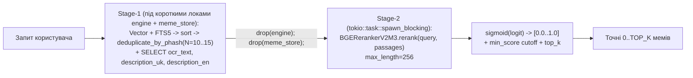

# План Phase 1B: Локальний Stage-2 Cross-Encoder (`BGERerankerV2M3`)

> **Ціль:** Вирішити проблему «короткий запит (2–4 слова) vs опис на 40–60 слів» і отримати калібрований поріг відсікання шуму без ручних евристик по вузькому косинусу E5.
> **Модель:** `fastembed::RerankerModel::BGERerankerV2M3` (уже є в `fastembed = "7.1.0"`, нових крейтів не треба; ~2.2 GB у `.fastembed_cache` та RAM).

---

## Архітектурний потік



### 3 критичні нюанси з вихідників `fastembed 7.1.0`

1. **`TextRerank::rerank` повертає сирі логіти (`logits`), НЕ ймовірності!**
   У `fastembed-7.1.0/src/reranking/impl.rs` скори виходять напряму з тензора `"logits"` (приблизно `-11.0 .. +10.0`). Перед фільтрацією і виводом у `build_caption` (`score * 100.0`) обов'язково проганяти через:
   ```rust
   pub fn sigmoid(logit: f32) -> f32 {
       1.0 / (1.0 + (-logit).exp())
   }
   ```
2. **Обов'язково ставити `.with_max_length(256)`:**
   Наші `v2` описи мають середню довжину ~44 слова (~70–120 токенів). Обмеження `max_length = 256` замість дефолтного `512` прискорює `BGERerankerV2M3` на CPU в ~2–3 рази без втрати змісту.
3. **Ніколи не тримати `meme_store.lock()` або `engine.lock()` під час реранку:**
   `BGERerankerV2M3` на CPU для 10–15 кандидатів може рахуватися `0.5–2.5` с. Тому `RerankerEngine` кладемо в окремий `Arc<std::sync::Mutex<RerankerEngine>>` і викликаємо через `tokio::task::spawn_blocking` уже після того, як `meme_store` та `engine` відпущені.

---

## Крок 1. Конфіг ([`src/config.rs`](../src/config.rs), [`.env.example`](../.env.example))

Додати в `AppConfig` і `.env.example` (з безпечними дефолтами):
- [ ] `enable_reranker: bool` (`ENABLE_RERANKER`, дефолт `true`) — дозволяє миттєво вимкнути завантаження 2.2 GB моделі локально або на слабкому хості.
- [ ] `rerank_min_score: f32` (`RERANK_MIN_SCORE`, дефолт `0.15`) — калібрований поріг `sigmoid(logit)` для відсікання нерелевантного сміття (оффтоп на кшталт `"квантова механіка синхрофазотрону"` зазвичай дає `< 0.02`).
- [ ] `rerank_candidates: usize` (`RERANK_CANDIDATES`, дефолт `15`) — скільки унікальних Stage-1 кандидатів подавати в Cross-Encoder (для inline можна брати `rerank_candidates.min(10)` для швидкості).

---

## Крок 2. Модуль реранкера (`src/reranker.rs`)

- [ ] Створити `src/reranker.rs` і зареєструвати `mod reranker;` у [`src/main.rs`](../src/main.rs) (та `pub mod reranker;` у [`src/lib.rs`](../src/lib.rs)).
- [ ] Структура та ініціалізація:
  ```rust
  use fastembed::{RerankInitOptions, RerankerModel, TextRerank};

  pub struct RerankerEngine {
      model: TextRerank,
  }

  impl RerankerEngine {
      pub fn new() -> Result<Self, String> {
          let options = RerankInitOptions::new(RerankerModel::BGERerankerV2M3)
              .with_max_length(256)
              .with_show_download_progress(true);
          let model = TextRerank::try_new(options).map_err(|e| e.to_string())?;
          Ok(Self { model })
      }

      /// Повертає (індекс кандидата, sigmoid score у [0.0..1.0]), відсортовано за спаданням
      pub fn rerank(&mut self, query: &str, passages: &[String]) -> Result<Vec<(usize, f32)>, String> {
          if passages.is_empty() {
              return Ok(Vec::new());
          }
          let results = self
              .model
              .rerank(query, passages, false, None)
              .map_err(|e| e.to_string())?;

          Ok(results
              .into_iter()
              .map(|r| (r.index, sigmoid(r.score)))
              .collect())
      }
  }
  ```
- [ ] Додати чисту функцію фільтрації результатів (легко тестувати без ONNX):
  ```rust
  pub fn filter_reranked(
      scored: Vec<(usize, f32)>,
      min_score: f32,
      top_k: usize,
  ) -> Vec<(usize, f32)>
  ```
  - Залишає лише `score >= min_score`.
  - Опційно: якщо `top1 >= 0.70`, можна відсікати слабкий хвіст нижче `top1 * 0.35`, щоб біля 95%-го ідеального мема не висів випадковий 18%-й.
  - Обрізає до `top_k`.

---

## Крок 3. Вибірка Stage-1 кандидатів із повними описами ([`src/meme_store.rs`](../src/meme_store.rs))

Зараз `struct Meme` в пам'яті не тримає `description_uk` і `description_en` — а Cross-Encoderу потрібен саме повний текст опису.

- [ ] Додати структуру кандидата:
  ```rust
  pub struct Stage1Candidate {
      pub meme: Meme,
      pub stage1_score: f32,
      pub passage: String,
  }
  ```
- [ ] Додати метод `MemeStore::search_stage1_candidates`:
  1. Рахує `embed = engine.embed_query(query_text)?` і `fts_hits = self.query_fts_hits(query_text, BM25_MATCH_LIMIT)`.
  2. Пробігає по `self.memes` (та сама логіка `is_visible_to`, `media_filter`, `vec + fts boost`), сортує за спаданням і робить **`deduplicate_by_phash(..., candidate_limit, app_config.max_phash_distance)`**.
     > **Важливо:** для Stage-1 **НЕ** запускати `weak_results` і `select_relative` — інакше евристика по косинусу E5 може викинути синонімічний мем ще до того, як його побачить `BGERerankerV2M3`!
  3. Для відібраних 10–15 `id` одним запитом у SQLite (`SELECT id, ocr_text, description_uk, description_en FROM memes WHERE id IN (?, ?, ...)`) зібрати `passage`:
     - Формат: `format_embedding_passage(&ocr_text, &description_uk)` (якщо `description_uk` порожній — fallback на `description_en`).
  4. Повернути `Vec<Stage1Candidate>` (володіючі `Meme`, щоб одразу відпустити `meme_store.lock()`!).
- [ ] Залишити старий `search_top_k` без змін як fallback, коли `ENABLE_RERANKER=false`.

---

## Крок 4. Інтеграція в [`main.rs`](../src/main.rs) і [`handlers.rs`](../src/bot/handlers.rs)

- [ ] У [`AppState`](../src/main.rs#L20-L24) додати:
  ```rust
  reranker: Option<Arc<std::sync::Mutex<reranker::RerankerEngine>>>,
  ```
  У `main()`: якщо `app_config.enable_reranker`, ініціалізувати `RerankerEngine::new()` (якщо впало з помилкою — залогувати `[WARN]` і стартувати з `None`, щоб бот усе одно працював на Phase 1A!).
- [ ] У [`src/bot/handlers.rs`](../src/bot/handlers.rs) винести спільний async-хелпер `run_search(state, app_config, query, user_id, media_filter, candidate_limit) -> Result<Vec<(Meme, f32)>, String>`:
  1. Якщо `state.reranker` є `None` → викликати під коротким локом `meme_store.search_top_k(...)`, склонувати `Vec<(Meme, f32)>` і відпустити локи.
  2. Якщо `state.reranker` є `Some(reranker)`:
     - Під коротким блоком `{ let mut engine = ...; let store = ...; store.search_stage1_candidates(...) }` отримати `candidates` і **відпустити обидва локи**.
     - Якщо `candidates.is_empty()` → повернути `Ok(vec![])`.
     - Запустити `tokio::task::spawn_blocking`:
       ```rust
       let t0 = std::time::Instant::now();
       let ranked = tokio::task::spawn_blocking(move || {
           let mut guard = reranker.lock().map_err(|_| "Reranker lock poisoned".to_string())?;
           guard.rerank(&query_owned, &passages)
       })
       .await
       .map_err(|e| format!("Reranker task panicked: {e}"))??;
       println!("[RERANK] {} candidates scored in {:?}", passages.len(), t0.elapsed());
       ```
     - Відфільтрувати через `filter_reranked(ranked, app_config.rerank_min_score, app_config.top_k)` і змапити індекси назад у `Vec<(Meme, f32)>`.
- [ ] Використати `run_search` у `handle_search` (`candidate_limit = app_config.rerank_candidates`) та `handle_inline_query` (`candidate_limit = app_config.rerank_candidates.min(10)`).
  - Приємний бонус: у `handle_search` (`L179–L215`) більше не триматимуться локи `engine` та `meme_store` під час `bot.send_animation` / `bot.send_media_group`!

---

## Крок 5. Тести та замір швидкості

- [ ] Юніт-тести в `src/reranker.rs`:
  - `sigmoid` (`0.0 -> 0.5`, `-5.0 < 0.01`, `+5.0 > 0.99`).
  - `filter_reranked` (відсікання нижче `min_score`, обрізання до `top_k`, порожній вхід).
- [ ] Тест `search_stage1_candidates` на `MemeStore::open(":memory:")`: перевіряє, що повертає повний `passage` (`ocr_text | description_uk`), дедуплікує `phash`, і не ріже кандидатів `weak_results`-ом.
- [ ] Живий замір у боті по логу `[RERANK] ... candidates scored in ...ms`:
  - Прогнати 3 типи запитів: точний (`"шоколадки на касі"`), складний/синонім (`"важко вранці відкрити очі"`, `"пішов качатися в зал"`), і нісенітницю (`"квантова механіка синхрофазотрону"` — має повернути `0` результатів!).
  - Якщо `BGERerankerV2M3` на 10 кандидатах в inline буде довшим за ~1.5 с — достатньо змінити в `RerankerEngine::new()` один рядок на `RerankerModel::JINARerankerV2BaseMultiligual` або викликати реранкер лише в `/search` (код уже буде повністю готовий до обох!).
