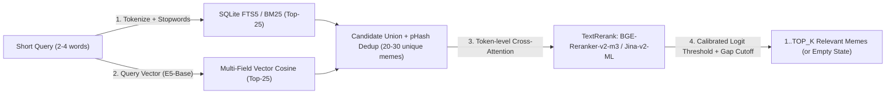

# 3. Solution Space & Recommended Architecture

This document evaluates engineering solutions tailored to MnemosyneM's Rust stack (`fastembed 7.1.0`, `rusqlite 0.32`, CPU inference, Gemini VLM pool, Telegram inline/bot search), including an exact inventory of local models already supported in the locked `fastembed` crate.

---

## 🧰 Built-in Capabilities in Locked `fastembed = "7.1.0"`

Inspecting `fastembed-7.1.0` source in the Cargo registry shows these ready-to-use capabilities with zero new FFI bindings:

| Module / Type | Relevant Multilingual / Vision Models in `fastembed 7.1.0` | Dims / Specs | Fit for MnemosyneM (UA + EN Memes) |
| :--- | :--- | :---: | :--- |
| **`TextEmbedding`** | `MultilingualE5Base` *(current, `1.1 GB` in `.fastembed_cache`)*, `MultilingualE5Small`, `MultilingualE5Large` (`1024`), `BGEM3` (`1024`), `EmbeddingGemma300MQ` / `Q4` (`768`) | `384–1024` | Fast Stage-1 recall, but limited by single-vector passage dilution & anisotropy |
| **`TextRerank`** | `RerankerModel::BGERerankerV2M3` (`rozgo/bge-reranker-v2-m3`), `RerankerModel::JINARerankerV2BaseMultiligual` (`jinaai/jina-reranker-v2-base-multilingual`) *(note typo `Multiligual` in crate enum)* | Cross-Encoder, max len `512` | **Ideal Stage-2 reranker** over Top-15–20 candidates: eliminates `3 vs 65 words` dilution & gives calibrated scores |
| **`Bgem3Embedding`** | `Bgem3Model::BGEM3Q` (`gpahal/bge-m3-onnx-int8`) | INT8, `1024`, max len `512` | Emits **dense + sparse + ColBERT** in one forward pass; strong candidate to evaluate if scaling corpus |
| **`SparseTextEmbedding`** | `SparseModel::BGEM3` (`BAAI/bge-m3`) | Learned sparse | Multilingual lexical weights without hand-rolled stemmers (heavy `model.onnx_data`) |
| **`ImageEmbedding`** *(feature `image-models`)* | `ClipVitB32`, `NomicEmbedVisionV15`, `Resnet50`, `UnicomVitB16` | `512–2048` | **Not suitable as primary UA text→meme search:** paired text encoders (`ClipVitB32`/`Nomic`) are EN-only *(already verified by legacy `clip-ViT-B-32` 581M & `nomic-embed-v1.5` 1012M artifacts in `.fastembed_cache`)* |

---

## 🚀 Phased Search Architecture

Below is the breakdown by phase, engineering cost, and trade-offs.

---

## 🛠️ Phase 0: Zero New Models, Zero Re-Indexing (Immediate Quick Wins)

All four fixes can be shipped in 1–2 hours with zero extra RAM or model downloads:

### 0.1. Fix `ocr_boost` in [`find_top_k`](file:///home/mykhailo/dev/pet/MnemosyneM/m_nemosyne_m/src/meme_store.rs#L694-L724)
* Replace `w.len() >= 3` (UTF-8 byte count!) with `w.chars().count() >= 3` (Unicode scalar count).
* Filter out **Ukrainian & English stopwords** (`"на"`, `"до"`, `"за"`, `"про"`, `"для"`, `"при"`, `"але"`, `"коли"`, `"що"`, `"як"`, `"the"`, `"for"`, `"and"`, etc.).
* Split text on non-alphanumeric delimiters (`!c.is_alphanumeric()`) instead of raw `.contains(w)` — guaranteeing `"на"` or `"очі"` never match inside `"СвіНАбони"` or `"ВНОЧІ"`.
* Apply soft prefix/stem matching on normalized whole tokens for words `>= 4` chars (`"касі"` ~ `"касах"`), and include clean non-spam `title` tokens.

### 0.2. Search-Time `phash` Deduplication
* After ranking in `find_top_k`, maintain a seen set of selected `phash` values (or cluster within Hamming distance $\le \text{MAX\_PHASH\_DISTANCE} = 5$ using [`hash_helper.rs`](file:///home/mykhailo/dev/pet/MnemosyneM/m_nemosyne_m/src/helpers/hash_helper.rs)).
* Immediately stops clones (`1793039502` + `1793525020`) from consuming multiple slots of `TOP_K`.

### 0.3. Relative Score Cutoff Instead of `best_score > 0.05`
* **Relative drop from Top-1:** When `#1` scores `0.874` (`1793039502`) and `#2` drops to `0.820` (`-0.054`), return **1 crisp result** rather than forcing filler (`score >= top1 - 0.032` when `#2` lacks lexical confirmation).
* **Weak-result guard:** If there are zero clean lexical/BM25 hits AND the top-to-tail spread (`top1 - top20`) is flat (`< 0.020`) at low raw cosine (`< 0.825`), return an empty list / "nothing relevant found" instead of random noise. *(Clean negative rejection is finalized by `TextRerank` in Phase 1B.)*

### 0.4. Structured, Concise VLM Prompt in [`vlm.rs`](file:///home/mykhailo/dev/pet/MnemosyneM/m_nemosyne_m/src/vlm.rs#L54-L71)
Eliminate prose boilerplate and English layout tags inside `ocr_text` by requesting structured fields:
* `ocr_text`: **verbatim meme text ONLY**, explicitly forbidding `*Top text:*`, `*Left side:*`, or Markdown asterisks.
* `scene_uk`: 1 crisp sentence (≤ 15 words) — *template, subjects, facial expression/action* (forbid `"Мем складається з..."` / `"На зображенні..."`).
* `meaning_uk`: 1 crisp sentence (≤ 18 words) — *core joke punchline and real-life situation when someone sends this meme*.
* `keywords_uk`: 6–10 dense Ukrainian tags/slang/synonyms.

> [!TIP]
> Keeping cleaned descriptions concise (~30–40 signal-dense words vs ~67 bloated words with 34% boilerplate) directly reduces Mean Pooling dilution without breaking keyword anchoring.

---

## 🧩 Phase 1A: Hybrid Retrieval — Vector + SQLite FTS5 / BM25

### Mechanism
1. Maintain a normalized lexical index (`ocr_clean`, `title`, `uk_description`, `en_description`) via **SQLite FTS5** (or a lightweight in-memory inverted BM25 index—building from scratch over 1,237 memes took only **`420.8 ms`** unoptimized and uses a few MB of RAM).
2. Normalize apostrophes, strip stopwords, and apply light Ukrainian suffix stemming (or prefix/trigram matching for words `>= 4` chars).

### Critical Warning from Experiment 2 (Avoid Blind Equal-Weight RRF)
Part 1B proved that **equal-weight RRF (`1/(60+v) + 1/(60+b)`) degrades pure-synonym retrieval (`25% -> 0% Hit@3`)** whenever a noisy stem overlaps an unrelated meme.
* **Best practice:** Use BM25 primarily for **Stage-1 Candidate Generation** (`Top-20 Vector ∪ Top-20 BM25`), or if scoring without a reranker, weight BM25 proportionally to rare-term (`IDF`) query coverage so single common-word matches never override top semantic hits.

---

## 🧠 Phase 1B: Two-Stage Retrieval + Cross-Encoder Reranking (`TextRerank`) — **Primary Accuracy Leap**

### Why a Cross-Encoder Directly Solves "3 Words vs 70 Words"
A bi-encoder (`MultilingualE5Base`) compresses the query and 70-word meme description **independently** into single vectors—forcing every topic sentence into an average.

A **Cross-Encoder (`TextRerank`)** evaluates `[CLS] query [SEP] meme_passage [SEP]` jointly with **full token-to-token self-attention**:
* Even when the meaning `"важко вранці відкрити очі"` resides solely in sentence #3 out of 5, cross-attention locks directly onto those tokens with zero dilution from background visual details.
* Cross-encoder logits are **calibrated per-pair (`sigmoid(logit) ∈ [0, 1]`)**, giving out-of-domain queries like `"квантова механіка синхрофазотрону"` near-zero scores (`< 0.05`) for clean empty-state cutoff.

### Model Options in `fastembed 7.1.0` & Resource Trade-offs

| Model (`RerankerModel`) | Architecture / Languages | Disk / RAM Footprint | Pros | Cons / Risks |
| :--- | :--- | :---: | :--- | :--- |
| **`JINARerankerV2BaseMultiligual`** (`jinaai/jina-reranker-v2-base-multilingual`) | ~278M params (Base), 100+ langs | **~1.1 GB FP32** (single `model.onnx`) | Faster on CPU than M3; strong multilingual cross-attention | Slightly weaker on nuanced Slavic idioms than M3 |
| **`BGERerankerV2M3`** (`rozgo/bge-reranker-v2-m3`) | ~560M params (XLM-R-large), 100+ langs | **~2.2 GB** (`model.onnx` + `model.onnx.data`) | Top-tier multilingual accuracy on Slavic paraphrases & tricky phrasing | Slower on CPU and adds ~2+ GB RAM atop E5 (`1.1 GB`) |

### Inline Latency Budget (Telegram 500 ms Debounce)
* **Anti-pattern:** Never run a Cross-Encoder across all 1,237 rows (~20+ seconds).
* **Recommended:** Stage 1 (`Top-15 Vector ∪ Top-10 BM25` ➔ ~20 unique candidates post-`phash` dedup) finishes in **`< 5 ms`**. Running `TextRerank` over only **15–20 candidates** (truncating cleaned text to ~150 tokens) keeps `/search` fast and can run in `tokio::task::spawn_blocking` (capped at Top-10–12 candidates with a small LRU query cache for `handle_inline_query`).
* *Validation required before prod rollout:* benchmark p50/p95 CPU latency and RSS memory of `JINARerankerV2BaseMultiligual` vs `BGERerankerV2M3` on target deployment hardware.

---

## 🧬 Phase 2: Balanced Multi-Vector Schema & Next-Gen Encoders

### 2.1. Balanced Multi-Vector (Applying the Lesson from `M3_Multi_Sent`)
Experiment 3 showed that splitting into 8–10 sentence vectors and taking raw `max_i` inflates false positives on paraphrases. If migrating SQLite to multiple embeddings per meme (`meme_embeddings(meme_id, field_kind, vec)`):
* Store **at most 3 structured vectors** per meme:
  1. `holistic`: `clean_ocr | summary | keywords` (preserves full joke context),
  2. `scene`: visual objects/template,
  3. `meaning`: situational punchline.
* Blend holistic context with best field match:
  $$\text{score} = 0.5 \cdot \cos(q, v_{\text{holistic}}) + 0.5 \cdot \max\big(\cos(q, v_{\text{holistic}}), \cos(q, v_{\text{scene}}), \cos(q, v_{\text{meaning}})\big)$$
  Retains exact-detail gains (`+0.05..0.07`) while preventing lucky unrelated sentence spikes.

### 2.2. Evaluating `Bgem3Embedding` (`Bgem3Model::BGEM3Q`)
`fastembed 7.1.0` includes `Bgem3Embedding` with **`Bgem3Model::BGEM3Q`** (`gpahal/bge-m3-onnx-int8`, INT8 quantized, dim `1024`), outputting in **a single forward pass**:
1. Dense embedding,
2. Learned multilingual sparse lexical weights (solving Ukrainian morphology/synonyms without custom stemmers),
3. Token-level **ColBERT (MaxSim)** vectors — mathematically solving 3-word vs 70-word asymmetry via token-level max-similarity!

**Trade-off:** Storing ColBERT token matrices in RAM consumes substantial memory (`~70 tokens × 1024 dims` per meme = tens/hundreds of MB at 1k–10k memes, GBs at 50k+). Storing Dense + Sparse first (or computing ColBERT only for Top-30 / using `TextRerank`) is far more RAM-efficient initially.

---

## 🖼️ Alternative A: Direct Visual Embeddings (`CLIP` / `NomicEmbedVision` / `SigLIP`)

`.fastembed_cache` already contains earlier trials with `Qdrant/clip-ViT-B-32-vision` (`336M`) + `text` (`245M`) and `nomic-embed-vision-v1.5` (`358M`) + `text` (`654M`). Why pure vision embeddings cannot replace VLM text search:

1. **Language mismatch in `fastembed 7.1.0`:** Built-in `ImageEmbeddingModel::ClipVitB32` and `NomicEmbedVisionV15` pair with **English-only** text encoders. Ukrainian queries require translation or integrating custom multilingual `SigLIP-2` / `OpenCLIP XLM-R` ONNX pipelines outside `fastembed`.
2. **Humor & caption blindness:** CLIP sees a kid squinting under a barbell, not the irony that the barbell says `"мої повіки"` (*my eyelids*) representing waking up tired.
3. **Where vision embeddings *do* add value:** **"Find visually similar memes"** (Image-to-Image template matching using the already-cached `ClipVitB32` or `NomicEmbedVisionV15`), or as a minor `0.15` signal on pure uncaptioned scene photos.

---

## 🤖 Alternative B: Search-Time LLM Query Rewriting / HyDE (Gemini)

Using Gemini to expand `"тренування в спортзалі"` into synonyms/scenarios before vector search:
* **Why NOT on the hot path (especially inline mode):** adds `300–1,000 ms` HTTP latency on every search and burns free-tier generative quota reserved for meme indexing.
* **Viable niche:** Strictly as an explicit opt-in fallback button (`"🔍 Deep AI Search"`) shown when local Hybrid + Reranker returns zero confident matches.

---

## 🎯 Alternative C: Gemini Decisions API (`gemini-decision-1`) — Calibrated Judgments Without Free-Text Parsing

Unlike generative Gemini models that stream token-by-token prose/JSON (requiring fragile cleanup like `unwrap_vlm_value`, `deserialize_flexible_bool`, and layout-prefix stripping in [`src/vlm.rs`](file:///home/mykhailo/dev/pet/MnemosyneM/m_nemosyne_m/src/vlm.rs#L35-L385)), **`gemini-decision-1`** (`POST https://generativelanguage.googleapis.com/v1beta/decisions`) evaluates **up to 1,000 closed-form questions** against a shared multimodal context in **one single forward pass** with **`0` output tokens** (~50–100 ms compute, ~150–250 ms end-to-end; AI Studio Free Tier: **`200 RPM` / `50K TPM` / `10K RPD`**).

Supported question types:
* **`noul` (Yes / No):** calibrated probability `0.01..0.99` + `confidence`.
* **`choice` (Single-Select):** evaluates 2–255 labeled options (`criteria`) with per-option probabilities.
* **`score` (Rubric Rating):** evaluates 2–255 ordered rubric levels, returning a probability-weighted expected score.

### Where `gemini-decision-1` Fits Best in MnemosyneM

1. **Cloud Stage-2 Search Reranker / Borderline Validator (Alternative to 2.2 GB Local `TextRerank`):**
   * **Use case:** Pass a user's `/search` query + Top-15 Stage-1 candidates (`ocr_text + description_uk`, ~1,000–1,500 input tokens total) and evaluate 15 parallel `noul` / `score` questions (*"Does meme #i genuinely match the user's intent?"*).
   * **Benefit:** Solves `"3 words vs 45–65 words"` dilution and borderline rejection (`weak_results` `< 0.82`) with **0 GB extra RAM** on the host and calibrated confidence scores, without burning generative `500 RPD` quota.
   * **Caveat:** Keep inline hot-path (`handle_inline_query` while typing) strictly local (`Vector + FTS5`); use `gemini-decision-1` for explicit `/search`, `"Deep Search"` fallback, or when `weak_results` / low-confidence ties occur.
2. **Pre-Ingestion NSFW, Safety & Spam Gate (Before Generative `Flash Lite`):**
   * **Problem today:** Every image/GIF immediately hits scarce `500 RPD` Flash Lite quota, and generative `is_nsfw` booleans still falsely reject drawn comedy comics (e.g., `id=1794231524`, `vlm_version=-2`).
   * **With `Decision 1`:** Run 3 `noul` checks (`is_real_photographic_nudity`, `is_drawn_art_or_comic_meme`, `is_non_meme_ad_or_receipt`) with separate `10K RPD` quota. Reject spam/explicit photos in ~200 ms before touching `500 RPD` generative quota, and store calibrated `safety_score` (`0.01..0.99`) for `Milestone 4`.
3. **Deterministic Taxonomy Tagging for `/tags`:**
   * Batch 30–100 fixed Ukrainian category tags as `noul` questions in **one call per meme** over compact existing text (`ocr_text + description_uk`, ~100 input tokens -> keeps within **`50K TPM`** easily and can backfill ~1,390 memes inside one day's `10K RPD` quota). Zero tag drift (`#it` vs `#айті` vs `#програмування`).
4. **Output Sanity Validation:**
   * Spot-check or validate generated `uk_description` quality (e.g., catching legacy-style failures where 72% of `v1` rows had English text in `description_uk`) with a single `noul` check rather than brittle regex heuristics.

> [!IMPORTANT]
> **Quota Bottleneck Note:** On Free Tier, `gemini-decision-1` gives **200 RPM / 10K RPD** but **50K TPM** (input tokens per minute). Prefer passing compact text (`ocr_text + description_uk`) for bulk tasks (tagging, reranking), and reserve image/MP4 payloads for single-upload gates so `50K TPM` is not saturated during backfills.

---

## 🗺️ Updated Rollout Plan (Status as of Nov 18, 2026)

| Step | Changes | Status / Observed Notes | Migration Needed |
| :--- | :--- | :--- | :---: |
| **Step 1 (Phase 0 — Shipped)** | Fixed UTF-8 byte & `.contains()` bug in [`lexical_helper.rs`](file:///home/mykhailo/dev/pet/MnemosyneM/m_nemosyne_m/src/helpers/lexical_helper.rs); added [`deduplicate_by_phash`](file:///home/mykhailo/dev/pet/MnemosyneM/m_nemosyne_m/src/meme_store.rs#L855), [`select_relative`](file:///home/mykhailo/dev/pet/MnemosyneM/m_nemosyne_m/src/meme_store.rs#L886), [`weak_results`](file:///home/mykhailo/dev/pet/MnemosyneM/m_nemosyne_m/src/meme_store.rs#L904), concise `VLM_PROMPT`, and `vlm_version=2` reprocessing | **✅ Done** (`13/13` unit tests pass; `621` rows reprocessed, avg `64.4 -> 44.2` words, `0%` English leak on `v2` vs `72%` on `v1`). *Note:* `weak_results` skips `<20` candidates (e.g. small `private_only` sets) | In progress via background worker (`768` `v1` rows left) |
| **Step 2 (Phase 1A)** | Add SQLite FTS5 (`memes_fts`) indexing normalized/stemmed `ocr_text + description_uk + description_en + clean title` + `Top-20 Vector ∪ Top-20 FTS5` union (fixing the current gap where `count_lexical_matches` sees only `ocr_text`) | **Next** | Minor (virtual FTS5 table from existing rows) |
| **Step 3 (Phase 1B)** | Stage-2 Reranking & Validation: benchmark local `fastembed::TextRerank` (`JINARerankerV2BaseMultiligual` / `BGERerankerV2M3`) **or** batch `gemini-decision-1` (`POST /v1beta/decisions`) for `/search` reranking, NSFW pre-gate, and `/tags` classification | **Planned** | None (for rerank) / `tags` tables for `/tags` |
| **Step 4 (Phase 2)** | Automated golden evaluation suite (`Hit@3`, `MRR`, `syn_zero`, `NEGATIVE`); evaluate balanced 3-vector blending or `BGEM3Q` as catalog scales | **Planned** | Yes (if changing embeddings) |

