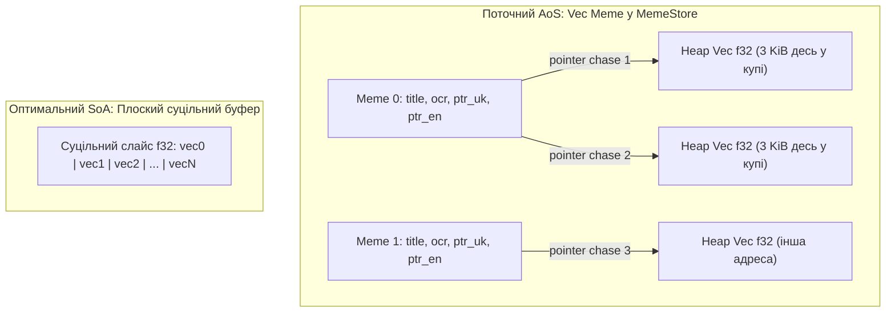

# ⚡ Розділ 01: SIMD AVX2 / FMA, Кеші CPU та Чесний Бенчмаркінг

> **Мета розділу:** зрозуміти, чому «просте множення двох векторів» упирається не стільки в математику, скільки в конвеєр процесора та ієрархію кешів, як отримати **×3 прискорення ще до SIMD**, а потім **×4–×8** на рівні 256-бітних регістрів AVX2 + FMA.

---

## 🧮 1. Безкоштовне прискорення ×3 ще до SIMD: Косинус $\rightarrow$ Скалярний добуток

Подивимось, як зараз у боті рахується схожість у [`cosine_similarity`](file:///home/mykhailo/dev/pet/MnemosyneM/m_nemosyne_m/src/meme_store.rs#L2452-L2468):

```rust
let mut dot_product = 0f32;
let mut sqrt_sq_a = 0f32;
let mut sqrt_sq_b = 0f32;

for (&x, &y) in a.iter().zip(b.iter()) {
    dot_product += x * y;
    sqrt_sq_a += x * x;
    sqrt_sq_b += y * y;
}

Ok(dot_product / (sqrt_sq_a.sqrt() * sqrt_sq_b.sqrt()))
```

Геометрично косинусна подібність — це косинус кута між двома векторами:

$$\cos(\mathbf{a}, \mathbf{b}) = \frac{\mathbf{a} \cdot \mathbf{b}}{\|\mathbf{a}\|_2 \, \|\mathbf{b}\|_2} = \frac{\sum_{i=0}^{d-1} a_i b_i}{\sqrt{\sum_{i=0}^{d-1} a_i^2} \cdot \sqrt{\sum_{i=0}^{d-1} b_i^2}}$$

Але що таке **L2-нормалізований вектор**? Це вектор довжиною рівно $1$: $\|\mathbf{v}\|_2 = 1$.
Перевірка реальної бази `mnemosynem_v2.db` показала, що `MultilingualE5Base` у [`ClipEngine`](file:///home/mykhailo/dev/pet/MnemosyneM/m_nemosyne_m/src/engine.rs#L1-L47) **вже повертає L2-нормалізовані вектори** ($\|\mathbf{v}\|_2 = 1.000000$).

Коли обидва вектори лежать на одиничній гіперсфері ($\|\mathbf{a}\|_2 = 1$ і $\|\mathbf{b}\|_2 = 1$), знаменник дорівнює $1 \cdot 1 = 1$:

$$\cos(\mathbf{a}, \mathbf{b}) = \mathbf{a} \cdot \mathbf{b} = \sum_{i=0}^{767} a_i b_i$$

Що ми викидаємо в смітник прямо зараз на кожному мемі?
1. Два зайвих накопичення квадратів (`x * x`, `y * y`) — у **3 рази менше арифметики** і у **3 рази менше ланцюгів залежностей у регістрах**!
2. Два повільні інструкції `sqrt()` та одне ділення `f32` у кінці (а ділення та корінь — найповільніші операції ALU: ~10–15 тактів проти 3–4 тактів у множення).

> [!TIP]
> **Золоте правило інваріанту:** щоб `dot(a, b)` гарантовано дорівнював `cosine(a, b)` навіть якщо колись оновиться модель у `fastembed`, виконуй дешеву `l2_normalize()` **один раз** при записі мема в базу і **один раз** для вектора запиту. Після цього на гарячому шляху пошуку живе лише чистий `dot_product`.

---

## 🧠 2. Як процесор насправді читає вектори: Кеші, AoS vs SoA, Roofline Model

Щоб писати швидкий Rust-код, треба дивитися на нього очима заліза. Ось точна карта пам’яті нашого хоста (**AMD Ryzen 5 5600H, Zen 3**):

| Рівень пам’яті | Обсяг нашому CPU | Латентність | Що туди влазить із нашої бази (`d = 768`) |
| :--- | :--- | :--- | :--- |
| **Регістри YMM** | `16 × 32 B = 512 B` | `0–1` такт | 128 чисел `f32` (1/6 одного вектора) |
| **L1d Cache** (на ядро) | `32 KiB` | `~4` такти (~1 ns) | **Вектор запиту (`3 KiB`)** + індексні лічильники |
| **L2 Cache** (на ядро) | `512 KiB` | `~12` тактів (~3 ns) | ~166 векторів `f32` або ~665 векторів `SQ8` |
| **L3 Cache** (спільний) | `16 MiB` | `~40` тактів (~10 ns) | ~5 460 векторів `f32` (**вся наша поточна база 9.13 MiB!**) |
| **DRAM** (ОЗП) | Гігабайти | `~200+` тактів (~60–80 ns) | Десятки/сотні тисяч векторів |

### Кеш-лінії (Cache Lines) та апаратний префетчер
Процесор **ніколи** не читає з DRAM одне число `f32` (4 байти). Мінімальна одиниця обміну з пам’яттю — **кеш-лінія розміром 64 байти** (`16 × f32`).
Наш вектор `d = 768` займає $768 \times 4 = 3\,072$ байти, тобто рівно $3\,072 / 64 = 48$ кеш-ліній. Якщо дані лежать у пам’яті суцільним блоком, апаратний *hardware prefetcher* CPU бачить лінійний патерн читання (`+64`, `+64`, `+64`...) і підвантажує наступні кеш-лінії в L1/L2 **наперед**, ще поки ядро рахує поточну ітерацію.

### Чому поточний `Vec<Meme>` шкодить кешу (AoS vs SoA)
Поглянь на поточну структуру [`MemeStore`](file:///home/mykhailo/dev/pet/MnemosyneM/m_nemosyne_m/src/meme_store.rs#L38-L42) та [`Meme`](file:///home/mykhailo/dev/pet/MnemosyneM/m_nemosyne_m/src/database/entity/meme.rs#L5-L23): це класичний **AoS (Array of Structures)**.



1. Щоб дістати `embedding_uk` і `embedding_en`, процесор має спочатку прочитати структуру `Meme` (забиваючи кеш непотрібними під час скорингу полями `title`, `ocr_text`, `file_tg_id`, `source_url`), а потім стрибнути за **двома різними вказівниками в Heap** (*pointer chasing*).
2. У плоскому буфері **SoA (Structure of Arrays)** усі вектори лежать підряд: `slot * 768 .. (slot + 1) * 768`. Промахів кешу через метадані — нуль.

### Roofline Model: Де стеля швидкості?
Не завжди винен CPU. **Roofline Model** визначає, чи задача обмежена обчисленнями (*Compute-bound*), чи шиною пам’яті (*Memory-bandwidth-bound*), через **Операційну інтенсивність**:

$$I = \frac{\text{FLOPs}}{\text{Bytes з DRAM}}$$

Для скалярного добутку вектор запиту `query` (`3 KiB`) лежить у кеші L1. Для кожного вектора з бази ми читаємо $768 \times 4 = 3\,072$ байти і робимо $768$ множень + $768$ додавань $= 1\,536$ FLOPs:

$$I = \frac{1\,536\text{ FLOPs}}{3\,072\text{ байти}} = 0.5\text{ FLOP/byte}$$

Тепер рахуємо стелю на Ryzen 5 5600H:
* **Обчислювальна стеля ядра (AVX2 + FMA):** 2 порти FMA × 8 `f32` × 2 FLOPs = **32 FLOPs/такт**. На частоті ~4.0 GHz це **~128 GFLOP/s** (одне ядро!).
* **Стеля шини DRAM** (типовий двоканальний DDR4 ~35–40 GB/s):
  $$\text{Max GFLOP/s з DRAM} = I \times \text{Bandwidth} \approx 0.5 \times 35\text{ GB/s} = 17.5\text{ GFLOP/s}$$

> [!IMPORTANT]
> **Ось головний інсайт Roofline:**
> Коли вектори **поміщаються в L3/L2/L1** (як наші поточні `9.13 MiB` у `16 MiB` L3), пропускна здатність кешу на порядок вища (~200–400 GB/s), і скалярний код не встигає «годувати» кеш — тут **SIMD дає вибуховий приріст у 4×–8×**.
> Але коли база виростає до `586 MiB` ($100\,000$ мемів) і випадає в DRAM, повний скан упирається у **17.5 GFLOP/s стелю пам’яті**, хоч би який крутий SIMD ти написав! Щоб пробити цю стелю, потрібні **HNSW** (читати в 200 разів менше векторів) та **SQ8** (читати в 4 рази менше байт на вектор, піднімаючи інтенсивність з $0.5$ до **$2.0\text{ FLOP/byte}$**!).

---

## 🚀 3. Як працює SIMD (AVX2 + FMA) на рівні регістрів

### Від скаляра (SISD) до векторних інструкцій (SIMD)
* **SISD (Single Instruction, Single Data):** звичайний регістр тримає $1 \times \text{f32}$. Цикл на 768 елементів виконує 768 кроків.
* **AVX2 (Advanced Vector Extensions 2):** 16 векторних регістрів `YMM0..YMM15`, кожен шириною **256 біт = 32 байти = 8 чисел `f32`** (або 32 байти `u8`/`i8`). Одна інструкція обробляє одразу 8 елементів:

```text
YMM0 (a[0..8]):   [ a0 | a1 | a2 | a3 | a4 | a5 | a6 | a7 ]
YMM1 (b[0..8]):   [ b0 | b1 | b2 | b3 | b4 | b5 | b6 | b7 ]
                    │    │    │    │    │    │    │    │
                    ▼    ▼    ▼    ▼    ▼    ▼    ▼    ▼   (_mm256_fmadd_ps)
YMM2 (acc):       [ acc0 + a0*b0 | acc1 + a1*b1 | ... | acc7 + a7*b7 ]
```

### FMA (`_mm256_fmadd_ps`): два в одному + вища точність
Інструкція Fused Multiply-Add (`vfmadd231ps`) рахує `a * b + acc` за **один крок**:
1. Менше інструкцій і вища пропускна здатність.
2. **Одне округлення замість двох** (проміжний добуток `a * b` тримається у підвищеній точності до додавання `acc`), тобто результат ще й точніший за наївний цикл `x * y + sum`!

### Секрет старших інженерів: Чотири незалежні акумулятори (`acc0..acc3`)
Чому не можна написати просто один акумулятор `acc = _mm256_fmadd_ps(a, b, acc)` у циклі?

На архітектурі AMD Zen 3 інструкція `vfmaddps` має **Latency = 4 такти**, але **Throughput = 2 інструкції за такт** (два окремі виконавчі порти).
Якщо використовувати **один** `acc`, кожна наступна ітерація циклу **змушена чекати 4 такти**, поки попередня завершить запис у `acc` — і 7 із 8 слотів конвеєра простоюють!

Рішення — **розкрутка циклу (loop unrolling) на 4 незалежні акумулятори**:
* `acc0` збирає елементи `0..8`
* `acc1` збирає елементи `8..16`
* `acc2` збирає елементи `16..24`
* `acc3` збирає елементи `24..32`

Магія чисел нашої задачі: за одну ітерацію ми з’їдаємо $4 \times 8 = 32$ числа `f32` (`128` байт = рівно 2 кеш-лінії!). Для `d = 768` цикл робить рівно $768 / 32 = 24$ ітерації — **жодного «хвоста»!** Водночас `4` акумулятори + `4` завантажених регістри легко поміщаються у 16 доступних регістрів `YMM0..YMM15` без витіснення на стек (*register spilling*).

### Горизонтальне додавання (Horizontal Reduction)
Наприкінці циклу ми додаємо `acc0 + acc1 + acc2 + acc3` в один `YMM` (`[s0, s1, s2, s3 | s4, s5, s6, s7]`), а далі «згортаємо» 8 смуг у єдиний скаляр `f32`:
1. Розрізаємо 256-бітний `YMM` на дві 128-бітні половини (`_mm256_castps256_ps128` + `_mm256_extractf128_ps::<1>`) і додаємо їх $\rightarrow$ `[s0+s4, s1+s5, s2+s6, s3+s7]`.
2. Переміщуємо верхню пару у нижню (`_mm_movehl_ps`) і додаємо $\rightarrow$ 2 числа.
3. Переставляємо друге число у перше (`_mm_shuffle_ps`) і додаємо (`_mm_add_ss`) $\rightarrow$ фінальний `f32` у `_mm_cvtss_f32`!

> Чому горизонтальне додавання не роблять усередині циклу (наприклад, через `_mm256_hadd_ps`)? Бо `hadd` — повільна мікрокодована інструкція (~7 тактів), яка ламає паралельність. Ми робимо її **один раз** після всіх 24 ітерацій!

---

## 💻 4. Повний приклад коду на Rust (AVX2 + Runtime Detection + Fallback)

Нижче — готовий до компіляції ідіоматичний модуль із безпечним публічним API, перевіркою інструкцій у рантаймі (`is_x86_feature_detected!`) та fallback-ом для ARM/старих x86 CPU.

```rust
#[inline]
pub fn l2_normalize(v: &mut [f32]) {
    let norm_sq = dot_product(v, v);
    if norm_sq > 0.0 {
        let inv_norm = norm_sq.sqrt().recip();
        for x in v.iter_mut() {
            *x *= inv_norm;
        }
    }
}

/// Безпечний публічний інтерфейс: обирає AVX2+FMA у рантаймі або fallback.
/// Обидва вектори мають бути попередньо L2-нормалізовані.
#[inline]
pub fn dot_product(a: &[f32], b: &[f32]) -> f32 {
    assert_eq!(a.len(), b.len(), "Vector dimension mismatch");

    #[cfg(any(target_arch = "x86", target_arch = "x86_64"))]
    {
        if std::arch::is_x86_feature_detected!("avx2")
            && std::arch::is_x86_feature_detected!("fma")
        {
            // SAFETY: ми щойно перевірили наявність AVX2 та FMA на поточному CPU,
            // а довжини слайсів однакові (assert_eq! вище).
            return unsafe { dot_product_avx2(a, b) };
        }
    }

    dot_product_scalar(a, b)
}

/// Скалярний fallback з 4-кратною розкруткою: дає компілятору змогу
/// застосувати авто-векторизацію на ARM NEON або SSE2.
#[inline]
pub fn dot_product_scalar(a: &[f32], b: &[f32]) -> f32 {
    let mut acc0 = 0.0f32;
    let mut acc1 = 0.0f32;
    let mut acc2 = 0.0f32;
    let mut acc3 = 0.0f32;

    let mut chunks_a = a.chunks_exact(4);
    let mut chunks_b = b.chunks_exact(4);

    for (ca, cb) in chunks_a.by_ref().zip(chunks_b.by_ref()) {
        acc0 += ca[0] * cb[0];
        acc1 += ca[1] * cb[1];
        acc2 += ca[2] * cb[2];
        acc3 += ca[3] * cb[3];
    }

    let rem = chunks_a
        .remainder()
        .iter()
        .zip(chunks_b.remainder().iter())
        .map(|(&x, &y)| x * y)
        .sum::<f32>();

    (acc0 + acc1) + (acc2 + acc3) + rem
}

#[cfg(any(target_arch = "x86", target_arch = "x86_64"))]
#[target_feature(enable = "avx2,fma")]
unsafe fn dot_product_avx2(a: &[f32], b: &[f32]) -> f32 {
    #[cfg(target_arch = "x86")]
    use std::arch::x86::*;
    #[cfg(target_arch = "x86_64")]
    use std::arch::x86_64::*;

    let mut acc0 = _mm256_setzero_ps();
    let mut acc1 = _mm256_setzero_ps();
    let mut acc2 = _mm256_setzero_ps();
    let mut acc3 = _mm256_setzero_ps();

    let mut chunks_a = a.chunks_exact(32);
    let mut chunks_b = b.chunks_exact(32);

    // SAFETY: `chunks_exact(32)` гарантує наявність >= 32 елементів (128 байт)
    // для кожного `ca` та `cb`, а `target_feature` гарантує AVX2 + FMA.
    unsafe {
        for (ca, cb) in chunks_a.by_ref().zip(chunks_b.by_ref()) {
            let pa = ca.as_ptr();
            let pb = cb.as_ptr();

            let va0 = _mm256_loadu_ps(pa);
            let vb0 = _mm256_loadu_ps(pb);
            acc0 = _mm256_fmadd_ps(va0, vb0, acc0);

            let va1 = _mm256_loadu_ps(pa.add(8));
            let vb1 = _mm256_loadu_ps(pb.add(8));
            acc1 = _mm256_fmadd_ps(va1, vb1, acc1);

            let va2 = _mm256_loadu_ps(pa.add(16));
            let vb2 = _mm256_loadu_ps(pb.add(16));
            acc2 = _mm256_fmadd_ps(va2, vb2, acc2);

            let va3 = _mm256_loadu_ps(pa.add(24));
            let vb3 = _mm256_loadu_ps(pb.add(24));
            acc3 = _mm256_fmadd_ps(va3, vb3, acc3);
        }

        // Зводимо 4 акумулятори в один YMM
        let sum01 = _mm256_add_ps(acc0, acc1);
        let sum23 = _mm256_add_ps(acc2, acc3);
        let sum256 = _mm256_add_ps(sum01, sum23);

        // Горизонтальна редукція 8 -> 4 -> 2 -> 1
        let lo = _mm256_castps256_ps128(sum256);
        let hi = _mm256_extractf128_ps::<1>(sum256);
        let sum128 = _mm_add_ps(lo, hi);
        let hi64 = _mm_movehl_ps(sum128, sum128);
        let sum64 = _mm_add_ps(sum128, hi64);
        let hi32 = _mm_shuffle_ps::<0x01>(sum64, sum64);
        let sum32 = _mm_add_ss(sum64, hi32);
        let mut total = _mm_cvtss_f32(sum32);

        // Залишок (< 32 елементів): для d = 768 цей шлях порожній!
        for (&x, &y) in chunks_a.remainder().iter().zip(chunks_b.remainder().iter()) {
            total += x * y;
        }
        total
    }
}
```

### Важливі нюанси про цей код
1. **Чому `_mm256_loadu_ps` (unaligned), а не `_mm256_load_ps` (aligned)?**
   На сучасних процесорах (включно з Zen 3), коли адреса фактично вирівняна на 32 байти (а ми вирівняємо її у `.vec`), `_mm256_loadu_ps` виконується з **абсолютно нульовим штрафом** — так само швидко, як `_mm256_load_ps`. Зате якщо хтось передасть звичайний `Vec<f32>` (вирівняний лише на 4 байти), програма не впаде з `SIGSEGV`.
2. **Порівняння з `RUSTFLAGS="-C target-cpu=native"`:**
   Якщо скомпілювати весь проєкт із `target-cpu=native`, компілятор сам оптимізує і залишок коду під Zen 3 (і навіть авто-векторизує `dot_product_scalar`). Проте паттерн із `#[target_feature(enable = "avx2,fma")]` + `is_x86_feature_detected!` робить бінарник **переносним** (він запуститься на будь-якому x86_64 сервері, але на AVX2-залізі автоматично увімкне турбо-ядро).
3. **Маленька деталь порядку додавання в `f32`:** додавання чисел із плаваючою комою не асоціативне, тому через інший порядок сумування + FMA результат `dot_product_avx2` може відрізнятися від `cosine_similarity` на $\sim 10^{-7}$–$10^{-6}$. Для юніт-тестів використовуй перевірку `abs(a - b) < 1e-5`.

---

## 📊 5. Чесний бенчмаркінг: Criterion + Flamegraph + Типові пастки

Щоб бачити реальні числа, а не самообман, використовуємо `criterion` (`dev-dependency`) та `cargo-flamegraph`.

### Конфігурація `Cargo.toml` і `benches/vector_bench.rs`
*(Оскільки `benches/` лінкується лише до бібліотечного крейту [`src/lib.rs`](file:///home/mykhailo/dev/pet/MnemosyneM/m_nemosyne_m/src/lib.rs#L1-L7), модуль `vector_engine` обов’язково треба буде експортувати у `lib.rs`!)*

```rust
// benches/vector_bench.rs (концепт для етапу реалізації)
use criterion::{BenchmarkId, Criterion, Throughput, black_box, criterion_group, criterion_main};
use m_nemosyne_m::vector_engine::simd::{dot_product, dot_product_scalar};

fn bench_batch_scan(c: &mut Criterion) {
    let dim = 768usize;
    let query = vec![0.036f32; dim];

    let mut group = c.benchmark_group("batch_scan_768d");
    for n in [1_558usize, 50_000usize] {
        let matrix = vec![0.036f32; n * dim];
        let bytes = (n * dim * std::mem::size_of::<f32>()) as u64;
        group.throughput(Throughput::Bytes(bytes));

        group.bench_with_input(BenchmarkId::new("scalar_dot", n), &n, |b, _| {
            b.iter(|| {
                let mut best = f32::NEG_INFINITY;
                for vec in matrix.chunks_exact(dim) {
                    let s = dot_product_scalar(black_box(&query), black_box(vec));
                    if s > best { best = s; }
                }
                black_box(best)
            })
        });

        group.bench_with_input(BenchmarkId::new("avx2_fma_dot", n), &n, |b, _| {
            b.iter(|| {
                let mut best = f32::NEG_INFINITY;
                for vec in matrix.chunks_exact(dim) {
                    let s = dot_product(black_box(&query), black_box(vec));
                    if s > best { best = s; }
                }
                black_box(best)
            })
        });
    }
    group.finish();
}

criterion_group!(benches, bench_batch_scan);
criterion_main!(benches);
```

### Як читати `cargo flamegraph`
Команда: `cargo flamegraph --bench vector_bench -- --bench` (або профілювання під навантаженням).
На що дивитися на графіку полум’я:
* **Широкий стовпець у `dot_product_avx2`:** добре — CPU зайнятий корисною математикою (або стрімінгом із кешу/DRAM).
* **Широкі стовпці у `Vec::clone`, `blob_to_embedding`, `HashMap::get`, `sqrt`:** паразитні витрати навколо пошуку (пам’ять, алокації, хешування).
* **Перевірка пропускної здатності (Throughput):** Criterion автоматично покаже `GiB/s` для кожного прогону! Якщо на `N = 1,558` ти бачиш десятки GB/s (L3 cache), а на `N = 50,000` швидкість падає до ~30–40 GB/s (DRAM wall) — ти наживо побачив *Roofline Model* в дії.

### 4 класичні пастки мікробенчмарків
1. **Забутий `black_box`:** компілятор бачить, що результат не використовується (або вхідні дані константні), обчислює все під час компіляції і видаляє цикл (час = `0.3 ns`).
2. **Міряти лише 1 вектор (`a · b`) у циклі:** два вектори по 3 KiB сидять у регістрах/L1 кеші! Ти виміряєш пікову швидкість L1 (~200+ GB/s), але вона не має нічого спільного з реальним сканом бази в L3 або DRAM.
3. **Порівнювати debug vs release або забути `target-cpu`:** завжди запускай `cargo bench` (він збирається з профілем `release`), і тестуй як з дефолтними флагами, так і з `RUSTFLAGS="-C target-cpu=native"`.
4. **Плутати прогрів кешу:** реальний бот між запитами робить купу іншої роботи (Telegram JSON, SQLite), тому гарячий L1/L2 може встигнути витіснитися.

---

**Далі:** коли скалярний добуток уже прискорений до межі фізики шини пам’яті, єдиний спосіб прискоритися ще на 2 порядки — **читати в сотні разів менше векторів**. Про це в [Розділі 02: Графовий індекс HNSW](file:///home/mykhailo/dev/pet/MnemosyneM/m_nemosyne_m/docs/vector-engine-research/02-hnsw-graph-index.md).
