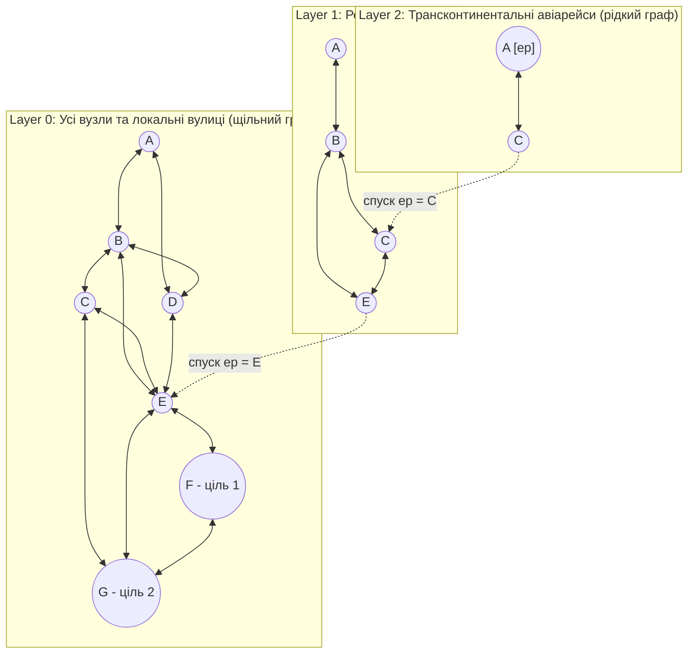

# 🕸️ Розділ 02: Графовий індекс HNSW (Hierarchical Navigable Small World)

> **Мета розділу:** зрозуміти, чому класичні дерева не працюють у 768 вимірах, як математика «тісного світу» (*Small World*) поєднується зі структурою *Skip List*, розібрати точні алгоритми Malkov & Yashunin (2018) на числовому прикладі «на пальцях» і спроєктувати cache-friendly граф у Rust без `Rc<RefCell<>>`.

---

## 🌌 1. Чому B-Tree та KD-Tree вмирають у 768 вимірах (Curse of Dimensionality)

У звичайних БД пошук за $O(\log N)$ дає B-Tree (у 1D) або KD-Tree (у 2D–3D). Чому не можна просто побудувати KD-Tree для наших 768-вимірних ембедінгів?

1. **Вибух об’єму та кутів гіперкуба:** у просторі $\mathbb{R}^{768}$ одиничний гіперкуб має $2^{768} \approx 10^{231}$ кутів (для порівняння, у спостережуваному Всесвіті $\sim 10^{80}$ атомів). Ділити такий простір ортогональними гіперплощинами на «кімнати» безглуздо — майже кожна точка лежить біля якоїсь межі поділу.
2. **Концентрація відстаней (Distance Concentration):** коли розмірність $d$ росте, відношення між відстанню до найближчого і найдальшого сусіда прямує до 1. (Ми це бачили наживо в `docs/search-research`: у `MultilingualE5Base` випадкові пари мемів мають середній косинус `0.8175`!). У результаті гіперсфера пошуку запиту в KD-Tree перетинає майже всі гілки дерева, і *backtracking* змушений перевірити ~99% вузлів — пошук деградує до повільнішого за повний перебір $O(N)$!

**Рішення — Approximate Nearest Neighbor (ANN):** ми відмовляємося від математичної гарантії 100.0% точності і погоджуємося на **98–99% Recall@K** (майже завжди знаходимо істинно найближчих сусідів), натомість падаючи зі складності $O(N)$ до **$O(\log N)$**.

---

## 🌍 2. Теоретичні основи: Small World $\rightarrow$ Skip List $\rightarrow$ NSW $\rightarrow$ HNSW

У HNSW сходяться дві, здавалося б, далекі ідеї інформатики та теорії графів:

1. **Експеримент Стенлі Мілгрема (1967) та графи «Тісного світу» (Watts & Strogatz, 1998):**
   Світ людей налічує мільярди вузлів, але будь-які дві людини поєднані ланцюжком у середньому з ~6 рукостискань, бо граф має одночасно **високу кластеризацію** (сусіди знайомі між собою) та **рідкісні дальні «мости»** (діаметр графа росте як $O(\log N)$).
2. **Теорема навігаційності Джона Клейнберга (2000):**
   *Короткі шляхи в графі ще не означають, що їх легко знайти жадібним локальним алгоритмом!* Щоб агент, бачачи лише своїх прямих сусідів, міг за полілогарифмічний час $O(\log^2 N)$ дістатися цілі, **довжини зв’язків мають підкорятися степеневому закону** — потрібні й «трансконтинентальні авіарейси», й «міжміські поїзди», і «вулиці в районі».
3. **Skip List (Вільям П’ю, 1990) + NSW $\rightarrow$ HNSW (Malkov & Yashunin, 2018):**
   Замість того щоб складати всі типи зв’язків в один плоский граф **NSW** (де вузли високого ступеня перетворюються на хаби-пляшкові горлечка), **HNSW** розносить «авіарейси», «поїзди» та «вулиці» по дискретних шарах, як у **Skip List**:



* На верхніх шарах мало вузлів, але довгі ребра: одним стрибком перелітаємо через пів семантичного простору.
* На нижньому шарі `Layer 0` присутні **усі $100\%$ вузлів** із щільними локальними зв’язками.

---

## 🎲 3. Математика висоти вузлів: $l = \lfloor -\ln(U) \cdot m_L \rfloor$

Коли новий мем додається в HNSW, його максимальний шар $l$ обирається випадково за експоненціальним законом:

$$l = \lfloor -\ln(U) \cdot m_L \rfloor, \quad \text{де } U \sim \text{Uniform}(0, 1), \quad m_L = \frac{1}{\ln(M)}$$

*(У реалізації затискаємо $U \ge 10^{-9}$, щоб уникнути $\ln(0) = -\infty$.)*

При значенні $m_L = \frac{1}{\ln(M)}$ імовірність піднятися на наступний шар падає рівно в $M$ разів на кожному рівні: $P(\text{layer} \ge k) = M^{-k}$. Ось як це виглядає для стандартного **`M = 16`** ($m_L \approx 0.3607$):

| Максимальний шар вузла | Ймовірність $P(l = k)$ | Скільки вузлів при `N = 1,558` | Скільки вузлів при `N = 100,000` |
| :---: | :---: | :---: | :---: |
| **Лише `Layer 0`** | `93.75%` ($1 - 1/16$) | `~1,461` | `~93,750` |
| **До `Layer 1`** | `5.86%` | `~91` | `~5,859` |
| **До `Layer 2`** | `0.366%` | `~5–6` | `~366` |
| **До `Layer 3`** | `0.023%` | `0–1` | `~23` |
| **До `Layer 4`** | `0.0014%` | `0` | `~1–2` |

Очікувана висота всього дерева всього **2–3 шари зараз** і **~4 шари на 100 000 мемів**! Тому кількість вузлів нагорі мізерна, а пошук робить лише кілька десятків кроків.

---

## ⚙️ 4. Точні алгоритми Malkov & Yashunin (2018)

Для L2-нормалізованих векторів у HNSW зручно працювати з **метрикою відстані** (менше = ближче):

$$d(\mathbf{a}, \mathbf{b}) = 1.0 - (\mathbf{a} \cdot \mathbf{b}) \in [0.0,\ 2.0]$$

### Серце рушія: `SEARCH-LAYER(q, ep, ef, lc)` (Algorithm 2)
Це модифікований *Beam Search* на одному шарі `lc` шириною пучка `ef` (*exploration factor*):
* **`visited`:** множина вже відвіданих вузлів (у швидкому коді — масив `visited_gen: Vec<u32>`, не `HashSet`!).
* **`C` (Candidates — Min-Heap):** кандидати, сусідів яких ми ще **не розкрили**, відсортовані за *найменшою* відстанню до запиту `q`.
* **`W` (Results — Max-Heap, розмір $\le ef$):** найкращі `ef` знайдених вузлів, де на верхівці купи лежить **найгірший** (найдальший) із поточних переможців!

**Цикл алгоритму:**
1. Додаємо точку входу `ep` у `visited`, `C` і `W`.
2. Поки `C` не порожня:
   * Дістаємо з `C` найближчого нерозкритого кандидата `c` з відстанню $d(c, q)$.
   * Беремо найгіршого переможця `f` із верхівки `W` з відстанню $d(f, q)$.
   * **Умова зупинки:** якщо $d(c, q) > d(f, q)$ (і `W` вже містить `ef` елементів) — **STOP!** Навіть найближчий нерозкритий кандидат уже гірший за всіх наших `ef` переможців.
   * Інакше перебираємо всіх сусідів `e` вузла `c` на шарі `lc`:
     * Якщо `e` ще не у `visited`: позначаємо `visited`, рахуємо $d(e, q)$.
     * Якщо `W.len() < ef` або $d(e, q) < d(f, q)$: додаємо `e` у `C` і у `W`; якщо `W.len() > ef`, викидаємо найдальший елемент із `W`.

> [!TIP]
> **Трюк без аллокацій для `visited`:** замість створення `HashSet<u32>` чи обнулення `Vec<bool>` на 100 000 елементів перед кожним пошуком, тримай у стейті `visited_gen: Vec<u32>` та лічильник `current_gen: u32`. Щоб «очистити» множину перед запитом, достатньо зробити **`current_gen += 1`** за $O(1)$! Перевірка `visited_gen[id] == current_gen` працює за 1 інструкцію у кеші L1.

### Пошук Top-K: `K-NN-SEARCH(q, K, efSearch)` (Algorithm 5)
1. **Фаза 1 (швидке наближення, `ef = 1`):** починаємо з глобальної точки входу `entry_point` на максимальному шарі $L_{\max}$. Спускаємося з $L_{\max}$ до шару $1$: на кожному шарі викликаємо `SEARCH-LAYER(q, ep, ef = 1, layer)`, і єдиний знайдений найближчий вузол стає новим `ep` для шару нижче.
2. **Фаза 2 (точний пошук на `Layer 0`):** викликаємо `SEARCH-LAYER(q, ep, ef = max(efSearch, K), layer = 0)`.
3. Сортуємо `W` і віддаємо найкращі `K` вузлів.

### Вставка нового вузла: `INSERT(q)` (Algorithm 1)
1. Генеруємо висоту $l = \lfloor -\ln(U) \cdot m_L \rfloor$.
2. Якщо $L_{\max} > l$: жадібно (`ef = 1`) спускаємося з $L_{\max}$ до $l + 1$, знаходячи найближчу точку входу `ep`.
3. Для кожного шару $lc$ від $\min(L_{\max}, l)$ вниз до `0`:
   * Запускаємо `W = SEARCH-LAYER(q, ep, ef = efConstruction, lc)`.
   * Обираємо до `M` сусідів за допомогою евристики (див. нижче!).
   * Додаємо **двонаправлені** ребра `q <-> neighbor`.
   * Якщо у якогось існуючого сусіда кількість ребер перевищила ліміт (`M_max` на верхніх шарах або `M_max0 = 2 * M` на Layer 0), обрізаємо його список сусідів тією самою евристикою.
   * Оновлюємо `ep` для наступного шару нижче.
4. Якщо $l > L_{\max}$: новий вузол стає новою глобальною точкою входу `entry_point`.

### Критична деталь: `SELECT-NEIGHBORS-HEURISTIC` (Algorithm 4) vs Наївний Top-M
Чому не можна просто взяти `M` найближчих кандидатів із `W`?

Уяви два кластери мемів: щільний кластер «коти» (20 дуже схожих мемів) і кластер «собаки» трохи далі. Якщо новий вузол `P` стоїть у кластері «коти», і ми просто візьмемо `M = 16` найближчих сусідів — **усі 16 ребер підуть усередину кластера «коти»**, і граф може розірвати місток до «собак» (ізольована компонента зв’язності)!

**RNG-евристика (Relative Neighborhood Graph pruning):**
Перебираємо кандидатів `e` у порядку зростання відстані $d(e, q)$. Додаємо `e` у фінальний список сусідів $R$, **тільки якщо** `e` ближчий до нового вузла `q`, ніж до будь-якого вже обраного сусіда `r ∈ R`:

$$\forall r \in R:\quad d(e, q) < d(e, r)$$

Геометричний сенс: якщо кандидат `Y` ховається «за спиною» вже взятого сусіда `X` (у тому самому напрямку, і $d(Y, X) \le d(Y, P)$), ми **пропускаємо** `Y`, бо до нього легко дійти транзитом `P -> X -> Y`, а вільний слот ребра залишаємо для вузла `Z` в **іншому кутовому напрямку**! (При потребі відкинутих кандидатів добирають у самому кінці до `M`, якщо після проходу менше `M` ребер).

---

## ✍️ 5. Покроковий приклад «на пальцях» (точна математика)

Перевіримо обидва механізми на маленькому 2D-прикладі, де замість косинуса для наочності візьмемо квадрат евклідової відстані $d^2(p, u) = (p_x - u_x)^2 + (p_y - u_y)^2$ (цілі числа, легко перевірити в умі).

### Приклад A: Трасування `K-NN-SEARCH` (`K = 2`, `efSearch = 3`)
Маємо 7 вузлів і точку запиту **`Q = (7, 5)`**:

| Вузол | Координати | Макс. шар | Точна $d^2(\cdot, Q)$ | Сусіди по шарах |
| :---: | :---: | :---: | :---: | :--- |
| **`A`** | `(0, 0)` | `L2` (Entry Point) | $(7-0)^2 + (5-0)^2 = \mathbf{74}$ | L2: `[C]`; L1: `[B]`; L0: `[B, D]` |
| **`B`** | `(4, 1)` | `L1` | $3^2 + 4^2 = \mathbf{25}$ | L1: `[A, C, E]`; L0: `[A, C, D, E]` |
| **`C`** | `(8, 0)` | `L2` | $1^2 + 5^2 = \mathbf{26}$ | L2: `[A]`; L1: `[B, E]`; L0: `[B, E, G]` |
| **`D`** | `(2, 4)` | `L0` | $5^2 + 1^2 = \mathbf{26}$ | L0: `[A, B, E]` |
| **`E`** | `(6, 4)` | `L1` | $1^2 + 1^2 = \mathbf{2}$ | L1: `[B, C]`; L0: `[B, C, D, F, G]` |
| **`F`** | `(7, 6)` | `L0` | $0^2 + 1^2 = \mathbf{1}$ | L0: `[E, G]` |
| **`G`** | `(9, 5)` | `L0` | $2^2 + 0^2 = \mathbf{4}$ | L0: `[C, E, F]` |

**Покрокове виконання:**
1. **`Layer 2` (`ef = 1`):** старт у `ep = A(74)`. Дивимось сусіда `C(26)`. Оскільки $26 < 74$, переходимо в `C`. Інших кращих сусідів немає $\rightarrow$ спуск на `Layer 1` з **`ep = C(26)`**.
2. **`Layer 1` (`ef = 1`):** старт у `C(26)`. Сусіди на L1: `B(25)` та `E(2)`. Найкращий `E(2)` $\rightarrow$ стрибаємо в `E`. У `E` на L1 сусіди `B(25)` і `C(26)` гірші за `2` $\rightarrow$ спуск на `Layer 0` з **`ep = E(2)`**.
3. **`Layer 0` (`efSearch = 3`):**
   * Ініціалізація: `visited = {E}`, `C = [E(2)]`, `W = [E(2)]`.
   * **Крок 1:** дістаємо `E(2)` з `C`. Перевіряємо його сусідів на L0: `B(25), C(26), D(26), F(1), G(4)`.
     * `B(25)` і `C(26)` влазять, бо `W` ще менша за 3: `W = [E(2), B(25), C(26)]`, найгірший у `W` зараз `C(26)`.
     * `D(26)`: $26 \not< 26$ $\rightarrow$ не проходить!
     * `F(1)`: $1 < 26$ $\rightarrow$ входить у `C` і `W`, витісняє `C(26)`. `W = [F(1), E(2), B(25)]`.
     * `G(4)`: $4 < 25$ $\rightarrow$ входить у `C` і `W`, витісняє `B(25)`. **`W = [F(1), E(2), G(4)]`** (найгірший у `W` тепер `G(4)`).
   * **Крок 2:** дістаємо найменшого з `C` — це `F(1)`. Перевірка $1 \le 4$ (може покращити `W`), але всі сусіди `F` (`E, G`) вже у `visited`.
   * **Крок 3:** дістаємо `G(4)` ($4 \le 4$). Усі сусіди `G` (`C, E, F`) уже у `visited`.
   * **Крок 4:** наступний мінімум у `C` — `B(25)`. Перевіряємо умову зупинки: $d^2(B, Q) = 25 > \text{worst}(W) = 4$ $\rightarrow$ **STOP!**
4. **Результат (`K = 2`):** **`F(1)` і `E(2)`**! Ми перевірили відстані лише до 6 із 7 точок тут (а на базі в $100\,000$ вузлів це було б ~250 вузлів замість $100\,000$).

### Приклад B: Як працює RNG-евристика `SELECT-NEIGHBORS`
Нехай для нового вузла `P = (0, 0)` шукаємо `M = 2` ребра серед кандидатів:
1. `X = (1, 0)` ($d^2(P, X) = 1$) $\rightarrow$ перший у списку, беремо: $R = [X]$.
2. `Y = (2, 0)` ($d^2(P, Y) = 4$) $\rightarrow$ рахуємо відстань між `Y` та вже взятим `X`: $d^2(Y, X) = (2-1)^2 + 0^2 = 1$. Перевіряємо правило $d^2(P, Y) < d^2(Y, X)$: чи $4 < 1$? **НІ!** Вузол `Y` лежить за `X` в тому ж напрямку, тому **не витрачаємо на нього ребро**!
3. `Z = (0, 3)` ($d^2(P, Z) = 9$) $\rightarrow$ рахуємо $d^2(Z, X) = (0-1)^2 + (3-0)^2 = 1 + 9 = 10$. Чи $9 < 10$? **ТАК!** Приймаємо `Z` $\rightarrow$ **`R = [X, Z]`**. Два ребра покрили ортогональні напрямки замість дублювання одного кластера!

---

## 🎛️ 6. Гіперпараметри та компроміси

| Параметр | Що контролює | Вплив при збільшенні | Рекомендація для MnemosyneM |
| :--- | :--- | :--- | :--- |
| **`M`** | Макс. кількість вихідних ребер на шарах $\ge 1$ (на Layer 0 зазвичай `M_max0 = 2 * M`) | $\uparrow$ Recall (особливо у високих вимірах), $\uparrow$ RAM графа, $\downarrow$ швидкість | **`M = 16`** (`M_max0 = 32`) |
| **`efConstruction`** | Ширина пучка `ef` під час побудови графа (`INSERT`) | $\uparrow$ якість графа та Recall, $\uparrow$ час індексації (~лінійно), **не впливає** на RAM | **`128`–`200`** |
| **`efSearch`** | Ширина пучка `ef` під час пошуку (`K-NN-SEARCH`), можна міняти на кожен запит! | $\uparrow$ Recall (`efSearch` має бути $\ge K$), $\uparrow$ час запиту | **`48`–`100`** (залежно від `candidate_limit`) |
| **`mL`** | Нормуючий множник висоти шарів | Стандартне значення із статті дає оптимум | **`1.0 / (M as f64).ln()`** |

**Скільки пам’яті їсть сам граф?**
На `M = 16` (`M_max0 = 32` внизу + в середньому ~1–2 ребра на верхніх шарах), кожне ребро — це `u32` (`4` байти). Навіть якщо заповнені всі слоти, граф на 1 вузол займає лише **~136–180 байт** (для порівняння, один вектор `f32` — `3,072` байти, тобто граф додає лише ~5–10% поверх вартості векторів!).

---

## 🦀 7. Ідіоматичний Rust: Чому `Vec<Node>` + `u32` Arena перемагає `Rc<RefCell<>>`

Якщо спробувати написати граф у Rust «по-джавівськи» через `Rc<RefCell<Node>>` або сирі вказівники `*const Node`:
* Боротьба з *Borrow Checker*-ом при двонаправлених циклах у графі + падіння в рантаймі через `RefCell::borrow_mut()`.
* Витоки пам’яті через цикли `Rc` при видаленні вузлів.
* Кожен `Node` — окрема аллокація на Heap $\rightarrow$ шалені Cache Miss-и при обході.

**Рішення в системному Rust — індексна Арена (Arena Allocation):**

```rust
use std::cmp::Reverse;
use std::collections::BinaryHeap;

pub type NodeId = u32;

#[derive(Clone, Copy, Debug)]
struct Candidate {
    dist: f32,
    id: NodeId,
}

impl PartialEq for Candidate {
    fn eq(&self, other: &Self) -> bool {
        self.id == other.id && self.dist.to_bits() == other.dist.to_bits()
    }
}
impl Eq for Candidate {}

impl PartialOrd for Candidate {
    fn partial_cmp(&self, other: &Self) -> Option<std::cmp::Ordering> {
        Some(self.cmp(other))
    }
}

impl Ord for Candidate {
    fn cmp(&self, other: &Self) -> std::cmp::Ordering {
        // total_cmp коректно впорядковує f32 без паніки на NaN
        self.dist
            .total_cmp(&other.dist)
            .then_with(|| self.id.cmp(&other.id))
    }
}

pub struct HnswIndex {
    /// layers[level][node_id] -> список сусідів u32 (або плоский CSR для ще кращого кешу)
    layers: Vec<Vec<Vec<NodeId>>>,
    /// М'яке видалення: true = вузол видалено з видачі, але лишається прохідним у графі
    tombstones: Vec<bool>,
    entry_point: Option<NodeId>,
    max_level: usize,
    m: usize,
    m_max0: usize,
    ef_construction: usize,
    m_l: f64,
}
```

### Як виглядає `SEARCH-LAYER` на цій арені з Generation Array

```rust
pub struct SearchScratch {
    visited_gen: Vec<u32>,
    current_gen: u32,
}

impl SearchScratch {
    pub fn next_query(&mut self, node_count: usize) -> u32 {
        if self.visited_gen.len() < node_count {
            self.visited_gen.resize(node_count, 0);
        }
        self.current_gen = self.current_gen.wrapping_add(1);
        if self.current_gen == 0 {
            self.visited_gen.fill(0);
            self.current_gen = 1;
        }
        self.current_gen
    }
}
```

Всередині `search_layer`:
* `candidates: BinaryHeap<Reverse<Candidate>>` — **Min-Heap** (найменший `dist` наверху).
* `results: BinaryHeap<Candidate>` — **Max-Heap** (найбільший `dist` наверху, щоб за $O(1)$ перевіряти `.peek()` і викидати найгіршого).

### Видалення вузлів (Tombstones) — чому не можна просто вирізати вузол
Якщо просто видалити вузол і всі його ребра з HNSW, можна розірвати важливий місток на `Layer 1` або `Layer 0`, і частина графа стане недосяжною!
Тому всі індустріальні двигуни (`hnswlib`, `Qdrant`, `Lucene`) роблять **Tombstone Deletion**:
1. Ставимо прапорець `tombstones[node_id] = true`.
2. Під час `search_layer` **продовжуємо ходити крізь ребра видалених вузлів** (графіку потрібна маршрутизація!), але **забороняємо додавати видалений вузол у фінальний буфер результатів користувача** (і не рахуємо його у `K` валідних результатів).
3. Коли частка `tombstones` перевищує поріг (наприклад, **> 15–20%** від індексу), у фоні перезбираємо граф начисто без видалених слотів.

---

**Далі:** як завантажувати десятки гігабайтів векторів за `0 ms` через `mmap` без небезпечного UB, і як стиснути вектори в 4 рази за допомогою квантування **SQ8** — у [Розділі 03: Zero-Copy `mmap` та SQ8](file:///home/mykhailo/dev/pet/MnemosyneM/m_nemosyne_m/docs/vector-engine-research/03-mmap-and-sq8-quantization.md).
