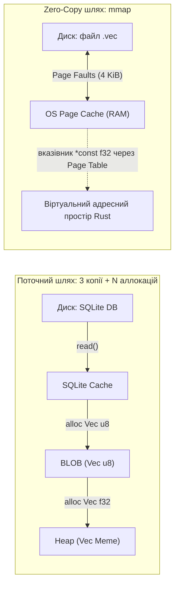

# 💾 Розділ 03: Zero-Copy `mmap` Сховище (`.vec`) та Скалярне Квантування (SQ8)

> **Мета розділу:** розібрати, як ОС проєктує файл із диска прямо у віртуальну пам’ять процесу (`mmap`) без зайвого копіювання та алокацій, які смертельні UB-пастки чатують на `unsafe` + `memmap2` у Rust, і як **SQ8** стискає базу у **4 рази**, пришвидшуючи пошук на великому масштабі без втрати якості.

---

## 📄 Частина A: Віртуальна пам’ять ОС та Zero-Copy `mmap`

### 1. Проблема поточного запуску в MnemosyneM
Подивимось, що відбувається при кожному старті бота у [`MemeStore::open`](file:///home/mykhailo/dev/pet/MnemosyneM/m_nemosyne_m/src/meme_store.rs#L804-L849) та [`blob_to_embedding`](file:///home/mykhailo/dev/pet/MnemosyneM/m_nemosyne_m/src/helpers/embeding_helper.rs#L7-L13):

1. SQLite читає сторінки з диска в свій внутрішній кеш.
2. `rusqlite` копіює `embedding_uk` і `embedding_en` у тимчасові `Vec<u8>` (`BLOB`).
3. `blob_to_embedding` алокує **два нові `Vec<f32>`** у Heap для кожного мема і по 4 байти збирає числа.
4. Ми маємо **$3\times$ копіювання пам’яті**, тисячі дрібних алокацій та лінійний час старту, що росте разом із базою.



### 2. Як `mmap` працює на рівні ядра Linux
Системний виклик `mmap()` (`memmap2::Mmap` у Rust) **не читає файл з диска** під час відкриття! Замість цього ядро ОС створює запис у **таблиці віртуальних сторінок (Page Table)** процесу: «діапазон адрес `0x7f...` відповідає байтам файлу `.vec` на диску».

Що відбувається, коли код у Rust вперше торкається елемента `vectors[slot * 768]`:
1. MMU (Memory Management Unit) бачить, що віртуальна сторінка (`4 KiB`) ще не прив’язана до фізичної рамки RAM $\rightarrow$ генерує переривання **Page Fault**.
2. **Major Page Fault:** якщо сторінки немає в RAM, ядро ОС читає один 4 KiB блок (або пакет із *readahead*) із SSD у **OS Page Cache** і відображає ту саму фізичну сторінку прямо у наш адресний простір. **Нуль копій у `userspace`!**
3. **Minor Page Fault:** якщо файл уже читався (наприклад, після попереднього запуску бота), дані вже сидять у **OS Page Cache** — ядро лише оновлює покажчик у Page Table за наносекунди!
4. Якщо системі раптом не вистачатиме RAM під інші програми, ядро саме вивантажить «холодні» чисті сторінки `.vec` із кешу за алгоритмом LRU — бот не впаде з OOM.

> [!TIP]
> **Трюк `madvise`:** через `mmap.advise(Advice::Random)` можна підказати ядру Linux вимкнути агресивне послідовне дочитування (*readahead*) під час стрибків по графу HNSW, а для повного скану — навпаки вказати `Advice::Sequential`.

---

## 🧱 3. Проєктування бінарного формату `.vec` файлу

Щоб AVX2 міг читати вектори напряму з `mmap` без розпакування та з ідеальним вирівнюванням під кеш-лінії (`64 B`), проєктуємо суворий бінарний формат.

### Заголовок файлу (рівно `64` байти = 1 кеш-лінія)

| Зсув (байти) | Розмір | Поле | Значення / Призначення |
| :---: | :---: | :--- | :--- |
| `0..4` | `4 B` | `magic: [u8; 4]` | `b"MNEM"` — сигнатура, щоб не прочитати сміття |
| `4..6` | `2 B` | `version: u16` | `1` (Little-Endian) — версія формату |
| `6..8` | `2 B` | `flags: u16` | Біт 0: endianness (`0=LE`); біти `1..2`: режим (`0=f32`, `1=sq8`) |
| `8..12` | `4 B` | `dim: u32` | `768` — розмірність вектора |
| `12..16` | `4 B` | `reserved0: u32` | `0` (щоб `vector_count` стояв на кратному 8 зсуві!) |
| `16..24` | `8 B` | `vector_count: u64` | Кількість активних слотів у файлі |
| `24..32` | `8 B` | `payload_offset: u64` | `64` — старт даних, вирівняний на **64 байти**! |
| `32..64` | `32 B` | `reserved / crc32` | Запас під контрольну суму або ID схеми БД |

### Математика вирівнювання (Alignment)
* Початок payload: байт `64` $\implies 64 \pmod{32} = 0$ і $64 \pmod{64} = 0$.
* Розмір 1 вектора `f32` (`d = 768`): $768 \times 4 = 3\,072\text{ B} \implies 3\,072 \pmod{64} = 0$.
* Розмір 1 вектора `SQ8` (`d = 768`): $768 \times 1 = 768\text{ B} \implies 768 \pmod{64} = 0$.

**Кожен вектор із номером $i$ автоматично стартує на межі 32-байтної AVX2-лінії та 64-байтної кеш-лінії CPU!** Якщо у майбутньому розмірність моделі не буде кратною `16`, просто додаєш `stride_bytes = align_up(dim * elem_size, 64)`.

### Безпечне дозаписування (Append-Only Lifecycle)
Не можна змінювати розмір уже замапленого `Mmap` або перевикористовувати активні слайси `&[f32]` після розширення файлу. Правильний життєвий цикл:
1. Тримаємо у стейті: `file: File`, `mmap: Mmap`, `count: u64`.
2. При вставці нового мема (маючи `&mut self`, тобто ексклюзивний доступ!):
   * Дописуємо нові байти в кінець файлу через `File` + оновлюємо `vector_count` у заголовку + `file.sync_data()`.
   * Створюємо **новий** `unsafe { Mmap::map(&self.file)? }` і замінюємо старий `self.mmap`. Оскільки метод бере `&mut self`, компілятор Rust на рівні лайфтаймів гарантує, що жоден пошуковий потік не тримає старий `&[f32]`!

---

## ⚠️ 4. Критичні правила безпеки `unsafe` + `memmap2` у Rust

Чому `Mmap::map` у крейті `memmap2` позначено як `unsafe`? Бо операційна система не може дати гарантій моделі пам’яті Rust. Ось **4 реальні загрози Undefined Behavior (UB)** і як їх закрити:

| Небезпека | Що піде не так у рантаймі / компіляторі | Як ми захищаємося в MnemosyneM |
| :--- | :--- | :--- |
| **1. Зовнішнє обрізання файлу (`SIGBUS`)** | Якщо інший процес викличе `truncate()` на `.vec`, читання за межею нового кінця миттєво вб’є процес сигналом `SIGBUS` | Файл `.vec` відкриває й змінює **лише один процес бота** (плюс `fs2::FileExt::try_lock_exclusive` на старті) |
| **2. Порушення імутабельності `&[f32]`** | Компілятор Rust вважає, що дані за `&[f32]` ніколи не змінюються. Зовнішній запис у ту саму пам’ять під час читання — миттєвий Data Race / UB | Записуємо лише під `&mut self` (і `Mutex`), і **лише дозаписуємо** в нові слоти поза поточним `mmap.len()`, після чого робимо re-map |
| **3. Невирівняний вказівник (`cast` у `f32`)** | `std::slice::from_raw_parts(ptr as *const f32, ...)` вимагає `ptr as usize % align_of::<f32>() == 0`, інакше UB | Перевіряємо вирівнювання `payload_offset >= 64` і `ptr.align_offset(align_of::<f32>()) == 0` при відкритті (або `bytemuck::try_cast_slice`) |
| **4. Невідповідність Endianness / Розміру** | Читання битого або обірваного після краху `.vec` файлу | Перевірка `magic`, `flags`, `file.len() >= payload_offset + count * stride`. Якщо щось не зійшлося — перебудова `.vec` із SQLite! |

```rust
// Приклад безпечного доступу до вектора без UB-сюрпризів
pub fn vector_slice(&self, slot: usize) -> &[f32] {
    let start = self.payload_offset + slot * self.dim * std::mem::size_of::<f32>();
    let end = start + self.dim * std::mem::size_of::<f32>();
    let bytes = &self.mmap[start..end]; // гарантований bounds check!

    // bytemuck (або перевірений assert на вирівнювання + довжину):
    let (prefix, floats, suffix) = unsafe { bytes.align_to::<f32>() };
    debug_assert!(prefix.is_empty() && suffix.is_empty(), "Unaligned .vec slot!");
    floats
}
```

---

## 🗜️ Частина B: Scalar Quantization (SQ8) — Стиснення ×4

### 1. Навіщо SQ8, якщо диск не шкода?
Головний виграш **SQ8** — навіть не економія місця на диску, а **пропускна здатність шини пам’яті та обсяг кешу L3**:
* За $10\,000$ мемів вектори `f32` займають `58.59 MiB` і **не влазять** у наш `16 MiB` L3 кеш.
* У форматі **SQ8** (`u8`/`i8`) ті самі $10\,000$ мемів стискаються до **`14.65 MiB`** — і **знову повністю сідають в L3!**
* Кількість байтів через шину DRAM падає в **4 рази**, піднімаючи стелю Roofline Model у **4 рази**!

### 2. Геометрія 768-вимірної сфери та наші реальні дані (`mnemosynem_v2.db`)
У просторі високої розмірності $\mathbb{R}^d$ на одиничній сфері ($\sum_{i=0}^{d-1} v_i^2 = 1$) середній квадрат однієї координати дорівнює $1/d$, а стандартне відхилення:

$$\sigma \approx \frac{1}{\sqrt{768}} \approx 0.0361$$

Тому координати ніколи не займають весь теоретичний діапазон `[-1.0, +1.0]`! Прямий замір `mnemosynem_v2.db` показав фактичні межі по всій базі:
**`min = -0.2215`, `max = +0.2070`** ($\approx \pm 6\sigma$).

> [!IMPORTANT]
> **Чому це критично для квантування:**
> Якщо наївно квантувати `[-1.0, +1.0]` у `0..=255`, крок сітки становить $\Delta = 2.0 / 255 \approx 0.00784$, і **78% усіх доступних значень `u8` простоюють порожніми!**
> Якщо квантувати реальний діапазон `[-0.2215, +0.2070]` (або локальні `[min, max]` кожного вектора), крок зменшується до $\Delta \approx 0.4285 / 255 \approx 0.00168$ — **у 4.6× вища точність при тій самій пам’яті!**

### 3. Формули квантування та деквантування
* **Асиметричне квантування (`u8`, діапазон `0..=255`):** зберігаємо `v_min: f32` та `scale: f32` (`8` байт метаданих на вектор або в окремому SoA-масиві, щоб вектори залишались кратними `64 B`):
  $$s = \frac{v_{\max} - v_{\min}}{255}, \qquad q_i = \text{clamp}\!\left(\text{round}\!\left(\frac{v_i - v_{\min}}{s}\right),\, 0,\, 255\right), \qquad \hat{v}_i = v_{\min} + s \cdot q_i$$
* **Симетричне квантування (`i8`, діапазон `-127..=+127`):** нуль завжди лишається нулем ($q=0 \iff \hat{v}=0$), потрібне лише одне число `scale = abs_max / 127.0`:
  $$q_i = \text{clamp}\!\left(\text{round}\!\left(\frac{v_i}{s}\right),\, -127,\, 127\right), \qquad \hat{v}_i = s \cdot q_i$$

---

## 🔢 4. Покроковий числовий приклад SQ8 (точна перевірка)

Візьмемо два точні 4D одиничні вектори (перевір норму: $(-0.2)^2 + 0.4^2 + 0.8^2 + (-0.4)^2 = 0.04 + 0.16 + 0.64 + 0.16 = 1.00$!):
* Запит: $\mathbf{a} = [-0.4,\; +0.2,\; +0.8,\; -0.4]$ ($\|\mathbf{a}\|_2 = 1.0$)
* Документ: $\mathbf{b} = [-0.2,\; +0.4,\; +0.8,\; -0.4]$ ($\|\mathbf{b}\|_2 = 1.0$)
* **Точний скалярний добуток:**
  $$\mathbf{a} \cdot \mathbf{b} = (-0.4)(-0.2) + (0.2)(0.4) + (0.8)(0.8) + (-0.4)(-0.4) = 0.08 + 0.08 + 0.64 + 0.16 = \mathbf{0.960000}$$

**Крок 1. Квантуємо документ $\mathbf{b}$ у `u8` (`0..=255`):**
* $v_{\min} = -0.4$, $v_{\max} = +0.8 \implies s_b = \frac{0.8 - (-0.4)}{255} = \frac{1.2}{255} \approx 0.00470588$.
* $q_0 = \text{round}\big(\frac{-0.2 - (-0.4)}{1.2} \cdot 255\big) = \text{round}(42.5) = \mathbf{43}$ *(у Rust `f32::round()` округлює `.5` від нуля $\rightarrow$ `43`)*
* $q_1 = \text{round}\big(\frac{0.4 + 0.4}{1.2} \cdot 255\big) = \text{round}(170.0) = \mathbf{170}$
* $q_2 = \text{round}\big(\frac{0.8 + 0.4}{1.2} \cdot 255\big) = \text{round}(255.0) = \mathbf{255}$
* $q_3 = \text{round}\big(\frac{-0.4 + 0.4}{1.2} \cdot 255\big) = \text{round}(0.0) = \mathbf{0}$
* Отже, у пам’яті замість 16 байт `f32` лежить **`[43, 170, 255, 0]` (4 байти)** + `(v_min = -0.4, s_b = 1.2/255)`.

**Крок 2. Швидкий скалярний добуток БЕЗ деквантування у масив `f32`:**
Розкриваємо дужки для $\mathbf{a} \cdot \hat{\mathbf{b}}$:

$$\mathbf{a} \cdot \hat{\mathbf{b}} = \sum_{i=0}^{d-1} a_i (v_{\min} + s_b \, q_i) = v_{\min} \underbrace{\sum_{i=0}^{d-1} a_i}_{\text{рахуємо 1 раз для } \mathbf{a}} + \; s_b \sum_{i=0}^{d-1} a_i q_i$$

Підставляємо наші числа:
* $\sum a_i = -0.4 + 0.2 + 0.8 - 0.4 = \mathbf{+0.2}$
* $\sum a_i q_i = (-0.4)(43) + (0.2)(170) + (0.8)(255) + (-0.4)(0) = -17.2 + 34.0 + 204.0 + 0 = \mathbf{220.8}$
* Результат:
  $$\mathbf{a} \cdot \hat{\mathbf{b}} = (-0.4)(0.2) + \frac{1.2}{255}(220.8) = -0.08 + 1.039059 = \mathbf{0.959059}$$

Похибка всього **`0.000941`** (< 0.1%), а на 768 вимірах похибки округлення додатково взаємно компенсуються!

---

## ⚡ 5. Цілочисельний SIMD на нашому CPU: AVX2 `_mm256_maddubs_epi16`

Хоча наш Ryzen 5 5600H не має `AVX-512 VNNI` (`vpdpbusd`), в **AVX2** є фантастична пара інструкцій, яка множить **32 байти за раз**:
1. `_mm256_maddubs_epi16(u, s)` — бере 32 **беззнакові (`u8`)** елементи `u` та 32 **знакові (`i8`)** елементи `s`, множить попарно і додає кожні два сусідні добутки у **16 чисел `i16`**:
   $$p_k = u_{2k}\cdot s_{2k} + u_{2k+1}\cdot s_{2k+1}$$
2. `_mm256_madd_epi16(p, ones_i16)` — множить ці 16 `i16` на `1` і згортає пари в **8 безпечних 32-бітних `i32`** (без ризику переповнення суми в `i16` на довгих векторах!).

### Пастка сатурації (Overflow Gotcha) та елегантне рішення!
Інструкція `_mm256_maddubs_epi16` виконує **насичене (saturated)** додавання в `i16` (затискає у `[-32768, +32767]`).
Якщо просто взяти `u ∈ [0, 255]` та `s ∈ [-128, 127]`, пара `255 * 127 + 255 * 127 = 64,770` **переповнить `32,767` і тихо спотворить результат!**

**Рішення (7-bit query × 8-bit doc):**
* Документи кодуємо симетрично в **`i8` на `[-127, +127]`** (`scale_b = abs_max / 127.0`).
* Запит кодуємо асиметрично в **7-бітний `u8` на `[0, 127]`** (`scale_a = (max - min) / 127.0`).
* Максимально можливий модульний добуток пари: $127 \times 127 + 127 \times 127 = 32\,258 \le 32\,767$ (а мінус — $-32\,258 \ge -32\,768$). **Сатурація математично неможлива!**

Тоді скалярний добуток:
$$\mathbf{a} \cdot \mathbf{b} \approx a_{\min} s_b \Big(\sum_i q_{b,i}\Big) + s_a s_b \Big(\sum_i u_{a,i} q_{b,i}\Big)$$

Де $\sum_i q_{b,i}$ рахується один раз при індексації мема, а $\sum_i u_{a,i} q_{b,i}$ летить в AVX2 по **32 виміри за крок (`768 / 32 = 24` інструкції!)**:

```rust
#[cfg(any(target_arch = "x86", target_arch = "x86_64"))]
#[target_feature(enable = "avx2")]
pub unsafe fn dot_u7_i8_avx2(u_query: &[u8], i_doc: &[i8]) -> i32 {
    #[cfg(target_arch = "x86")]
    use std::arch::x86::*;
    #[cfg(target_arch = "x86_64")]
    use std::arch::x86_64::*;

    debug_assert_eq!(u_query.len(), i_doc.len());
    unsafe {
        let ones = _mm256_set1_epi16(1);
        let mut acc = _mm256_setzero_si256();

        for (uq, id) in u_query.chunks_exact(32).zip(i_doc.chunks_exact(32)) {
            let vu = _mm256_loadu_si256(uq.as_ptr() as *const __m256i);
            let vs = _mm256_loadu_si256(id.as_ptr() as *const __m256i);
            let prod_i16 = _mm256_maddubs_epi16(vu, vs);
            let prod_i32 = _mm256_madd_epi16(prod_i16, ones);
            acc = _mm256_add_epi32(acc, prod_i32);
        }

        // Редукція 8 x i32 -> 1 x i32
        let lo128 = _mm256_castsi256_si128(acc);
        let hi128 = _mm256_extracti128_si256::<1>(acc);
        let sum128 = _mm_add_epi32(lo128, hi128);
        let hi64 = _mm_unpackhi_epi64(sum128, sum128);
        let sum64 = _mm_add_epi32(sum128, hi64);
        let hi32 = _mm_shuffle_epi32::<0x01>(sum64);
        let sum32 = _mm_add_epi32(sum64, hi32);
        let mut total = _mm_cvtsi128_si32(sum32);

        for (&u, &s) in u_query
            .chunks_exact(32)
            .remainder()
            .iter()
            .zip(i_doc.chunks_exact(32).remainder().iter())
        {
            total += (u as i32) * (s as i32);
        }
        total
    }
}
```

---

## 🎯 6. Двоетапний трюк індустрії: SQ8 + Oversampled `f32` Rescoring

Навіть якщо чистий SQ8 іноді дає ~96–98% Recall@10 замість 99.5%, це легко лікується стандартом **Qdrant / Vespa / Milvus**:
1. **Етап А (у гарячій RAM / L3):** HNSW або Flat-скан працює повністю на компактних **SQ8-векторах** і повертає з запасом **`oversample * K`** кандидатів (наприклад, `3 × 40 = 120` ID замість 40).
2. **Етап Б (точна перевірка по `.vec` mmap):** ми читаємо повні `f32`-вектори лише для цих **120** кандидатів (`120 × 3 KiB = 360 KiB`) і перераховуємо точний `dot_product_avx2`.
3. **Результат:** ми отримуємо **~99.5%+ Recall**, витрачаючи у **4× менше RAM** для всього графу та масових сканів!

---

**Далі:** збираємо всі 4 стовпи разом і проєктуємо точну інтеграцію в реальний код нашого бота без поломки FTS5, тегів, мультитенантності та адмінки — у [Розділі 04: План інтеграції в MnemosyneM](file:///home/mykhailo/dev/pet/MnemosyneM/m_nemosyne_m/docs/vector-engine-research/04-mnemosynem-integration-guide.md).
