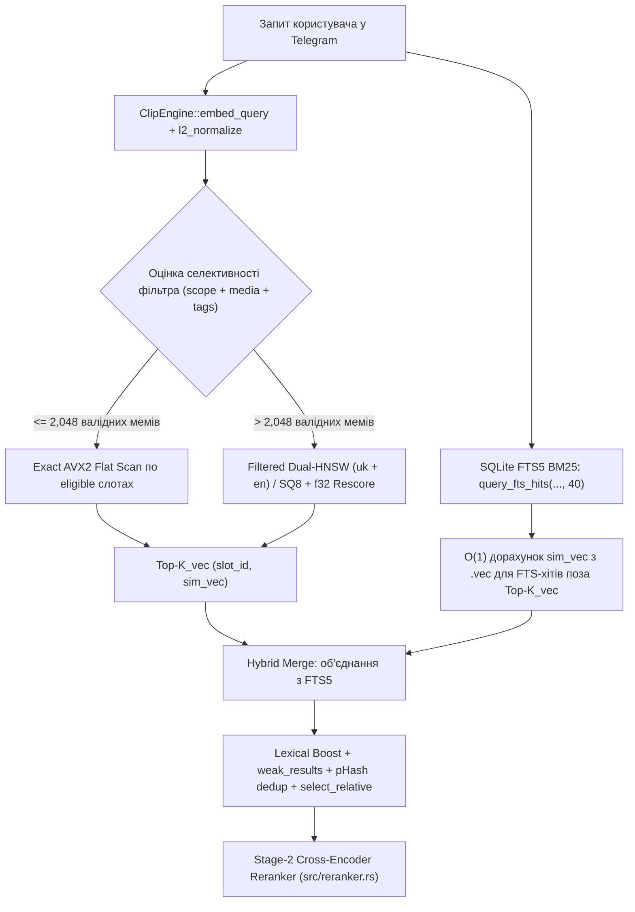

# 🧩 Розділ 04: Інтеграція Vector Engine у MnemosyneM

> **Мета розділу:** накласти всі чотири технології (AVX2, HNSW, `.vec` mmap, SQ8) безпосередньо на поточний код **MnemosyneM**, зберігши без регресій гібридний пошук (`Vector ∪ FTS5`), мультитенантність (`is_visible_to`), фільтри тегів/медіа, Stage-2 Reranker та існуючі тести.

---

## 🔍 1. Аудит поточного стану в MnemosyneM

Прямий розбір кодової бази показує **4 конкретні вузькі місця** на гарячому шляху пошуку:

1. **Зайві `sqrt` і ділення в [`cosine_similarity`](file:///home/mykhailo/dev/pet/MnemosyneM/m_nemosyne_m/src/meme_store.rs#L2452-L2468):**
   Рахує суми квадратів `sqrt_sq_a` і `sqrt_sq_b` для обох векторів на кожному мемі, хоча `MultilingualE5Base` уже повертає L2-нормалізовані вектори.
2. **Структура AoS у [`MemeStore`](file:///home/mykhailo/dev/pet/MnemosyneM/m_nemosyne_m/src/meme_store.rs#L38-L42) та [`Meme`](file:///home/mykhailo/dev/pet/MnemosyneM/m_nemosyne_m/src/database/entity/meme.rs#L5-L23):**
   Кожен `Meme` тримає у купі два окремі `Vec<f32>` (`embedding_uk` на [`L10`](file:///home/mykhailo/dev/pet/MnemosyneM/m_nemosyne_m/src/database/entity/meme.rs#L10) і `embedding_en` на [`L11`](file:///home/mykhailo/dev/pet/MnemosyneM/m_nemosyne_m/src/database/entity/meme.rs#L11)). Ба більше, при кожному пошуку в [`stage1_candidates_from_embedding`](file:///home/mykhailo/dev/pet/MnemosyneM/m_nemosyne_m/src/meme_store.rs#L1128) і [`handlers.rs`](file:///home/mykhailo/dev/pet/MnemosyneM/m_nemosyne_m/src/bot/handlers.rs#L239) ми робимо `meme.clone()`, що безглуздо копіює `6 KiB` ембедінгів тільки для того, щоб віддати в Telegram `file_tg_id` та `title`!
3. **Лінійне сканування + повне сортування в [`score_candidates`](file:///home/mykhailo/dev/pet/MnemosyneM/m_nemosyne_m/src/meme_store.rs#L2470-L2529):**
   Перебирає кожен мем у циклі $O(N)$ (`for meme in memes`), фільтрує, рахує 2 косинуси, а потім сортує всіх кандидатів із `best_score > 0.5 || fts_hit.is_some()`.
4. **Парсинг усіх BLOB-ів на старті в [`MemeStore::open`](file:///home/mykhailo/dev/pet/MnemosyneM/m_nemosyne_m/src/meme_store.rs#L804-L849):**
   Розпаковує кожен рядок через [`blob_to_embedding`](file:///home/mykhailo/dev/pet/MnemosyneM/m_nemosyne_m/src/helpers/embeding_helper.rs#L7-L13) у `2 * N` окремих `Vec<f32>`.

*(Приємний бонус: у [`handlers.rs`](file:///home/mykhailo/dev/pet/MnemosyneM/m_nemosyne_m/src/bot/handlers.rs#L243-L290) вже є телеметрія `stage1_ms` у `/stats`, тож ми зможемо виміряти реальний ефект прямо в проді!)*

---

## 🏗️ 2. Цільова архітектура пошукового пайплайну

HNSW та `.vec` **не замінюють** увесь пошук — вони замінюють лише векторне сканування всередині Stage-1:



---

## 🧩 3. Розв’язання 5 специфічних викликів MnemosyneM

### Виклик 1: Подвійні вектори (`embedding_uk` + `embedding_en`)
У нашому боті кожен мем має **два** незалежні ембедінги, а фінальний скор рахується як `f32::max(sim_uk, sim_en)` ([`L2500-L2502`](file:///home/mykhailo/dev/pet/MnemosyneM/m_nemosyne_m/src/meme_store.rs#L2500-L2502)). Як будувати HNSW?

| Варіант | Суть | Плюси | Мінуси / Вердикт |
| :--- | :--- | :--- | :--- |
| **A. Два окремі HNSW (`hnsw_uk`, `hnsw_en`) зі спільним `slot_id` (Рекомендовано)** | Індексуємо `uk` у першому графі, `en` — у другому. На пошуку беремо Top-`K` із обох і зливаємо через `max(uk, en)` | Чиста геометрія в кожному графі (виконується нерівність трикутника для RNG-евристики!), легко вимкнути один граф | Два виклики `search_layer` (~0.3 ms замість ~0.18 ms) |
| **B. Один HNSW на `2 * N` вузлів** | `node_id = slot * 2 + lang`. Усі вектори в одному просторі `E5-Base` (бо модель мультимовна!) | Лише один граф у пам’яті | Українські й англійські кластери можуть злегка конкурувати за `M` ребер; потрібна дедуплікація `slot = node_id >> 1` |
| **C. Один HNSW із відстанню `1 - max(uk, en)`** | Кастомна функція відстані всередині одного графа на `N` вузлів | Одне входження мема | ❌ **Погано:** `max` ламає нерівність трикутника та сусідську геометрію RNG-евристики — якість графа деградує |

> **Вибір:** **Варіант A** (два окремі HNSW поверх спільного масиву `slot_id`) — найчистіший теоретично та простий у відлагодженні.

---

### Виклик 2: Filtered ANN (`is_visible_to` + `SearchFilter { media, tags }`)
У [`score_candidates`](file:///home/mykhailo/dev/pet/MnemosyneM/m_nemosyne_m/src/meme_store.rs#L2484-L2498) перевіряються три жорсткі умови:
1. Видимість [`is_visible_to(user_id, scope)`](file:///home/mykhailo/dev/pet/MnemosyneM/m_nemosyne_m/src/database/entity/meme.rs#L34-L40) (`"private_only"`, `"public_only"`, або все).
2. Тип медіа `filter.media` (`!gif` / `!img`).
3. Теги `filter.tags` (усі вказані теги мають бути в мема).

Чому наївні підходи в HNSW **не працюють**?
* **Наївний Post-filtering** (знайти глобальні Top-100, потім відфільтрувати): якщо база має $100\,000$ мемів, а користувач шукає у **`private_only`** серед своїх 15 приватних мемів, жоден із них може не потрапити у глобальні Top-100 $\rightarrow$ **бот поверне 0 результатів!**
* **Наївний Pre-filtering** (відфільтрувати `Vec<bool>`, якщо > 50% бази — пробігати все): для **`public_only`** це ~95% бази, тобто повернення до повільного $O(N)$.

**Адаптивне двоетапне рішення (золотий стандарт Qdrant):**
Тримаємо в `MemeStore` легкі метадані `MemeMeta` (без `embedding_uk`/`embedding_en`!) + зворотний індекс `user_owned_slots: HashMap<i64, Vec<u32>>` / лічильники тегів:

1. **Якщо кількість валідних слотів $\le 2\,048$** (наприклад, майже будь-який `private_only` чи вузький тег `!gif #it`):
   Одразу запускаємо **точний AVX2 SIMD Flat Scan** лише по списку валідних слотів! Для $\le 2\,048$ мемів це швидше за будь-який граф (`< 0.25 ms`) і гарантує **100% точність (Recall = 1.0)** без жодних евристик!
2. **Якщо валідних слотів $> 2\,048$** (типовий `all` чи `public_only`):
   Запускаємо **Inline Filtered HNSW**:
   * **Важливе правило обходу:** під час пошуку граф **може проходити транзитом крізь сусідів, які НЕ проходять фільтр** (інакше розірвуться маршрути!), але в купу переможців `W` додає **тільки** вузли, що проходять предикат `predicate(slot_id) == true`!
   * Якщо фільтр звузив вибірку (наприклад, лише 10% мемів мають `!gif`), масштабуємо `ef_search = (base_ef / selectivity).clamp(base_ef, 512)`.
   * Якщо раптом через дуже рідкісний фільтр граф повернув `< K` результатів — автоматичний fallback на точний AVX2 скан валідних слотів.

---

### Виклик 3: Збереження 100% якості Hybrid Search (`Vector ∪ FTS5`)
Подивимось на критичний рядок [`meme_store.rs#L2519`](file:///home/mykhailo/dev/pet/MnemosyneM/m_nemosyne_m/src/meme_store.rs#L2519):
```rust
if best_score > 0.5 || fts_hit.is_some() { ... }
```
Можлива ситуація: мем має **точне текстове співпадіння в OCR** (`fts_hit.is_some()`, `BM25_MATCH_LIMIT = 40` на [`L35`](file:///home/mykhailo/dev/pet/MnemosyneM/m_nemosyne_m/src/meme_store.rs#L35)), але його векторний косинус опинився на **#180 місці** (скажімо, `0.78`), тому він **не потрапить** у Top-80 з HNSW!

**Рішення («FTS5 Exact Rescue»):**
1. HNSW повертає набір `HashMap<slot_id, vec_score>` розміром `K_vec` (~60–100).
2. Для кожного з $\le 40$ мемів із `fts_hits`, які пройшли фільтр, але **відсутні** в результатах HNSW, беремо його `slot_id` і за $O(1)$ читаємо з `.vec` через `mmap` точний `max(dot(q, uk[slot]), dot(q, en[slot]))`.
3. 40 векторів = `120 KiB` = **~10 мікросекунд**, зате ми гарантовано не загубимо жодного FTS5-хіта і збережемо ідентичну формулу лексичного бусту (`0.04 * coverage + 0.02 * norm_bm25` на [`L2509-L2512`](file:///home/mykhailo/dev/pet/MnemosyneM/m_nemosyne_m/src/meme_store.rs#L2509-L2512))!

---

### Виклик 4: Мутації, видалення та синхронізація з SQLite
**Архітектурний принцип:** **SQLite залишається єдиним Source of Truth** (там лишаються `embedding_uk` і `embedding_en` BLOB-и для бекапів, міграцій і `:memory:` юніт-тестів). Поруч на диску лежать побічні файли:
* `<db_path>.vec` — `f32` SoA вектори (`mmap`).
* `<db_path>.hnsw` (опціонально) — дамп графа для швидкого рестарту без повторного `INSERT`.

**Точна таблиця синхронізації кожної операції у `MemeStore`:**

| Метод `MemeStore` | Що відбувається у SQLite / `MemeMeta` | Що відбувається у `VectorEngine` (`.vec` + HNSW) |
| :--- | :--- | :--- |
| **`MemeStore::open`** ([`L647`](file:///home/mykhailo/dev/pet/MnemosyneM/m_nemosyne_m/src/meme_store.rs#L647)) | Якщо `":memory:"` — in-memory бекенд (тести!). Інакше читає лише метадані мемів без BLOB | Перевіряє `.vec` заголовок і `count` проти SQLite. Якщо файл відсутній/пошкоджений — автогенерація `.vec` + HNSW із SQLite (один раз!) |
| **`add_meme`** ([`L257-360`](file:///home/mykhailo/dev/pet/MnemosyneM/m_nemosyne_m/src/meme_store.rs#L257-L360)) | Новий рядок або `ON CONFLICT(file_tg_unique_id) DO UPDATE` | Якщо новий мем — `append` у `.vec` + `hnsw.insert(new_slot)`. Якщо оновлення існуючого — `tombstone(old_slot)` + `append(new_slot)` |
| **`update_meme_reprocessed`** ([`L1334-1373`](file:///home/mykhailo/dev/pet/MnemosyneM/m_nemosyne_m/src/meme_store.rs#L1334-L1373)) | Переписує VLM-опис та ембедінги після переобробки | `tombstone(old_slot)` + `append(new_slot)` + `hnsw.insert(new_slot)` + оновлення `meme_id -> slot_id` |
| **`delete_user_meme`** ([`L588-635`](file:///home/mykhailo/dev/pet/MnemosyneM/m_nemosyne_m/src/meme_store.rs#L588-L635)) | При `RemovedFromCollection` лише оновлює `owners`/`is_public`. При `DeletedCompletely` видаляє мем | При `RemovedFromCollection` — **нічого не чіпаємо!** При `DeletedCompletely` — `tombstone(slot)` |
| **`admin_delete_meme`** ([`L2360-2374`](file:///home/mykhailo/dev/pet/MnemosyneM/m_nemosyne_m/src/meme_store.rs#L2360-L2374)) | Повністю чистить рядок із таблиць і `memes` | `tombstone(slot)` + видалити із мапи `meme_id -> slot_id` |
| **Фонова компактифікація** (`maintenance`) | Без змін | Коли `tombstones / total_slots > 0.20`, будуємо чистий `.vec.tmp` і робимо атомарний `std::fs::rename` |

---

### Виклик 5: Модульна структура Rust, `lib.rs` та Concurrency

Запропонована структура нового модуля (для майбутньої реалізації):

```text
src/
├── lib.rs                 <-- ОБОВ'ЯЗКОВО додати `pub mod vector_engine;` для benches/!
└── vector_engine/
    ├── mod.rs             <-- VectorIndex, VectorSearchBackend, trait VectorStorage
    ├── simd.rs            <-- l2_normalize, dot_product (AVX2+FMA / scalar), dot_u7_i8_avx2
    ├── storage.rs         <-- VecStorage: MmapVecFile (.vec) + InMemoryVecStore (для :memory: тестів)
    ├── sq8.rs             <-- Calibrated SQ8 квантувальник + rescore helper
    └── hnsw.rs            <-- Arena HnswIndex, SearchScratch, RNG heuristic, filtered search
benches/
└── vector_bench.rs        <-- Criterion мікробенчмарки + Recall@10 vs Brute-Force тести
```

> [!WARNING]
> **Часта пастка Cargo:**
> Усі бенчмарки з теки `benches/` компілюються як **зовнішні крейти**, тому бачать тільки те, що експортовано з [`src/lib.rs`](file:///home/mykhailo/dev/pet/MnemosyneM/m_nemosyne_m/src/lib.rs#L1-L7), і **не бачать** модулів, оголошених тільки у `src/main.rs` (`mod meme_store;` тощо)! Тому `vector_engine` обов’язково має бути в `src/lib.rs`.

**Примітка про багатопоточність (`Mutex<MemeStore>`):**
Зараз увесь `MemeStore` сидить під `tokio::sync::Mutex<MemeStore>` у [`src/main.rs#L89`](file:///home/mykhailo/dev/pet/MnemosyneM/m_nemosyne_m/src/main.rs#L89), бо `rusqlite::Connection` є `!Sync`. Якщо в майбутньому винести `VectorEngine` (який `Send + Sync` для читання!) за межі `Mutex` під `Arc<RwLock<VectorEngine>>`, десятки паралельних inline-запитів зможуть читати індекс одночасно без черги, але на першому етапі інкапсуляція всередині `MemeStore` набагато простіша й надійніша.

---

## 🪜 4. Поетапний план навчання та імплементації (4 незалежні кроки)

Щоб спокійно закріпити кожну тему на практиці й не розвалити робочого бота одним великим PR, ідеально рухатися в такій послідовності:

| Фаза | Що будуємо | Як перевіряємо успіх (Gate) |
| :--- | :--- | :--- |
| **Фаза 1: SIMD + Criterion** | `simd.rs` (`l2_normalize`, `dot_product_avx2`, `dot_product_scalar`) + `benches/vector_bench.rs`. Заміна `cosine_similarity` у `meme_store.rs` | 1. Точність збігається з `cosine_similarity` до `< 1e-5`.<br>2. Criterion фіксує прискорення на `N=1,558` і `N=50,000`.<br>3. Усі існуючі тести + Golden Eval проходять без змін |
| **Фаза 2: Zero-Copy `.vec` (`mmap`)** | `storage.rs` (бінарний заголовок `MNEM`, `memmap2` + fallback у RAM для `:memory:`). Прибираємо `embedding_uk`/`en` зі структури `Meme` | 1. Миттєвий `MemeStore::open` без розпакування BLOB-ів.<br>2. Перевірка вирівнювання і відновлення `.vec` після видалення файлу.<br>3. `stage1_ms` у `/stats` падає навіть на `N=1,558` |
| **Фаза 3: Arena HNSW + Filtered ANN** | `hnsw.rs` (`DualHnswIndex` для `uk` + `en`, RNG-евристика, tombstones, адаптивний Flat/HNSW + FTS5 rescue) | 1. Виміряний **Recall@10 $\ge 0.98$** проти точного Brute-Force на 50K синтетичних векторах.<br>2. **Zero regression** на реальних запитах Golden Search Eval, включно з `!gif`, `#tag` і `private_only` |
| **Фаза 4: SQ8 + Rescoring** | `sq8.rs` (каліброване квантування під діапазон `[-0.22, +0.21]`, `_mm256_maddubs_epi16`, oversampled `f32` rescore) | 1. Зменшення RAM у ~4 рази.<br>2. **Recall@10 $\ge 0.99$** після `f32` rescoring на Top-`3*K` кандидатів.<br>3. Порівняльний звіт `f32` vs `SQ8` у Criterion + Flamegraph |

---

## ✅ Короткий підсумок перед стартом кодингу
* Ти не «ліпиш велосипед наосліп» — ти розібрав ту саму архітектуру, на якій стоять Qdrant та `hnswlib`: **Cache-aligned SoA $\rightarrow$ AVX2+FMA (4 акумулятори) $\rightarrow$ Arena HNSW із RNG-евристикою $\rightarrow$ `mmap` + `SQ8`**.
* Головне правило під час реалізації: **ніякої оптимізації в темну**. Спочатку тест точності проти Brute-Force (**Recall@K**) та замір у **Criterion** (`stage1_ms`), і тільки потім — оптимізація.
