# ⚙️ MnemosyneM v0.4: Векторний рушій з нуля на Rust — Дослідження та Навчальний Гід

> **Ціль серії:** розібрати «під капотом» усі чотири інженерні стовпи [**Milestone v0.4**](file:///home/mykhailo/dev/pet/MnemosyneM/m_nemosyne_m/ROADMAP.md#L480-L538), зрозуміти фізику процесора, математику та алгоритми на рівні першопринципів (з числовими прикладами й готовим кодом на Rust), а також спроєктувати точну інтеграцію в **MnemosyneM** без ламання гібридного пошуку (`Vector ∪ FTS5`), мультитенантності та Stage-2 Reranker.

---

## 🧠 1. Навіщо будувати власний Vector Engine з нуля?

Коли чуєш назви на кшталт **Qdrant**, **Milvus**, **FAISS**, **hnswlib** чи **pgvector**, здається, що всередині них живе якась сакральна магія. Насправді **будь-який** сучасний високопродуктивний векторний рушій складається з комбінації лише **чотирьох ортогональних механізмів**:

1. **Математичне ядро (SIMD AVX2 / FMA):** рахує відстань між двома векторами не по 1 числу за такт, а по **8 `f32`** (або **32 `i8`/`u8`**) за одну машинну інструкцію — і тримає конвеєр процесора повністю завантаженим.
2. **Графовий індекс наближеного пошуку (HNSW):** замінює повний перебір $O(N)$ усіх мемів на навігацію багатошаровим графом *Small World* за $O(\log N)$ — торкаючись лише ~200–500 кандидатів замість $100\,000$.
3. **Zero-Copy сховище (`mmap` + `.vec`):** прибирає триразове копіювання `BLOB` із SQLite у купу (`Heap`) та дає миттєвий старт (`0 ms` завантаження векторів) завдяки віртуальній пам’яті ОС та вирівнюванню під кеш-лінії CPU.
4. **Скалярне квантування (SQ8):** стискає `f32` (4 байти) у `u8`/`i8` (1 байт), зменшуючи **і RAM, і обсяг трафіку через шину пам’яті у 4 рази**, що для пошуку векторів часто важливіше за самі обчислення.

---

## 🏗️ 2. Архітектура чотирьох стовпів

Кожен наступний шар розв’язує вузьке місце попереднього:

```mermaid
flowchart LR
    D["Диск: файл .vec (32/64B вирівнювання)"] -->|"mmap zero-copy"| PC["OS Page Cache (віртуальна пам'ять)"]
    PC -->|"4x менше байт по шині DRAM"| SQ["SQ8 (1 байт/вимір) + f32 Rescore"]
    SQ -->|"O(log N) навігація без повного скану"| HNSW["HNSW Арена-граф (Vec Node, u32 ID)"]
    HNSW -->|"перевірка відстані у вузлах графу"| SIMD["Ядро SIMD (AVX2 + FMA, 4 акумулятори)"]
    SIMD -->|"Top-K векторних кандидатів"| HYB["Hybrid Merge (Vector + FTS5 + Reranker)"]
```

Чому важливо вчити їх саме як єдину систему?

* **Тільки SIMD без HNSW:** усе одно лінійний скан $O(N)$. При $100\,000+$ векторів ви впретесь не в процесор, а в **пропускну здатність оперативної пам’яті (DRAM Bandwidth)** — *Roofline Model* детально розібрана у [Розділі 01](file:///home/mykhailo/dev/pet/MnemosyneM/m_nemosyne_m/docs/vector-engine-research/01-simd-and-benchmarks.md).
* **Тільки HNSW без SIMD та без вирівнювання:** граф робить у 200 разів менше порівнянь, але кожен стрибок по графу породжує **Cache Miss** у випадкову адресу пам’яті; плюс у Rust погана структура вузлів на `Rc<RefCell<...>>` знищить локальність кешу.
* **Тільки `f32` без `mmap` та `SQ8`:** на $10\,000$ мемів дані перестають влазити в кеш процесора L3 (`16 MiB` на нашому CPU), а старт бота перетворюється на секунди парсингу SQLite BLOB-ів.

---

## 🔬 3. Наш реальний фундамент: Залізо + База даних

Щоб уся теорія не була сферичною у вакуумі, прив’яжемо кожен розрахунок до **реальної машини** та **реальної бази `mnemosynem_v2.db`**.

### Апаратні характеристики хоста (перевірено через `lscpu`)

| Параметр | Реальне значення | Інженерний наслідок для v0.4 |
| :--- | :--- | :--- |
| **Процесор** | `AMD Ryzen 5 5600H` (`x86_64`, Zen 3, 6 ядер / 12 потоків) | Має 2× 256-бітні FMA-конвеєри на ядро |
| **SIMD-розширення (є)** | `avx2`, `fma`, `sse4_1`, `sse4_2`, `f16c`, `bmi1`, `bmi2`, `popcnt` | Ідеально для `_mm256_fmadd_ps` (`f32`) та `_mm256_maddubs_epi16` (`u8 × i8`) |
| **SIMD-розширення (немає)** | Немає `avx512f` / `avx512vnni` | Орієнтуємося саме на **AVX2 (256-bit)**, а не AVX-512 |
| **Кеш L1d (на ядро)** | `32 KiB` (~4 такти) | Вектор запиту (`3 KiB`) + таблиця стану живуть прямо в L1 |
| **Кеш L2 (на ядро)** | `512 KiB` (~12 тактів) | Вміщує ~166 повних векторів `f32` або ~665 векторів `SQ8` |
| **Кеш L3 (спільний)** | `16 MiB` (~40 тактів) | Критична межа! Поки база влазить у 16 MiB — швидкість космічна |

### Характеристики реальних ембедінгів (`mnemosynem_v2.db`)

| Параметр | Факт із бази / коду | Наслідок |
| :--- | :--- | :--- |
| **Модель ембедінгів** | `fastembed::TextEmbedding` (`MultilingualE5Base`) ([`engine.rs`](file:///home/mykhailo/dev/pet/MnemosyneM/m_nemosyne_m/src/engine.rs#L1-L47)) | Префікси `"passage: "` та `"query: "` |
| **Кількість мемів ($N$)** | `1,558` мемів $\rightarrow$ `3,116` векторів | Кожен мем має **два** вектори (`embedding_uk` + `embedding_en`) |
| **Розмірність ($d$)** | `768` (`f32` Little-Endian) | $768 \times 4 = 3\,072\text{ байти}$ (`3 KiB` = `48` кеш-ліній по 64B) |
| **Розмір на 1 мем** | $2 \times 3\,072 = 6\,144\text{ байти}$ (`6 KiB`) | На дивному збігу `3,072` кратне і `32` (AVX2), і `64` (Cache Line)! |
| **L2-нормалізація** | **Вже нормалізовані:** $\|\mathbf{v}\|_2 = 1.000000$ | Косинусна подібність тотожна скалярному добутку: $\cos(\mathbf{a},\mathbf{b}) = \mathbf{a} \cdot \mathbf{b}$! |
| **Фактичний діапазон координат** | `[-0.2215, +0.2070]` (не `[-1, +1]`!) | Для SQ8 це критично: діапазон у 4.6× вужчий за `[-1, 1]` |

---

## 📊 4. Чесна математика масштабування (`1.5K` $\rightarrow$ `1M` мемів)

Старший інженер відрізняється від джуна тим, що рахує цифри *до* написання коду. Ось точна арифметика пам’яті для векторів MnemosyneM (по 2 вектори на мем: `uk` + `en`):

| Масштаб бази ($N$) | Пам’ять `f32` (вектори) | Пам’ять `SQ8` (вектори) | Попадання в L3 (`16 MiB`) | Flat AVX2 скан (`f32`) | HNSW ($M{=}16, ef{=}64$) |
| :--- | :---: | :---: | :--- | :---: | :---: |
| **`1,558` мемів (зараз)** | **`9.13 MiB`** | `2.28 MiB` | `f32` **повністю в L3!** | **~0.15–0.3 ms** | ~0.1–0.2 ms |
| **`10,000` мемів** | `58.59 MiB` | **`14.65 MiB`** | `f32` випадає в DRAM; `SQ8` **ще в L3!** | ~1.5–3 ms | **~0.2–0.4 ms** |
| **`100,000` мемів** | `585.94 MiB` | `146.48 MiB` | Обидва в DRAM / OS Page Cache | ~15–35 ms | **~0.4–0.8 ms** |
| **`1,000,000` мемів** | `5.72 GiB` | `1.43 GiB` | Лише `mmap` + `SQ8` | ~150–350 ms | **~0.8–1.5 ms** |

> [!NOTE]
> **Чесна інженерна ремарка:**
> При поточному $N = 1\,558$ мемів (`9.13 MiB`), проста заміна [`cosine_similarity`](file:///home/mykhailo/dev/pet/MnemosyneM/m_nemosyne_m/src/meme_store.rs#L2452-L2468) на `dot_product_avx2` над плоским масивом вже дасть пошук **швидший за 0.3 мілісекунди** (головна затримка зараз — `ClipEngine::embed_query` та Stage-2 Reranker!).
> Проте побудова повного стеку **AVX2 $\rightarrow$ `mmap` $\rightarrow$ HNSW $\rightarrow$ SQ8** у v0.4 дає дві величезні переваги:
> 1. Запас міцності архітектури до $100\,000+$ мемів із субмілісекундним Stage-1.
> 2. Глибока практика системного Rust (SIMD intrinsics, cache-aware структури даних, arena-графи, virtual memory та квантування).

---

## 🗺️ 5. Навігація по розділах (Study Guide)

Рекомендований порядок читання — послідовно від заліза (знизу) до інтеграції в бот (згори):

| Розділ | Що всередині | Ключові концепції |
| :--- | :--- | :--- |
| **[01-simd-and-benchmarks.md](file:///home/mykhailo/dev/pet/MnemosyneM/m_nemosyne_m/docs/vector-engine-research/01-simd-and-benchmarks.md)** | Спрощення косинуса, кеш CPU, Roofline Model, AVX2+FMA з 4 акумуляторами, Rust код + `Criterion` + `flamegraph` | `L1/L2/L3`, AoS vs SoA, 256-bit `YMM`, latency hiding, `_mm256_fmadd_ps`, `is_x86_feature_detected!` |
| **[02-hnsw-graph-index.md](file:///home/mykhailo/dev/pet/MnemosyneM/m_nemosyne_m/docs/vector-engine-research/02-hnsw-graph-index.md)** | Прокляття розмірності, Small World, Skip-List, точні алгоритми Malkov & Yashunin, числовий розбір «на пальцях», Rust Arena | $m_L = 1/\ln(M)$, `SEARCH-LAYER`, `INSERT`, **RNG-евристика** (`SELECT-NEIGHBORS-HEURISTIC`), `u32` Arena, Tombstones |
| **[03-mmap-and-sq8-quantization.md](file:///home/mykhailo/dev/pet/MnemosyneM/m_nemosyne_m/docs/vector-engine-research/03-mmap-and-sq8-quantization.md)** | Віртуальна пам’ять ОС, формат `.vec`, безпека `unsafe` + `memmap2`, теорія та математика SQ8, integer SIMD, двоетапний rescore | Page Fault, OS Page Cache, `MNEM` header, UB-пастки `mmap`, `_mm256_maddubs_epi16`, saturation guard, SQ8+f32 |
| **[04-mnemosynem-integration-guide.md](file:///home/mykhailo/dev/pet/MnemosyneM/m_nemosyne_m/docs/vector-engine-research/04-mnemosynem-integration-guide.md)** | Точна інтеграція в `MemeStore` і `handlers.rs`: dual `uk`/`en` вектори, Filtered ANN (`is_visible_to`, теги), Hybrid FTS5, мутації, 4-фазний план | Adaptive Flat/HNSW, FTS5 exact rescue, SQLite Source-of-Truth + `.vec` sidecar, `src/lib.rs` для `benches/` |

---

## 📚 6. Першоджерела для поглиблення

1. **HNSW (Оригінальна стаття):** Yu. A. Malkov, D. A. Yashunin — *"Efficient and robust approximate nearest neighbor search using Hierarchical Navigable Small World graphs"* (IEEE TPAMI 2018 / arXiv:1603.09320).
2. **Пам’ять і кеші CPU:** Ulrich Drepper — *"What Every Programmer Should Know About Memory"* (обов’язкове читання про cache lines, prefetcher та TLB).
3. **Інструкції AVX2 / FMA:** *Intel Intrinsics Guide* (шукай `_mm256_fmadd_ps`, `_mm256_maddubs_epi16`, `_mm256_madd_epi16`).
4. **Безпека `unsafe` у Rust:** *The Rustonomicon* — розділи про data layout, alignment, slice aliasing та FFI/OS boundaries.
5. **Практичний Filtered HNSW & SQ8:** інженерний блог **Qdrant** (*"Filterable HNSW"*, *"Scalar Quantization"*) та документація **hnswlib** / **FAISS**.
