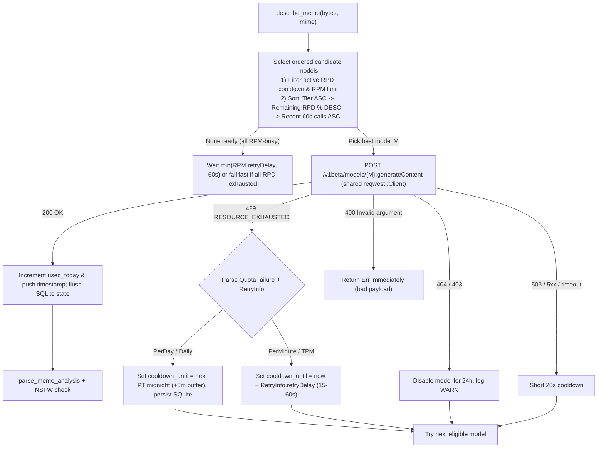

# VLM Quota-Aware Model Router & Circuit Breaker — Implementation Plan

> **Status:** Planned (`src/` untouched)
> **Goal:** Stop hammering exhausted/dead Gemini models on every meme, balance load evenly across high-quota Tier-1 models (`3.5-flash-lite` + `3.1-flash-lite` = 1,000 RPD / 30 RPM combined), and automatically fail over cleanly using structured HTTP `429` feedback and persisted cooldowns.

---

## 1. Gemini API Constraint: Can We Query Remaining Quota Upfront?

**No.** The Gemini Developer API (`generativelanguage.googleapis.com` with `x-goog-api-key`) **does not expose any endpoint or HTTP response headers** (no `X-RateLimit-Remaining`, and `GET /v1beta/models` only returns static model metadata) for checking remaining RPM or RPD quota beforehand.

Instead, remaining quota must be managed through **two complementary mechanisms**:
1. **Reactive feedback from HTTP `429 RESOURCE_EXHAUSTED` payloads:**
   * `error.details[]` includes `type.googleapis.com/google.rpc.QuotaFailure` (`violations[].quotaId` / `quotaMetric`) which distinguishes **daily exhaustion** (`GenerateRequestsPerDay...`) from **per-minute/token limits** (`GenerateRequestsPerMinute...` / `TPM`).
   * `error.details[]` also includes `type.googleapis.com/google.rpc.RetryInfo` (`retryDelay`, e.g. `"16s"`), giving the exact cool-off interval for transient RPM/TPM bursts.
   * Free-tier daily quotas (`RPD`) reset at **midnight Pacific Time (`America/Los_Angeles`)**.
2. **Proactive local accounting + SQLite persistence:**
   * Track successful requests per model for the current PT calendar day (`used_today`) and within a rolling 60-second window (`recent_requests`), persisted in SQLite so restarts do not forget daily exhaustion or cooldowns.

---

## 2. Audit of Current Issues in [`src/vlm.rs`](file:///home/mykhailo/dev/pet/MnemosyneM/m_nemosyne_m/src/vlm.rs)

1. **Sequential greedy drain + no memory between calls:** Every call to [`describe_meme`](file:///home/mykhailo/dev/pet/MnemosyneM/m_nemosyne_m/src/vlm.rs#L85-L219) restarts from `GEMINNI_MODEL_POOL[0]`. Once `gemini-3.5-flash-lite` hits `500/500 RPD`, every subsequent meme wastes a full HTTPS round-trip waiting for an inevitable `429` before falling back to `gemini-3.1-flash-lite`.
2. **Premature loop abort on `404` / `500` ([`vlm.rs#L174-L183`](file:///home/mykhailo/dev/pet/MnemosyneM/m_nemosyne_m/src/vlm.rs#L174-L183)):** Only `429` and `503` execute `continue`. Any other non-2xx status (such as `404 Not Found` if `"gemini-3.5-flash"` does not exist in AI Studio) immediately returns `Err(VlmError::Transient(...))`, preventing failover to `gemini-3.6-flash` and `gemini-3.8-flash`.
3. **Unused Tier-2 models & misconfigured pool:** Current AI Studio quotas show:
   * **Tier 1 (`15 RPM`, `250K TPM`, `500 RPD`):** `gemini-3.5-flash-lite`, `gemini-3.1-flash-lite`
   * **Tier 2 (`5–10 RPM`, `250K TPM`, `20 RPD`):** `gemini-2.5-flash-lite` (`10 RPM`), `gemini-3-flash` (`5 RPM`), `gemini-2.5-flash` (`5 RPM`), `gemini-3.6-flash` (`5 RPM`), `gemini-3.8-flash` (`5 RPM`), `gemini-4-hydrogen` (`5 RPM`)
   *(Note: `"gemini-3.5-flash"` does not appear in the dashboard list and should be verified via `GET /v1beta/models` before keeping it in the pool.)*
4. **Misleading logs & per-request HTTP client:**
   * [`vlm.rs#L97-L102`](file:///home/mykhailo/dev/pet/MnemosyneM/m_nemosyne_m/src/vlm.rs#L97-L102) always logs `GEMINNI_MODEL_POOL[0]` instead of the actual selected model.
   * [`vlm.rs#L90`](file:///home/mykhailo/dev/pet/MnemosyneM/m_nemosyne_m/src/vlm.rs#L90) allocates a fresh `reqwest::Client` on every invocation instead of sharing a connection-pooled client.
5. **Dual uncoordinated callers:** Both [`src/worker.rs`](file:///home/mykhailo/dev/pet/MnemosyneM/m_nemosyne_m/src/worker.rs#L163) (with hardcoded 4s sleep at `#L262`) and [`src/maintenance/maintance_worker.rs`](file:///home/mykhailo/dev/pet/MnemosyneM/m_nemosyne_m/src/maintenance/maintance_worker.rs#L190) (with 5s sleep at `#L263`) call `describe_meme` independently. Sharing one router guarantees unified accounting and lets Tier-1 load balancing effectively unlock up to **30 RPM / 1,000 RPD**.

---

## 3. Target Architecture (`VlmRouter`)



### 3.1. Model Pool Configuration (`ModelSpec`)

```rust
#[derive(Debug, Clone, Copy, PartialEq, Eq, PartialOrd, Ord)]
pub enum ModelTier {
    Tier1 = 1, // High-RPD Flash-Lite models (500 RPD)
    Tier2 = 2, // Scarce reserve models (20 RPD)
}

pub struct ModelSpec {
    pub id: &'static str,
    pub tier: ModelTier,
    pub rpm_limit: u32,
    pub rpd_limit: u32,
}
```

Recommended initial pool (verify exact API IDs with `GET /v1beta/models`):
* **Tier 1 (500 RPD, 15 RPM each):** `gemini-3.5-flash-lite`, `gemini-3.1-flash-lite`
* **Tier 2 (20 RPD):** `gemini-2.5-flash-lite` (`10 RPM`), `gemini-3-flash` (`5 RPM`), `gemini-3.6-flash` (`5 RPM`), `gemini-3.8-flash` (`5 RPM`), `gemini-2.5-flash` (`5 RPM`), `gemini-4-hydrogen` (`5 RPM`)

### 3.2. In-Memory & Persisted State (`ModelQuotaState`)

```rust
#[derive(Debug, Clone)]
pub struct ModelQuotaState {
    pub pt_day_key: String,              // e.g., "2026-11-18" in Pacific Time (America/Los_Angeles)
    pub used_today: u32,                 // Successful + quota-consuming calls today
    pub recent_calls: VecDeque<Instant>, // Rolling 60s timestamps for RPM guard
    pub cooldown_until_unix: i64,        // Unix epoch seconds until retry allowed
    pub last_reason: Option<String>,     // Diagnostic reason for cooldown / stats
}
```

#### SQLite Persistence Schema (via [`src/migrations.rs`](file:///home/mykhailo/dev/pet/MnemosyneM/m_nemosyne_m/src/migrations.rs))

```sql
CREATE TABLE IF NOT EXISTS vlm_model_quota (
    model_id TEXT PRIMARY KEY,
    pt_day_key TEXT NOT NULL,
    used_today INTEGER NOT NULL DEFAULT 0,
    cooldown_until INTEGER NOT NULL DEFAULT 0,
    last_reason TEXT NOT NULL DEFAULT '',
    updated_at INTEGER NOT NULL
);
```

*Note on Pacific Time rollover without heavy dependencies:* Since `Cargo.toml` currently has no `chrono` crate, either compute `America/Los_Angeles` day & next midnight with exact US DST rules (~25 lines of pure `std::time::SystemTime` math) or add `chrono` + `chrono-tz`. Always add a small safety buffer (e.g., `+300s`) past PT midnight.

### 3.3. Selection & Prioritization Rules

When `VlmRouter::pick_candidates(now_unix, now_instant)` selects the ordered fallback list for a meme:
1. **PT Day Rollover:** If `state.pt_day_key != current_pt_day`, reset `used_today = 0`, clear daily exhaustion cooldowns, and set `pt_day_key = current_pt_day`.
2. **Rolling RPM Prune:** Pop timestamps older than `60s` from `recent_calls`.
3. **Eligibility Check:** Keep models where:
   * `now_unix >= state.cooldown_until_unix`
   * `state.used_today < spec.rpd_limit` *(soft guard; if all models hit soft RPD locally before Google actually returned 429, allow probing as fallback)*
   * `state.recent_calls.len() < spec.rpm_limit as usize`
4. **Priority Sort Order:**
   * **Tier first:** `spec.tier` ascending (`Tier1` before `Tier2` — never burn scarce `20 RPD` models while `500 RPD` models have quota).
   * **Balance within tier:** highest estimated remaining RPD ratio `(rpd_limit - used_today) as f32 / rpd_limit as f32` descending. This spreads traffic evenly between `gemini-3.5-flash-lite` and `gemini-3.1-flash-lite` instead of draining one to zero first.
   * **Tie-breaker:** fewest `recent_calls.len()` in the last 60s (least saturated RPM window).
5. **If every model is temporarily blocked by RPM cooldown (`cooldown_until < now + 90s`):** Wait for the earliest RPM cooldown expiration (capped, e.g., max 65s) instead of immediately burning worker retries. If all models are exhausted for the day (`PerDay`), return `VlmError::Transient("All VLM models exhausted daily RPD quota")` immediately so workers pause cleanly.

### 3.4. Parsing Gemini `429` Payloads & Error Classification

```rust
enum GeminiFailureKind {
    DailyQuotaExhausted,         // quotaId contains "PerDay" or "Day"
    MinuteRateLimited(Duration), // quotaId contains "PerMinute"/"Tokens", RetryInfo.retryDelay
    ModelUnavailable,            // 404 Not Found / 403 Permission Denied
    Overloaded,                  // 503 Service Unavailable / 500 / network timeout
    FatalPayload(String),        // 400 Bad Request (do not retry on other models)
}
```

Parsing rules on HTTP `429`:
* Inspect `json["error"]["details"]` array:
  * Any entry with `@type` ending in `"QuotaFailure"` ➔ inspect `violations[]`:
    * If `quotaId` or `quotaMetric` contains `"PerDay"` / `"day"` (case-insensitive) ➔ `DailyQuotaExhausted` (cooldown until `next_pt_midnight + 5m`).
    * Otherwise (`PerMinute`, `TPM`, `FreeTier`) ➔ look up entry ending in `"RetryInfo"` ➔ parse `"retryDelay"` (e.g. `"16s"`, `"16.98s"` -> `ceil().clamp(5, 90)` seconds), defaulting to `60s`.
  * Fallback if Google omits `details`: inspect `error.message` for `"Please retry in "` or `"per day"`, else apply a conservative 60s cooldown.

### 3.5. Async Locking Invariant

Following MnemosyneM's core invariant ([`docs/ARCHITECTURE.md#L101`](file:///home/mykhailo/dev/pet/MnemosyneM/m_nemosyne_m/docs/ARCHITECTURE.md#L101)):
* **Never hold `VlmRouter`'s internal `Mutex` across `.await` network calls.**
* Pattern inside `VlmRouter::describe_meme`:
  1. Lock internal state briefly ➔ compute ordered candidate list & reserve/record tentative RPM timestamp ➔ **drop lock**.
  2. Perform `self.client.post(&url)...send().await`.
  3. Lock internal state briefly ➔ on `200`, increment `used_today`; on `429`/`404`/`503`, set appropriate `cooldown_until_unix` ➔ **drop lock** (optionally persist updated row to SQLite).

---

## 4. Concrete Implementation Checklist by File

1. **Verify live model IDs once:** Run a quick `curl` against `GET https://generativelanguage.googleapis.com/v1beta/models` with `x-goog-api-key` to confirm exact API IDs (`gemini-3.6-flash`, `gemini-4-hydrogen`, whether `gemini-3.5-flash` exists or returns 404).
2. **[`src/migrations.rs`](file:///home/mykhailo/dev/pet/MnemosyneM/m_nemosyne_m/src/migrations.rs) & [`src/meme_store.rs`](file:///home/mykhailo/dev/pet/MnemosyneM/m_nemosyne_m/src/meme_store.rs):**
   * Add migration creating `vlm_model_quota`.
   * Add `load_vlm_quotas()` and `upsert_vlm_quota(...)` helpers on `MemeStore`.
3. **[`src/vlm.rs`](file:///home/mykhailo/dev/pet/MnemosyneM/m_nemosyne_m/src/vlm.rs):**
   * Replace `GEMINNI_MODEL_POOL` and stateless `describe_meme` with `VlmRouter` holding a shared `reqwest::Client` (30s timeout) and `tokio::sync::Mutex<HashMap<&'static str, ModelQuotaState>>`.
   * Add PT day-key / next-midnight-PT helper and `parse_gemini_error(&serde_json::Value, StatusCode)`.
   * Fix logging to print `[VLM] Sending <mime> (<KB> KB) to <actual_model> (tier=?, used_today=X/Y)`.
   * Fix `!status.is_success()` handling so `404`/`403`/`5xx` disable/cool down only that model and `continue` to fallback models.
   * Expose `VlmRouter::quota_snapshot()` so `/stats` or startup logs can print per-model `used_today / rpd_limit` and cooldown state.
4. **[`src/main.rs`](file:///home/mykhailo/dev/pet/MnemosyneM/m_nemosyne_m/src/main.rs):**
   * Initialize `VlmRouter` hydrated from `MemeStore::load_vlm_quotas()` and store `vlm_router: Arc<vlm::VlmRouter>` in `AppState`.
5. **[`src/worker.rs`](file:///home/mykhailo/dev/pet/MnemosyneM/m_nemosyne_m/src/worker.rs) & [`src/maintenance/maintance_worker.rs`](file:///home/mykhailo/dev/pet/MnemosyneM/m_nemosyne_m/src/maintenance/maintance_worker.rs):**
   * Route both workers through `state.vlm_router.describe_meme(...)`.
   * Reduce static `worker.rs` sleep from `4s` to `2s` (or compute dynamically from active Tier-1 aggregate RPM), and in `maintance_worker.rs` break early immediately when all models hit `DailyQuotaExhausted` instead of waiting for 3 consecutive failures.
6. **Unit Tests (in `src/vlm.rs` `#[cfg(test)]`):**
   * Parsing `429` JSON with `QuotaFailure` (`PerDay`) vs `QuotaFailure` (`PerMinute`) + `RetryInfo` (`"16s"`, `"16.9833s"`).
   * Tier-1 load balancing (`3.5-flash-lite` vs `3.1-flash-lite`) before falling back to Tier-2 (`20 RPD`) models.
   * PT midnight rollover resetting `used_today` and clearing daily exhaustion cooldowns.
   * Ensuring `404` on one model skips to the next eligible model instead of aborting the whole request.
